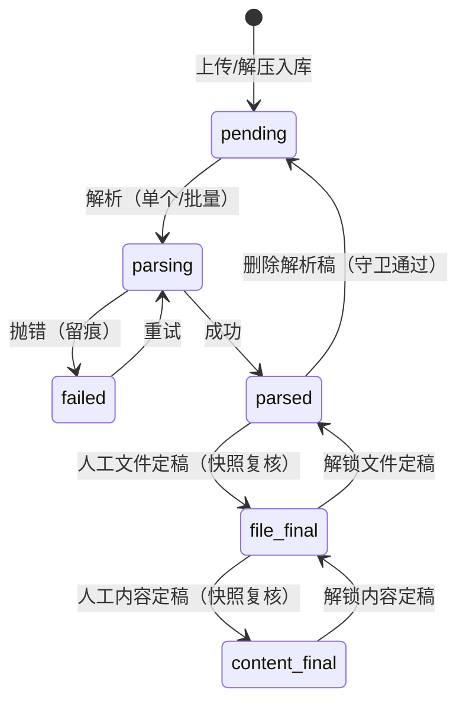
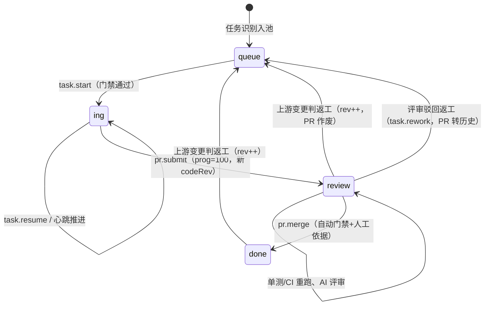
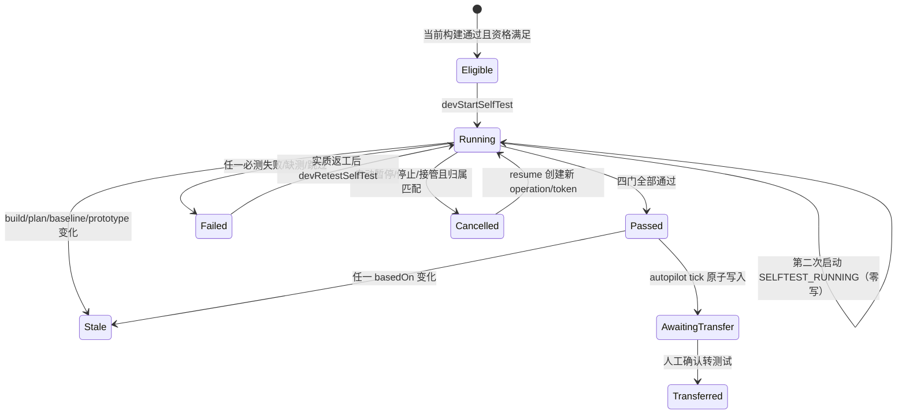
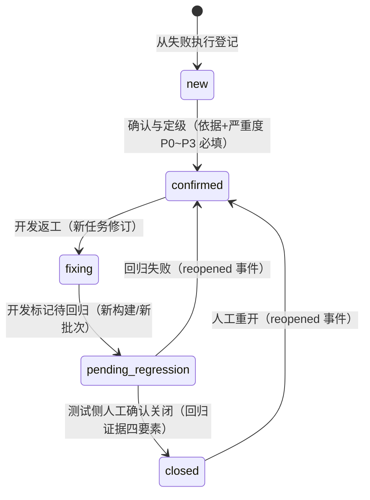
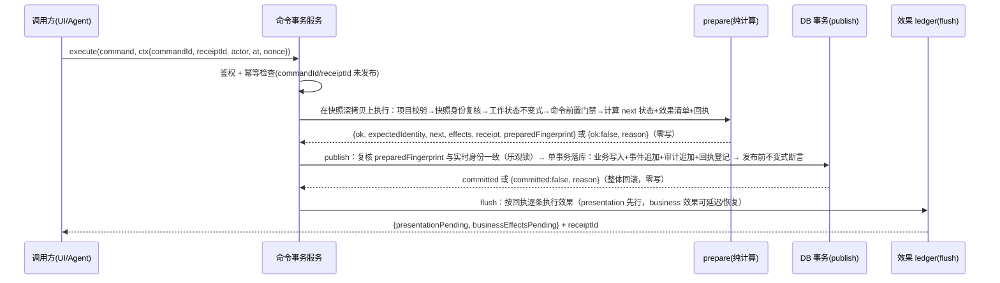
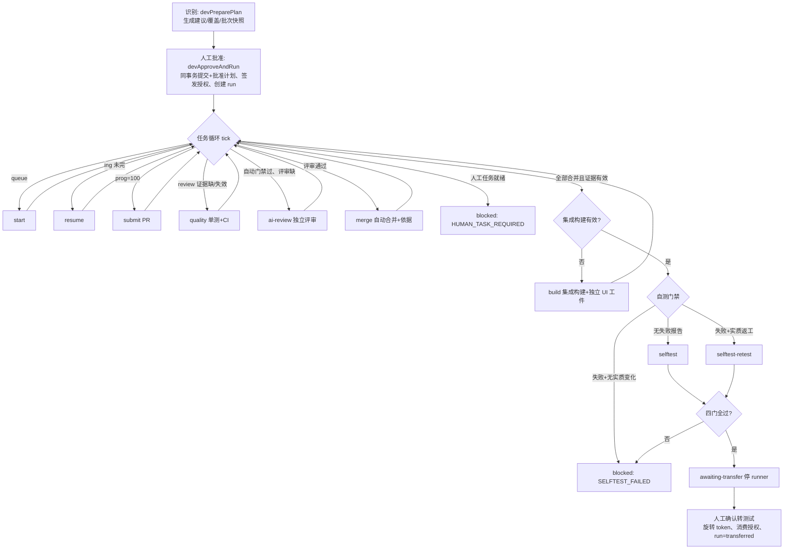
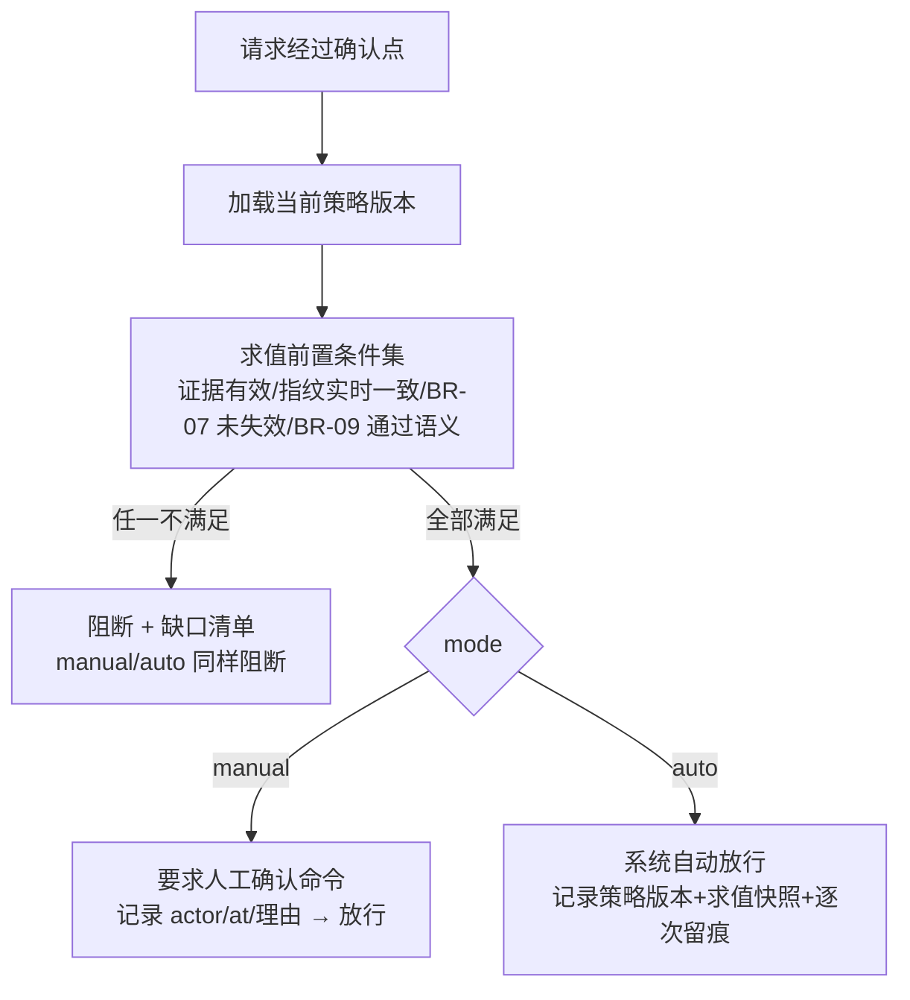

# 软件工厂（MSF）详细设计 · LLD-2 算法与流程

> 版本：V1.0-draft · 2026-09-20 · 状态：草稿，待评审
> 上游：`PRD.md`（REQ/BR）、`HLD.md`（ADR-3 命令事务、ADR-4 指纹、ADR-5 证据、ADR-7 策略引擎）；编号规则见 `README.md`。
> 每条设计条目以 `DSG-Fxx-y` 编号并反向引用 REQ/BR，同时标注原型出处；RTM 双向追溯见 `RTM.md`。
> 原型出处缩写：`runtime-hardening.js`=RH、`customer-state-kernel.js`=CSK、`msf-prototype.html`=PROTO（附行号）、`acceptance-workbench.js`=AWB、`material-folders.js`=MFD、`material-bulk.js`=MBK、`material-zip.js`=MZIP、`chat-reference.js`=CREF、`设计基线与自测契约.md`=契约。

## 1. 总则与通用约定（DSG-F01）

### DSG-F01-1 本册范围与阅读约定

本册规定全部跨模块复用的状态机、命令事务流程、指纹与评分算法、编排与审计流程。模块归属与接口签名见 `LLD-1`，实体字段见 `LLD-3`，落库结构见 `LLD-4`，REST 暴露见 `LLD-5`。
承接：BR-01~BR-15 全体。原型出处：契约§2/§5、RH 全文。

- 所有状态机的**唯一写边界**是命令事务（DSG-F03）；状态表与迁移表描述的是命令内部的判定逻辑，不允许绕过命令直接改状态。
- 所有「门禁」函数为**同步纯函数**，统一返回 `{ ok, issues: [{ code, message, target? }] }`；无写函数不得产生通知或审计（契约§6）。
- 所有「实时有效性」判定均在动作发生时**重新计算指纹比对**，不靠事件通知推定新鲜度（契约§3 末段）。

### DSG-F01-2 异步操作四元组身份（通用）

承接：BR-08、REQ-410。原型出处：契约§4.1 权威表、RH `devSelfTestOperationValid`、PROTO L5391-5394（`devQualityOperationValid/devBuildOperationValid/devIdentifyOperationValid`）。

1. 每个异步操作（设计 plan/generate/check、任务执行、单测/CI、AI 评审、构建、自测）创建时取得身份四元组：`operationId + opToken + dispatchAction + owner`；归属 autopilot 的操作追加 `autopilotRunId + autopilotRunToken + authorizationId`。
2. 创建事务**冻结输入快照**（governing/content/input fingerprint、任务修订、PR 身份等，按契约§4.1 逐行取值）。
3. 回调提交前必须同时满足：opToken 匹配、操作仍 `running`、冻结快照与实时重算相等、归属父运行（若有）runId/runToken/status 仍匹配。任一不满足 → **严格零写**：不改操作、不追加审计、不分配 ID、不渲染。
4. 操作状态枚举：`running → done | failed | stale | cancelled | superseded`。`stale`=输入已变化被淘汰；`cancelled`=被归属运行取消；`superseded`=被同 scope 新操作取代。**落库映射**：本权威枚举落库为 `dev_operations.status` 六值（LLD-4 DSG-D06-3）——`done` 落库为 `succeeded`；`stale` 与 `superseded` 合并落库为 `stale`；落库侧另有 `pending` 起始态。
5. running 只在其冻结输入仍实时有效时构成 busy：公开入口先调 `XxxOperationValid`，有效才返回 `*_BUSY` 零写拒绝；无效则在同一事务内旋转旧 opToken、标 `stale`、记审计，再按当前门禁决定是否登记新操作——不允许永久 busy（契约§4.1 末段、§9）。

### DSG-F01-3 状态图约定（补充设计：记法约定，无直接需求对应）

本册状态图用 Mermaid `stateDiagram-v2`；迁移表四列：触发事件（命令名）/ 前置条件（门禁）/ 动作（事务内写入）/ 后置（效果与失效传播）。「异常路径」列出拒绝码与零写保证。

## 2. 核心状态机集（DSG-F02）

### DSG-F02-1 文档生命周期状态机（草稿/提交/定稿 + undo/redo + 待确认补丁）

承接：REQ-203、REQ-204、REQ-205、REQ-209、REQ-210、BR-05、BR-12。原型出处：RH `preparePrototypeCommand`（L54-119）与 `assertPrototypeWorkingState/assertPrototypeVersionHistory`（L31-39）、PROTO `docUndo/docRedo/switchVer/commitVer/finalizeDoc/acceptPend/rejectPend`（L684-769）、`原型草稿与历史版本重设计.md`。

**状态表**（对任一受控文档：CRD/PRD/HLD/LLD 七册/原型 UI）：

| 状态 | 判定谓词 | 含义 |
| --- | --- | --- |
| `clean` | `draft=null && !modified && !finalized` | 当前指针指向已提交版本，无未提交改动 |
| `dirty` | `draft≠null && modified && !finalized` | 存在基于当前提交版本的工作草稿 |
| `finalized` | `finalized && finalVer===cur`（由 finalize 前置与不变式保证此时必 `draft=null && !modified && pend 为空`） | 当前版本已人工定稿，只读 |

基态 `clean`/`dirty`/`finalized` 谓词**互斥且完备**：任一文档在任一时刻恰好处于其一（不变式 `draft===null ⟺ modified===false`，finalized 蕴含无草稿、无未提交改动、无 pend）。`pending-review` 不是第四基态，而是**正交标记**：`pend.length>0`，可与 `clean`/`dirty` 叠加存在；迁移表与状态图中的 `pending-review` 均按「基态 + 本标记」解读（如 `clean + pending-review`）。

历史版本集合只增不改：已提交版本字节不可变、编号不复用（BR-05、REQ-209）。

**命令化覆盖（统稿 D-9，回销 C-3）**：文档域（CRD/PRD/HLD/LLD 各册/原型 UI）写操作全部收编进命令事务，无例外域（BR-04）；undo 栈上限 30 沿用原型值。

**迁移表**：

| 触发事件 | 前置条件 | 动作 | 后置 |
| --- | --- | --- | --- |
| `save-html`（编辑保存） | 非 finalized；内容有变化（否则 `NO_CHANGE`） | 当前内容对入 undo 栈（上限 30，超出丢最旧）、清空 redo、写草稿 `draft={baseVersion, baseContentFingerprint, 内容}`、`modified=true` | 事件留痕；设计域后置 `stale` 退化（DSG-F02-2） |
| `undo` / `redo` | 对应栈非空且栈顶与当前内容不等 | 对称互换：当前内容入对栈，栈顶出栈成为新草稿；重做后 `modified` 按草稿是否存在重算 | 同上 |
| `propose-pending`（AI 提补丁） | 非 finalized；无现存 pend；**启动时身份齐备**：项目/版本/内容指纹/pend 指纹/会话与目标消息指纹全部匹配（否则 `AI_BASIS_INVALID`/`AI_RESULT_STALE`）；补丁 `from` 文本仍在当前内容中（否则 `PATCH_BASE_STALE`） | 追加 1 条 pend（不直接落稿） | 高亮与确认行经效果层上屏（REQ-205） |
| `accept-pending` | pend 非空；`from` 仍在当前内容（已变则保留 pend 并拒绝） | 文本替换入草稿（走 save 同一路径，入 undo 栈）、清空 pend | `pending.applied` 留痕 |
| `reject-pending` | pend 非空 | 清空 pend，内容不变 | `pending.rejected` 留痕 |
| `commit-version` | `modified` 且 pend 为空 | 追加新版本 `v=max+1`（内容=草稿），清草稿/undo/redo/pend/modified | 历史追加恰好 1 条，版本号严格递增；下游指纹失效传播（DSG-F04-4） |
| `switch-version` | 目标版本存在；`!modified && pend 为空`（否则 `INVALID_STATE`；原型工作副本经门禁时 issue=`PROTOTYPE_DIRTY`，LLD-3 §15(a)） | 仅移动 `cur` 指针，清 undo/redo/pend | 历史版本只读；指针不是有效性证据（BR-03） |
| `finalize`（人工定稿） | 非 finalized；`!modified && pend 为空`；领域附加门禁（如需求域 RTM 健康度 DSG-F06、原型域 DSG-F02-2 定稿门禁） | `finalized=true; finalVer=cur; finalizationId=自增序号` | 同版本再定稿产生新 finalizationId（新身份）；触发下游失效传播（PROTO `impactTrigger` L5255） |
| `unlock`（人工解锁） | finalized | `finalized=false; finalVer=0` | **旧下游依据立即失效**：通知 + 失效传播效果（RH `observe-dev-input` L116/145-147） |
| `import-draft`（外部初稿入库） | `!modified && pend 为空`；内容校验通过 | 追加新版本（by 标注来源） | 触发检查调度效果 |

**发布前不变式**（每次命令提交前断言，违反即整体回滚；对应 LLD-3 §13 的 INV-DOC-1~6）：版本号唯一且为正整数、空历史时全部工作字段为零值、`draft===null ⟺ modified===false`、草稿基版本与基指纹必须等于当前提交版本且内容必须不同、undo/redo 各 ≤30 且结构合法、finalized 与 finalVer/cur 一致；历史断言要求每次操作恰好追加 0 或 1 条版本且既有版本逐字节等价——已丢失的历史绝不重建或谎称修复（RH L31-39）。

**异常路径**：并发提交按服务端版本号乐观锁拒绝（REQ-210，对应 publish 阶段 `VERSION_CONFLICT`，DSG-F03-1）；定稿态下一切内容命令拒绝（`VERSION_LOCKED`；原型域经门禁时 issue=`PROTOTYPE_FINALIZED`，LLD-3 §15(a)）；快照被篡改 `PREPARED_TAMPERED`；命令/收据号冲突 `IDEMPOTENCY_CONFLICT`。

```mermaid
stateDiagram-v2
  [*] --> clean: 首个版本提交/生成
  clean --> dirty: save-html（内容有变化）
  dirty --> dirty: save-html / undo / redo / accept-pending
  clean --> pending-review: propose-pending（AI 补丁）
  pending-review --> dirty: accept-pending
  pending-review --> clean: reject-pending
  dirty --> clean: commit-version（追加 v+1）
  clean --> clean: switch-version（仅指针）
  clean --> finalized: finalize（人工，过领域门禁）
  finalized --> clean: unlock（人工；下游立即失效）
```

### DSG-F02-2 设计阶段状态机（idle→…→finalized + stale 退化）

承接：REQ-304~310、BR-07。原型出处：契约§5 状态机与失败矩阵（逐行承接）、RH `start/complete` 覆写段（PROTO L8963-8964）、`designPrototypeGate`（PROTO L8962）。

**状态表**：`S.design.prototype.status ∈ { idle, planning, plan-ready, generating, generated, checking, ready, finalized, stale, failed }`。语义：

| 状态 | 含义 |
| --- | --- |
| `idle` | 尚无规划 |
| `planning` / `generating` / `checking` | 对应异步操作 running（操作身份见 DSG-F01-2） |
| `plan-ready` | 当前规划完整（`complete=true`） |
| `generated` | 原型已生成/已修改未定稿，或最近检查未通过 |
| `ready` | 当前检查报告全通过 |
| `finalized` | 人工定稿，共同设计基线已产生 |
| `stale` | 上游（governing）变化使当前阶段产物失效 |
| `failed` | 启动/执行失败（可恢复，DSG-F03-4） |

**迁移表**：

| 触发事件 | 前置条件 | 动作 | 后置 |
| --- | --- | --- | --- |
| `designPlanPrototype` | 门禁 `plan` 通过：项目匹配、来源审计问题集已知、无有效 running 操作 | 登记 planning 操作；完成时追加**完整规划快照**（页面/流程/状态/控件/字段/角色/视口 + 正反向追溯 + 来源审计，绑定 governing 指纹） | `complete=true` → `plan-ready`；否则 `failed`（问题全部可见，`complete=false` 不能生成） |
| `designGeneratePrototype` | 门禁 `generate`：规划完整且未过期（`PLAN_STALE` 拒绝）、原型非 dirty/非 finalized | 目录驱动生成完整 HTML+manifest，**追加**原型版本（未定稿） | `generated`；规划因 governing 未变而保持有效 |
| `designCheckPrototype` | 门禁 `check`：规划有效、原型存在 | 从当前 HTML **独立解析 DOM** 与目录/manifest 比对，追加检查报告 | 全通过 → `ready`；否则 `generated` |
| `designFinalizePrototypeBaseline`（人工） | 门禁 `finalize`：报告存在且 pass、报告依据与实时 governing+content 一致、原型非 dirty | 先在同事务内置 finalized/finalizationId，再取**定稿后**快照追加基线（含 UI 验收矩阵与规则指纹） | `finalized`；`currentBaselineId` 更新；基线入不可变证据（BR-03） |
| 任何原型内容写（save/undo/redo/commit/accept/import/unlock） | — | 同事务内旋转运行中操作的 opToken 并标 `stale`；`currentCheckReportId` 清空 | 状态落回 `generated`；旧报告过期（`CHECK_STALE`） |
| 上游 PRD/HLD/LLD/目录/审计规则变化 | — | 不写状态，由门禁实时比对判 `PLAN_STALE`/`BASELINE_STALE` | 逻辑上进入 `stale`；只能重新规划（`stale → planning`） |

**定稿事务顺序（强制）**：重验项目 → 当前 plan 存在/完整/自身哈希正确/实时 governing 一致 → 当前 report 存在/pass/自身哈希正确/plan 与实时一致 → `pend=0 && !modified` → 原型当前 content 与 report 一致 → **先在同一草稿设置 finalized/finalVer/finalizationId** → 基于该草稿重读定稿后输出快照 → 追加绑定 governing + 定稿后输出的基线 → 设置 `currentBaselineId` → 审计 → 原子提交。禁止先生成基线再切 finalized；不得从旧 plan/旧 report/仅 manifest/旧 finalized 恢复出新基线（契约§5）。

**异常路径**（契约§11 对应行）：未规划直接生成 `PLAN_REQUIRED` 零写；timer 启动失败记 `failed` 不产生产物；旧回调晚到严格零写；`generate` 期间原型被改 → 回调身份不符零写；定稿存在 pend/modified → 门禁拒绝且无「仍要定稿」旁路；定稿事务审计失败 → finalized 与基线整体回滚；已 final 基线任一组成变化 → `BASELINE_STALE`，旧开发输入失效。

```mermaid
stateDiagram-v2
  [*] --> idle
  idle --> planning: designPlanPrototype
  planning --> plan-ready: 回调有效 + 规划完整
  planning --> failed: 启动/执行失败
  plan-ready --> generating: designGeneratePrototype
  generating --> generated: 追加原型版本（未定稿）
  generated --> checking: designCheckPrototype
  checking --> ready: 当前报告全通过
  checking --> generated: 报告失败
  generated --> generated: 编辑后沿用 governing plan 重查
  ready --> finalized: 人工定稿（共同基线）
  ready --> generated: HTML/manifest 变化（仅旧 report stale）
  plan-ready --> stale: 上游/目录变化
  generated --> stale: governing 变化
  ready --> stale: governing 变化
  finalized --> generated: 原型内容变化（旧 baseline stale）
  finalized --> stale: governing 变化（旧 baseline stale）
  stale --> planning: 重新规划
  failed --> planning: 人工重新启动
```

### DSG-F02-3 资料解析状态机

承接：REQ-107、REQ-108、REQ-109。原型出处：MFD `ST_LABEL/v11Parse/retryParse/v11BatchFinal/v11ConfirmDeleteParsed`、PROTO `retryParse/batchParse/finalFile/finalContent`（L2221/2181/2246/2352）。

**状态表**：`file.status ∈ { pending, parsing, parsed, failed, file_final, content_final }`（落库枚举值以 LLD-4 为准，统稿 M4）；旁路标记：`unsupported`（类型不可解析，原件保留，不参与解析流转；落库承载字段 `mat_files.unsupported`，见 LLD-3 DSG-C03-1 / LLD-4 DSG-D03-2）、`archive`（ZIP 原包，行内解压为同名文件夹，原包不删）。旁路标记与状态机正交，不参与迁移表。

| 状态 | 含义 |
| --- | --- |
| `pending` | 待解析（上传/解压入库的初始态） |
| `parsing` | 解析中（带进度与 parseEpoch 代际） |
| `parsed` | 已解析·未定稿（可查看/可删除解析稿） |
| `failed` | 解析失败（留 failMsg，可重试） |
| `file_final` | 文件解析已定稿（人工确认；此后不参与「待解析」过滤） |
| `content_final` | 内容解析已定稿（人工确认；此后可作为需求/设计参考输入，REQ-114） |

**迁移表**：

| 触发事件 | 前置条件 | 动作 | 后置 |
| --- | --- | --- | --- |
| 上传/解压入库 | ZIP 校验通过（DSG-F09） | 追加文件记录 `pending` | 原件永久保留；刷新/项目切换以 epoch 防串写 |
| `v11Parse`（单个/批量） | `pending` 或 `failed` 且非 archive/unsupported；无运行中的解析/导入 | 逐条 `parsing → parsed | failed`，逐条留痕 | 批量结束后汇总成功/失败数 |
| `retryParse` | 同上 | 同 v11Parse 单条 | 失败历史保留 |
| 文件定稿（`finalFile`/`v11ConfirmBatchFinal`） | 状态 `parsed`；**确认对话框快照复核**：确认时项目一致且逐文件 basis 快照未变（`[id,status,md,contentMd,contentResults,attach,ops]`），否则整批拒绝 | `parsed → file_final` | 人工动作，逐条可查（REQ-112） |
| 内容定稿（`finalContent`/`v11ConfirmContentBulk`） | 状态 `file_final`；主稿（非加工结果行）；同样的快照复核 | `file_final → content_final` | 成为合法参考输入 |
| 解锁 | 人工命令（内容/文件定稿分别解锁） | 回退到 `parsed`/`file_final` | 引用门禁立即重判（CREF `v11RequirementInputs`） |
| 删除解析稿（`v11ConfirmDeleteParsed`） | 删除守卫为空：状态必须 `parsed`、无内容加工/附件/操作依赖、无需求引用依赖（否则给出守卫原因）；删除前快照、确认时复核一致 | 清解析产物，回到 `pending`；**原件不动** | `stage.material` 留痕 |

**异常路径**：解析抛错 → `failed` + `failMsg`，原件保留；批量期间项目切换/epoch 失配 → 剩余条目跳过，不产生半截写入；定稿确认期间文件变化 → 「本批未定稿，请重新复核」零写。



### DSG-F02-4 批量加工作业状态机

承接：REQ-111、REQ-112、BR-12。原型出处：MBK 全文（`v11BulkDialog/v11StartBulk/execute/v11StopBulk/v11RetryBulk/v11BulkContentFinal`）。

**作业级状态**：`idle → confirming → running → done | stopped`（`stopped` 由人工「停止后续任务」或项目切换触发）。**行级状态**：`pending → processing → succeeded | failed | skipped`（等待/处理中/成功/失败/跳过；落库枚举以 LLD-4 为准，统稿 M4）。加工类型枚举：`translate`/`mask`/`index`（翻译/脱敏/目录索引，统稿 M4）。

**承载字段注**：作业级五态的落库承载为 `mat_batch_jobs.status`（枚举 `idle/confirming/running/done/stopped`，表与列见 LLD-4 DSG-D03-5，已对齐本节口径）；行级五态落 `mat_batch_items.result`（M4 已对齐，LLD-4 DSG-D03-6）；实体字段见 LLD-3 DSG-C03-4。

**迁移规则**：

| 触发事件 | 前置条件 | 动作 | 后置 |
| --- | --- | --- | --- |
| `v11BulkDialog` | 无运行中作业；选中项均为 `file_final` 主稿 | 登记 `confirm={project, ids, bases}`——**作业开始前对每行做基线快照** `basis(f)` | 弹确认框，列明逐条清单 |
| `v11StartBulk` | 确认时重算每行 basis 并与快照逐一比对，项目未变；否则整批拒绝（「目标已变化，请重新选择」）；至少勾选一项加工（`translate`/`mask`/`index`） | 作业 `running`，逐行处理 | — |
| 行处理 | 处理前**再次**比对行 basis（提交前二次快照比对）；作业未停止、项目未变、文件仍 `file_final` | 计算加工结果并写入（脱敏改 `contentMd`，翻译/索引追加 `contentResults`，均不自动定稿） | 行 → `succeeded`；异常 → `failed`（留 detail）；快照不符/停止 → `skipped`（留原因） |
| 全部行终态（作业收尾，系统触发） | 作业 `running` 且全部行已入终态（`succeeded`/`failed`/`skipped`）；未置停止标记 | 作业 `running → done`，写 `finishedAt` | 汇总成功/失败/跳过数留痕；行结果全部可查 |
| `v11StopBulk` | 作业 running | 置停止标记 | 后续行全部 `skipped`；已提交行不回滚 |
| `v11RetryBulk` | 作业已结束；行仍 `file_final`、项目未变 | 以单行重新进入 confirming | 等价于新一轮作业 |

**异常路径**：翻译对真实上传原件不支持 → 该行失败且**未执行任何加工**（不产半成品）；`done/stopped` 后行结果全部留痕可查。

### DSG-F02-5 开发任务看板状态机

承接：REQ-405、REQ-407、REQ-416、REQ-419。原型出处：PROTO `devStart/devResumeTask/devSubmitReview/runTaskUt/prMerge/devApplyImpact/devBeginRework/devConfirmRework`（L5169-5261 区域）、`devStartAiReview`（L5498）、`devStartGate`（L4871）。

**看板列状态**：`task.col ∈ { queue, ing, review, done }`；**阻塞是标记不是列**：任务行另带 `blocked: boolean + blocked_reason`（统稿 A4）；执行细粒度：`runStatus ∈ { manual, running, paused, stopped, rework, merged }`；PR 状态：`pr.status ∈ { review, merged, changes }`。

**迁移表**：

| 触发事件 | 前置条件（`devStartGate` 摘要） | 动作 | 后置 |
| --- | --- | --- | --- |
| `task.start`（devStart） | 计划门禁 execute 通过；`col=queue`；任务在批准快照内；依赖与更早批次全部 done；与运行中任务写入范围不冲突；无开放影响 | `col=ing`；agent 任务起心跳，human 任务 `runStatus=manual` 无自动进度 | 审计 `task.start` |
| `task.resume`（devResumeTask） | 同上但 `col=ing`；自 `paused`/`stopped` 恢复时重过 `devStartGate` 实时求值 | 重建心跳（恢复入口可重入）；`runStatus` 回 `running` | — |
| `task.pause`（devPauseTask，人工或 autopilot 控制命令） | `col=ing` 且 `runStatus=running`（否则 `INVALID_STATE`） | `runStatus=paused`；agent 任务停心跳；运行中操作保留待恢复（不旋转 opToken） | 审计 `task.pause`；进度保留可恢复 |
| `task.stop`（devStopTask，人工停止） | `col=ing` 且 `runStatus ∈ {running, paused}`（否则 `INVALID_STATE`） | `runStatus=stopped`；旋转运行中操作 opToken 并标 `cancelled`（归属 autopilot 的操作联动 DSG-F02-6 控制语义），心跳终止 | 审计 `task.stop`；再启动走 `task.start`/`task.resume` 重过门禁 |
| `pr.submit`（devSubmitReview） | `col=ing` 且 `prog=100`；计划门禁通过 | `codeRev+1`；生成 commit 与 PR（`review`，人工 checklist=验收条件+规范+设计一致，全部未勾）；`col=review`；清空旧证据 | 单测/CI 需对新 codeRev 重跑 |
| `quality.complete` | 操作四元组与快照有效（DSG-F01-2） | 写 unit/ci 证据（含 taskRev/codeRev/qualityRev/baselineKey/sourceFingerprint/commitId/headRevision） | 未达覆盖率阈值 → 证据 `status=fail`，阻断合并 |
| `ai-review.complete` | 自动门禁通过 + 归属运行有效 | 写独立 AI 评审证据（评审者 ≠ 任务 owner） | `changes-requested` → 阻断合并；autopilot 归属时阻断父运行 |
| `pr.merge`（人工） | 自动门禁（unit+CI 有效且达标）通过；人工 checklist 全勾**或**有理由豁免（豁免理由必填） | 双对象（任务视图与 PR 记录）同步置 `merged`；**生成深冻结合并依据** `mergeBasis`（四类之一：manual-checklist / manual-skip / autopilot-authorization / legacy-manual，REQ-411） | `col=done`；关联返工影响闭环为 `remediation-complete` |
| `task.rework`（devBeginRework→devConfirmRework，人工返工；**评审驳回 `pr.status=changes` 后的重入路径**） | `col ∈ {ing, review}`（非 queue，否则 `INVALID_STATE`）；返工理由必填 | `rev++/codeRev++`、`col=queue`、`prog=0`、`runStatus=rework`、覆盖关联回 pending、`pr=null`；计划失效（DSG-F04-4） | 审计 `task.rework`；**codeRev/PR 处置**：codeRev 递增使旧单测/CI/AI 评审证据对新修订失效（须重跑），旧 PR 转历史只读（不可改不可合并，`PR_STALE`），下次 `pr.submit` 以新 codeRev 生成新 PR；需重新核对覆盖并重新批准计划 |
| 影响返工（`devApplyImpact=rework`） | 影响单处于 `pending-assessment`，理由必填 | 任务 `rev++/codeRev++`、`col=queue`、`pr=null`、覆盖关联回 pending、`runStatus=rework`；计划失效（DSG-F04-4） | 需重新核对覆盖并重新批准计划 |

**实现载体注（REQ-615 扩展，不改状态机语义）**：`task.start`/`task.resume` 后 agent 任务的编码/修单测执行环节由**沙箱容器内嵌入式 Pi AgentSession**（pi-coding-agent `createAgentSession`，LLD-1 DSG-M09-4 `CodingAgentRunner`）承载——沙箱工作区即会话工作目录，Pi 内建 read/write/edit/bash 工具即沙箱工作区操作面；会话经 SessionManager 管理（自动压缩），进度/产物由沙箱侧 turn/message 事件流回传，经 M09 证据通道登记 M11。看板迁移、写入范围冲突检出、心跳与操作四元组纪律均为平台自有机制，不委托给 Pi。

**异常路径**：`INVALID_STATE`（非 queue 不能开始/非 ing 不能继续/非 running 不能暂停/非 running·paused 不能停止）；`WRITE_SCOPE_CONFLICT`；`DEPENDENCY_NOT_DONE`/`BATCH_NOT_DONE`（门禁 issue，LLD-3 §15(d)）；`TASK_NOT_APPROVED`（同 §15(d)）；历史 PR 只读不可改不可合并（门禁 issue `PR_STALE`，§15(d)）；自动结果不可勾选、显式跳过不会变通过（PROTO prModal 说明行）。



### DSG-F02-6 autopilot 运行状态机（含暂停/停止/接管/晚到回调）

承接：REQ-409、REQ-410、BR-13。原型出处：PROTO `devApproveAndRun/v18CancelAutomatic/devAutoPause/devAutoTakeover/devAutoStop/devAutoResume/v18BlockRun/v18StartRunner`（L5479-5493）、契约§9。

**运行状态**：`run.status ∈ { running, paused, blocked, taken-over, stopped, awaiting-transfer, transferred }`；授权状态：`authorization.status ∈ { active, revoked, consumed }`；执行偏好 `mode ∈ { manual, auto }`（偏好切换不启动运行）。

**迁移表**：

| 触发事件 | 前置条件 | 动作 | 后置 |
| --- | --- | --- | --- |
| `autopilot.approve.start`（批准准备快照并启动） | 准备快照 `ready` 且新鲜（指纹一致）、未被消费（幂等键 `revisionId|fingerprint`）、无 humanRequired 未决项；页面展示的 revisionId/fingerprint 与服务端一致；计划预检通过 | 同一事务：应用准备建议 → 提交并批准计划快照 → 签发授权（scope 固定含 `transferToTest:false`）→ 创建 run（runId+runToken） | 授权与运行回执入不可变收据；启动 runner |
| `autopilot.pause` / `autopilot.stop` / `autopilot.takeover` | run 处于非终态 | **先旋转 runToken**（旧 token 的一切回调永久失效=晚到回调零写），再仅取消 `autopilotRunId+旧 runToken` 双匹配的 running 操作；`takeover` 另置 `mode=manual`；`stop` 另撤销授权 `revoked` | 审计记录取消的操作数；人工操作（无归属字段）不受影响 |
| `autopilot.resume` | run ∈ {paused, blocked, taken-over}；授权仍 active；阻断码属于可恢复集（RUNNER_START_FAILED/HUMAN_TASK_REQUIRED/SELFTEST_START_FAILED）；**重验**授权/输入/计划门禁 | 新 runToken，`status=running`，`mode=auto` | 重启 runner；不复用旧回调与半成品 |
| `autopilot.block` | 运行中遇门禁失败/质量失败/评审驳回/派发无进展/需人工任务 | 旋转 runToken，`status=blocked`，写 `blocker={code,message,taskId,category}`，停 runner | 生成「需你处理」定位条目（DSG-F07-4） |
| `autopilot.awaiting-transfer` | 全部批准任务合并且证据有效、构建通过、自测合格（DSG-F02-7 Passed） | `status=awaiting-transfer`，停 runner | 停在此态等人工；autopilot 永不自行转测试（scope 排除） |
| `test.handoff`（人工确认转测试） | 转测试门禁通过；run 处于 `awaiting-transfer` 时授权必须 active | 旋转/终态化：相关非终态 run 原子置 `transferred`，授权置 `consumed`；生成交接摘要 | 已终态 run 不能 resume；授权不可重放；事务失败时 transfer/auth/run/报告指针整体保持 |

**异常路径**：runner 启动失败 → `autopilot.start.failed` 收据 + run 阻断 `RUNNER_START_FAILED`（可恢复重试）；tick 内派发异常或同状态同身份重复派发 → `DISPATCH_NO_PROGRESS` 阻断（防空转）；授权/输入/计划任一变化 → tick 门禁失败阻断并撤销授权；离开项目自动 `pause`（PROTO `devLeaveProject` L5203）。

```mermaid
stateDiagram-v2
  [*] --> running: autopilot.approve.start（签发授权+runToken）
  running --> paused: 人工暂停（旋转 token）
  running --> taken-over: 人工接管（旋转 token，mode=manual）
  running --> stopped: 人工停止（撤销授权）
  running --> blocked: 门禁/质量/评审/派发失败（旋转 token，写 blocker）
  paused --> running: resume（重验授权+输入+计划，新 token）
  blocked --> running: resume（仅可恢复阻断码）
  taken-over --> running: resume（重验后交还自动）
  running --> awaiting-transfer: 任务循环+构建+自测全部合格
  awaiting-transfer --> transferred: 人工确认转测试（消费授权）
  stopped --> [*]
  transferred --> [*]
```

### DSG-F02-7 自测运行状态机（含 retest）

承接：REQ-413、REQ-416、REQ-417、BR-10。原型出处：契约§9 状态机、RH `devStartSelfTest/devSelfTestOperationValid/devSelfTestGate/devRetestSelfTest/remediation`（L266-298）。

**状态**：项目级全局单飞操作 `operations.selftest`：`Eligible（无 running 操作且资格满足）→ Running → Passed | Failed | Stale | Cancelled`；报告维度：`Failed → Running`（复测），`Passed → AwaitingTransfer → Transferred`（由 DSG-F02-6 承载）。

**迁移表**：

| 触发事件 | 前置条件 | 动作 | 后置 |
| --- | --- | --- | --- |
| `devStartSelfTest`（manual-selftest / selftest） | 项目/设计 develop 门禁通过；全部批准任务 `done+merged+自动门禁 ok`；当前构建有效且 UI 工件检查通过；无有效 running 操作（有则先同事务淘汰 stale，仍有效则 `SELFTEST_RUNNING` 零写拒绝，门禁 issue 见 LLD-3 §15(b)）；最近报告非 fail（fail 时必须走 retest，否则 issue `RETEST_REQUIRED`） | 冻结自测快照（构建/计划/基线/原型/规则全套身份，见 `v19CurrentSelftestSnapshot`）；登记 operation（owner=manual 或 autopilot 四元组归属） | 运行期间 `devSelfTestGate` 必须 fail——旧 pass 报告不能放行 |
| 完成回调 | 回调外比对 opToken；事务内重验 operation 全字段与实时快照 | 生成不可变报告（四门：功能检查/联调与冒烟/UI 符合度/开发审核——显示名以原型为准，gates 键与语义映射见 LLD-3 DSG-C06-5，DSG-F05），追加并置 `currentReportId`；操作 `done`（pass）或 `failed` | 失败且归属 autopilot → 父运行旋转 token 阻断 `SELFTEST_FAILED`；报告 `reportFingerprint` 自重算 |
| `devRetestSelfTest(reason)`（manual-retest / selftest-retest） | 最近报告 fail；reason 非空（但 reason 不算修复证据）；**实质变化核验**：当前构建与失败报告基于不同 buildId/指纹，且任务修订/代码修订/提交集合至少一项变化（`remediation` 派生指纹）；否则 `RETEST_WITHOUT_CHANGE` 零写 | 登记 retest 操作：`retestOfReportId/reportFingerprint/remediationFingerprint/remediationRefs` 全部由系统派生，调用方不可填 | 复测报告记录新旧构建身份链 |
| 输入变化（build/plan/baseline/prototype/rules） | — | 新入口同事务旋转旧 opToken 标 `stale`；若旧操作归属的父运行仍精确匹配，同事务阻断父运行 `SELFTEST_INPUT_STALE` | 不出可用报告；不产生永久 busy |
| 自动暂停/停止/接管 | 操作 `autopilotRunId+autopilotRunToken` 双匹配 | 标 `cancelled`（人工自测不受影响） | resume 时创建全新 operation/token |

**异常路径**：timer 启动失败 → runtime 收据 + 操作 `failed`，父运行阻断 `SELFTEST_START_FAILED`，`devRecoverSelfTestStart` 按 runId/opToken **幂等补记**（不执行检查、不造报告）；报告对象被改/指纹不符 → 门禁 `SELFTEST_REPORT_TAMPERED`；报告依据不是当前事实 → `SELFTEST_INPUT_STALE`；hook 强制失败写入真实失败报告，清 hook 后仍需新构建才能复测（契约§11）。



### DSG-F02-8 验收批次状态机

承接：REQ-501、REQ-502。原型出处：AWB `acceptanceReceive/acceptanceDraftPlan/acceptanceApprovePlan`。

**批次状态**：权威链 `received → planned → approved → executing → reported → released`（released 即交付决定已记录）+ `blocked` 异常终态（共 7 值；进入/恢复见迁移表）；批次内容自接收起**不可变**（冻结快照：交接、构建、开发自测报告、设计基线、环境指纹）。业务编号（统稿 M5/A5）：批次 `TB-<序>`、计划 `TP-<序>`、报告 `AR-<序>`、交付决定 `AD-<序>`。

**迁移表**：

| 触发事件 | 前置条件 | 动作 | 后置 |
| --- | --- | --- | --- |
| `acceptanceReceive` | 存在交接摘要 + 构建 + **当前合格**开发自测报告；交接 buildId 与当前候选一致且构建工件检查通过 | 计算交接指纹；**幂等接收**：同指纹已有批次则仅切换当前指针返回原批次，不产生重复批次 | 追加冻结批次，`currentBatchId` 指向新批；审计 `batch.receive` |
| `acceptanceDraftPlan` | 已接收批次 | 从设计目录流程起草用例 + 至少一条人工走查用例 | 计划 `draft` |
| `acceptanceApprovePlan`（人工） | 当前计划 `draft` | **追加新版本**（`previousId` 链），状态 `approved` | 批准后版本与范围固定；删除失败用例不能变绿（执行证据独立存在） |
| `run.execute`（人工/自动执行器启动执行） | 批次 `approved`；当前计划已批准（否则 `INVALID_STATE`） | 批次 `approved→executing`；执行记录按 DSG-F02-9 追加 | 执行证据逐条附着（BR-09/11）；批次状态迁移入审计 |
| `report.finalize`（人工，经确认点 `test.report.finalize`） | 批次 `executing`；报告 basis 指纹与执行/缺陷实时一致（否则 `REPORT_BASIS_MISMATCH`）；策略求值通过（否则 `GATE_BLOCKED`） | 报告定稿（可定稿「不通过」，REQ-508）；批次 `executing→reported` | 定稿≠放行；报告历史不可改写 |
| `delivery.authorize`（人工，经确认点 `test.release`） | 批次 `reported`；报告已定稿；结论 pass 或条件放行豁免合法（越界豁免 `WAIVER_NOT_ALLOWED`）；策略求值通过（否则 `GATE_BLOCKED`） | 追加交付决定 `AD-<序>`（不可变）；批次 `reported→released` | released 为交付终点；决定随报告与批次身份永久保存（REQ-510） |
| `batch.block`（人工中止，或系统失效传播触发） | 批次处于 `planned/approved/executing/reported` 之一；系统路径：执行/报告期间批次依据（构建/基线/环境指纹）失效（`STALE_EVIDENCE`）；对已终态（`released`）批次拒绝（`INVALID_STATE`） | 批次置 `blocked`（异常终态），不再接受新执行/报告/放行动作 | 生成「需你处理」定位条目 + 通知（BR-10） |
| `batch.unblock`（人工恢复，理由必填） | 批次 `blocked`（否则 `INVALID_STATE`）；阻断原因已消除；批次快照各身份与实时重算一致——不一致拒绝（`STALE_EVIDENCE`），须以新构建走新批次（REQ-502） | 恢复到阻断前状态 | 恢复动作审计留痕；blocked 期间历史全部保留 |
| 新构建交接 | 同 acceptanceReceive | 新指纹 → **新批次**，不覆盖旧批次 | 旧批次历史保留可查（BR-03） |

**异常路径**：未收到合格交接 → 拒绝接收；构建工件检查不过 → 拒绝；批次内任何执行/报告都必须绑定批次身份，不能对未接收候选产生记录（AWB `pending()`）；`blocked` 期间一切推进命令（执行/报告定稿/放行）拒绝 `INVALID_STATE`；批次快照内容列不可改写（`BATCH_IMMUTABLE`），状态列迁移由命令事务执行（LLD-4 DSG-D01-4 列白名单）。

### DSG-F02-9 用例执行状态机

承接：REQ-503、REQ-504、REQ-505、BR-09、BR-11。原型出处：AWB `acceptanceRun/acceptanceManual/acceptanceSaveManual`。

**用例结果枚举**：`pass | fail | blocked | not-run | not-applicable`。**规则**：`not-applicable ≠ pass`；必测项 `not-run` 保留在分母；零用例不得通过；每条结果必须附证据（截图/日志/记录）；模拟执行必须显式标注「模拟」。

**迁移表**（执行记录维度，全部追加式，新执行=新 run 记录 + `previousRunId` 链；运行业务编号 `TR-<序>`，统稿 M5/A5）：

| 触发事件 | 前置条件 | 动作 | 后置 |
| --- | --- | --- | --- |
| `acceptanceRun`（执行批准计划） | 批次已接收、计划已批准 | 逐用例产生结果行（自动执行器跑自动用例；人工用例保持 `not-run` 等人工记录） | 追加 run（含环境指纹与 simulation 标注）；任何结果不覆盖历史 run |
| `acceptanceSaveManual`（人工走查录入） | 存在当前 run；证据文本非空、结论 ∈ {pass, fail, blocked}；**录入时校验 run 未变**（`manualRunId` 匹配，否则「当前运行已变化」拒绝） | 追加新 run 版本：仅人工用例行更新（带 actor/at），自动行原样拷贝 | 人工结论不会由自动执行代填 |

**异常路径**：计划未批准 → 执行入口拒绝；证据缺失 → 保存拒绝；结论枚举外 → 拒绝。

### DSG-F02-10 缺陷状态机

承接：REQ-506、REQ-507。原型出处：AWB `acceptanceCreateDefect…acceptanceReopenDefect/regressionEvidence`。状态机权威定义按统稿 A1（回销 C-2）：五态 + `reopened` 事件；缺陷业务编号 `DF-<序>`（统稿 M5）。

**状态表**：`new → confirmed → fixing → pending_regression → closed`。**重开不是状态而是事件**：回归失败或人工重开产生 `reopened` 事件，缺陷回到 `confirmed`（不是 fixing），新一轮返工从 confirmed 重新进入 fixing。严重度枚举统一 **`P0/P1/P2/P3`**（P0 阻断/P1 严重/P2 一般/P3 轻微）；原型种子「高/中/低」映射为 P1/P2/P3；REQ-509「P0/P1 不可豁免」口径不变。

**迁移表**：

| 触发事件 | 前置条件 | 动作 | 后置 |
| --- | --- | --- | --- |
| 登记缺陷 | 只能来自本批**实际失败**（fail）执行记录；同 runId+caseId 幂等去重 | 创建 `new`（业务编号 `DF-<序>`），事件流记 `created` | 失败必须有去向 |
| 确认与定级 | 状态 new；确认依据必填；严重度 ∈ {P0, P1, P2, P3}（原型「高/中/低」映射 P1/P2/P3） | → `confirmed`，事件流记 `confirmed` | 登记返工请求入口 |
| 开始返工（开发侧） | 状态 confirmed | 关联开发任务返工（进 DSG-F02-5 返工路径）→ `fixing` | 开发侧**只能**推进到「待回归」 |
| 标记待回归（开发侧） | 返工产生**新构建 → 新批次** | 提交回归申请 → `pending_regression` | 开发侧不能关闭 |
| 关联回归证据 / 确认关闭（测试侧人工） | **回归证据四要素同时满足**：当前批次 ≠ 源批次、构建指纹与提交集合不同、同版本用例（用例内容哈希一致）、该用例在当前批执行为 pass（AWB `regressionEvidence`）；关闭时再重算证据哈希比对，不一致拒绝 | → `closed`，证据快照入事件流 | 关闭必须测试侧人工确认（REQ-506） |
| 回归失败 | 回归执行为 fail | 产生 `reopened` 事件，缺陷回到 `confirmed`（重开是事件不是状态），保留全部历史 | 新一轮返工从 confirmed 重新进入 fixing；同一失败链路可查 |
| 人工重开 | 状态 closed，人工命令 | 产生 `reopened` 事件 → `confirmed` | 原始失败记录永不清除 |

**异常路径**：非 fail 记录不能登记缺陷；缺新批次/同用例/通过记录任一 → 「需要新构建批次、相同版本用例和通过的回归记录」拒绝；切换执行场景不会关闭缺陷或清除原始失败（AWB defectsHtml 说明行）。



### DSG-F02-11 客户工件 CMS 内容状态机（平台生成工件的内置模板规格）

承接：REQ-304/REQ-305（目录驱动生成的工件行为规格）、REQ-709。原型出处：CSK 全文（6 状态对、三角色转移表）、`客户路由与状态重设计.md`；契约§3 字段契约段。

本状态机是平台生成客户工件（CMS）时**内置的权威行为模板**：设计目录、原型生成、UI 检查与来源审计都以此为期望语义（`STATUS_SOURCE_CONFLICT`/`SOURCE_UNVERIFIED` 的判定基准之一）。**可配置度（统稿 D-13，回销 C-7）**：本期为内置固定转移表（6 状态对 × 三角色），项目级可配置列后续扩展。

**状态对**（`status` 为持久权威；`workflowView/allowedActions/lastTransition` 由服务端按角色与当前记录派生返回，前端不得只凭角色或 status 推断）：

| 状态对 status/workflowView | 允许动作 | 可达来源（lastTransition.action） |
| --- | --- | --- |
| `draft/draft` | edit, submit-review | 初始（null）或 edit |
| `draft/returned` | edit, submit-review | return |
| `review/submitted` | approve, return | submit-review |
| `review/pending-publish` | publish, archive | approve 或 unpublish |
| `published/published` | unpublish, archive | publish |
| `archived/archived` | （无） | archive |

**三角色转移表**（actor 必须 `authenticated && domain='cms' && role` 与动作角色匹配，否则 `ACTOR_NOT_AUTHORIZED`）：

| 动作 | 角色 | 目标状态对 | 公开投影 publicProjection |
| --- | --- | --- | --- |
| edit | editor | draft/draft | — |
| submit-review | editor | review/submitted | — |
| approve | reviewer | review/pending-publish | — |
| return | reviewer | draft/returned | — |
| publish | publisher | published/published | published |
| unpublish | publisher | review/pending-publish | unpublished |
| archive | publisher | archived/archived | archived |

**不变式与校验**（CSK `validate`）：状态对必须属于上表（`UNKNOWN_STATUS_WORKFLOW_PAIR`）；`allowedActions` 与该对定义**逐一相等**（`ALLOWED_ACTIONS_MISMATCH`）；`lastTransition` 字段集恰为 `{action, actorRole, at, reason?}`、动作角色匹配、时间在档、动作属于该对可达来源（`LAST_TRANSITION_*` 族 8 码，闭集见 LLD-3 §14(j)）；`pending-publish` 必须 `status=review` 且含 publish；`returned` 必须 `status=draft` 且 `lastTransition.action=return`。转移后对新状态**再校验**，不过则整体返回原快照（零写）。UI 命令经 `SERVICE_ACTION_BY_UI_COMMAND` 白名单映射为服务动作（如 `publish-with-preflight → publish`），未知命令拒绝（`ACTION_UNKNOWN`）。

**异常路径**：动作不在当前 allowedActions（`ACTION_NOT_ALLOWED`）；未知动作（`ACTION_UNKNOWN`）；缺事件时间（`EVENT_TIME_REQUIRED`）；reason 非字符串（`REASON_INVALID`）。

```mermaid
stateDiagram-v2
  [*] --> draft_draft: initial
  draft_draft --> draft_draft: edit（editor）
  draft_draft --> review_submitted: submit-review（editor）
  draft_returned --> review_submitted: submit-review（editor）
  review_submitted --> review_pending-publish: approve（reviewer）
  review_submitted --> draft_returned: return（reviewer）
  review_pending-publish --> published_published: publish（publisher）
  review_pending-publish --> archived_archived: archive（publisher）
  published_published --> review_pending-publish: unpublish（publisher）
  published_published --> archived_archived: archive（publisher）
```

### DSG-F02-12 流式生成控制状态机（AI 输出）

承接：REQ-202、REQ-603、REQ-615。原型出处：PROTO `streamReply/tickStream/pauseStream/resumeStream/stopStream`（L1143-1177）。

**实现载体注（REQ-615，不改状态机语义）**：AI 会话/工具执行/委派的流程语义以本册既有状态机为权威，运行时载体为 Pi SDK（@earendil-works/pi-*）：
- **会话流式**：流式逐 token 推进由 pi-ai 流式响应驱动，经 pi-agent-core 的 agent loop 与 turn/message 事件流产出；`stop` 映射为对 Pi agent 运行时的 abort；`pause/resume` 由**平台缓冲层**实现（暂停=停止消费并缓冲事件流，恢复=重放缓冲后继续）——steering/follow-up 队列为注入消息机制，不承担暂停/恢复；服务端状态机（下表）语义不变。
- **工具执行**：平台工具经 ToolBridge 包装为 Pi AgentTool（LLD-1 DSG-M08-4）后由 pi-agent-core 调度执行；工具调用事件（开始/参数/结果/失败）来自 Pi 事件流，平台侧审计与门禁在事件落地前逐条拦截。
- **委派**：委派任务经 pi RPC 模式（stdin/stdout JSONL）下发执行目标（pi_native 为先导），RPC 消息流转为平台的异步操作四元组事件；晚到/失效回调零写纪律（DSG-F01-2）对 RPC 回包同样生效。**执行载体（REQ-615 扩展）**：委派任务在远端/沙箱内同样以 pi-coding-agent 承载执行，RPC JSONL 事件流（turn/message/工具调用/结果）逐项映射为平台证据经 M11 登记；事件映射与证据附着为平台侧职责，Pi 侧不感知平台证据语义。

**状态**：`idle → streaming（paused?）→ done | stopped | failed`。规则：逐 token 推进写会话消息；`pause` 停表保位、`resume` 续推；`stop` 清除定时器、消息尾追加「已停止」标注、释放执行锁——**停止后不残留半截状态**（`S.streaming=null` 且 agentBusy 复位）；**失败终态 `failed`**：模型/网络错误、流异常中断或超时 → 与 stop 同纪律（清定时器、消息尾追加「生成失败」标注、释放执行锁、无半截状态），failed 消息留存会话历史但不产生文档/原型版本记录、不可定稿（LLD-1 DSG-M08），对应错误码 `MODEL_UNAVAILABLE`/`NETWORK_ERROR`/`CHANNEL_ERROR`；流结束回调顺序固定为先 pend/done 状态写再统一渲染（v1.3 返工教训：否则高亮/横幅首次绘制不上屏）；上一段生成未结束禁止发送新指令；生成上下文（引用段落快照）随消息入历史，失效引用不随消息发出。

## 3. 命令事务流程（DSG-F03）

### DSG-F03-1 prepare / publish / flush 三阶段管线

承接：BR-04、BR-14、REQ-408、REQ-706；HLD ADR-3。原型出处：RH `executePrototypeCommand/preparePrototypeCommand/publishPrototypeCommand/flushPrototypeEffects`（L54-154）、PROTO `DevStore.transact`（L5371 区域 `transact`）。

所有领域写操作 = 封闭命令枚举中的一条命令（未注册命令直接拒绝 `COMMAND_UNKNOWN`，原型 `DEV_EVENT_UNKNOWN`）。统一管线：



关键规则：

1. **prepare 纯计算**：不触碰权威状态、不产生副作用；拒绝路径只返回原因（`rejectPrepared`），零写。
2. **publish 原子**：身份失配 `VERSION_CONFLICT`、制备结果被篡改 `PREPARED_TAMPERED`、命令/收据冲突 `IDEMPOTENCY_CONFLICT`、历史断言失败——任一失败**整体回滚**：业务状态、界面、定时器都不变（BR-04「审计失败零写」见 DSG-F03-3）。
3. **flush 幂等**：效果逐条登记在回执 ledger 上，见 DSG-F03-2。
4. 嵌套命令在同一草稿上计算，只有最外层提交（PROTO `transact` 的 `active` 分支）。
5. **证据/审计双链追加的并发纪律**：publish 事务内对 `evd_records`/`audit_log` 的链追加由 `UNIQUE(prev_hash)` 约束兜底（LLD-4 DSG-D09/D11-2）——并发 publish 读到同一链尾时仅一个事务插入成功，冲突事务整体回滚（审计场景即 BR-04 零写语义）；命令层随后按同一幂等键重读链尾、重算 `prev_hash`/`record_hash` 并有界退避重试，重试经命令幂等键去重，不产生重复命令记录或分叉链。

### DSG-F03-2 失败回滚矩阵

承接：BR-04、BR-14。原型出处：RH L120-154、PROTO `transact` catch 分支、契约§11。

| 失败点 | 回滚/处置 | 对外可见结果 |
| --- | --- | --- |
| prepare 门禁/不变式拒绝 | 无副作用，仅返回 reason | 业务/界面/定时器零变化 |
| publish 身份失配/冲突/断言抛错 | 草稿整体丢弃（业务、计数器、current 指针、效果清单字节等价回滚） | 零写 + 冲突提示 |
| publish 内审计写入失败 | 与业务写入同一事务，同生共死 → 整体回滚 | **审计失败零写**（DSG-F03-3） |
| flush 单条效果抛错 | 该效果置 `failed` 记 lastError，其余效果继续；ledger 保留可重放 | 业务已提交，效果可补记 |
| 效果定时器注册失败 | runtime 失败收据 `{opToken,error}` 落 V19_RUNTIME；事务补记 operation `failed` | 恢复入口可达（DSG-F03-4） |
| 崩溃/刷新（真实产品：进程重启） | 启动时扫描 ledger 中非 done/stale 效果，按 DSG-F03-4 幂等补记 | 状态一致，不重复执行 |

### DSG-F03-3 审计失败零写的实现路径

承接：BR-04、REQ-706；HLD ADR-3。原型出处：RH `auditPrototypeCommand` 在 prepare 内对草稿写审计、publish 整体提交（L113-126）；契约§5「mutator、audit、invariant 或发布前校验抛错时……全部字节等价回滚」。

1. 审计记录与业务写**在同一事务草稿上生成**（prepare 阶段写入 next 状态的审计集合），publish 阶段同一 DB 事务落库——不存在「业务已写、审计后补」的窗口。
2. 审计写入失败（约束违反/存储不可用）→ 事务回滚 → 业务状态、界面、定时器全部不变；调用方收到失败而非「部分成功」。
3. 真实产品落库：审计追加走 HLD ADR-5 的 append-only 证据表（DB 角色禁 UPDATE/DELETE），与业务表同事务；效果 flush 在提交后执行，因此审计失败时**不可能**出现界面已显示成功的情形。

### DSG-F03-4 效果 ledger 幂等补记流程

承接：BR-14、REQ-804。原型出处：RH `commandEffect/runPrototypeEffect/flushPrototypeEffects/designRecoverPrototypeEffects`（L47/132-152）、`devRecoverSelfTestStart/designRecoverPrototypeStart`（RH L278、PROTO L8965 区域）。

1. 每条效果登记：`{ effectId=receiptId:序号, kind, status: pending, payload, attempts, lastError, business, timerHandle, operationId }`；回执与效果随 publish 深冻结（字段级 `Object.freeze/seal`）。
2. 执行守卫：已 `done/stale/running` 不重入；执行前做**实时性检查**（`prototypeEffectCurrent`：项目匹配、版本与内容指纹仍匹配），失配置 `stale` 不执行；执行中置 `running`、attempts+1；成功 `done`；抛错 `failed`+lastError。
3. 效果分两类：presentation（render/toast/modal-close，提交后立即 flush）与 business（dispatch-check/schedule-check/observe-dev-input 等，可延迟、可恢复）。toast 类效果按 effectId 打 DOM 标记防重（`upsertPrototypeToast`）。
4. 幂等补记入口 `recover()`：对全部或指定回执重放 `flush(includeDispatch:true)`——pending/failed 效果重试，done/stale 跳过；在任何公开命令入口前自动调用（`executePrototypeCommand` 与 plan/generate/check/finalize 包装器均先 recover），保证「恢复函数可重入」。
5. 启动失败补记：timer 注册失败先落 runtime 收据（事务外、总是可达），再尝试事务标 `failed`；若补记事务本身也失败，收据仍在，下次任意入口重试——**只补记失败状态，不重新执行业务动作、不重复分配 ID**（契约§5/§9）。

## 4. 指纹算法（DSG-F04）

### DSG-F04-1 规范化序列化规则

承接：BR-01、BR-02；HLD ADR-2/ADR-4。原型出处：RH `canonical/hash`（L5-6）、PROTO `devStableValue/devStableString/devHash`（L4712-4718）、契约§3 末段。

1. 递归规范化：对象 key **字典序排序**后重建；数组保持原顺序逐元素规范化；具名集合按稳定 ID 排序后序列化；流程步骤与页面状态等业务有序集合**保留原顺序**（契约§3）。
2. 编码：`JSON.stringify(规范化值)` 的 UTF-8 字节作为哈希输入；原型用 FNV-1a 32 位（`devHash`），**真实产品替换为 SHA-256**（HLD ADR-2），输出十六进制 64 字符，展示层可加 `fp-` 前缀但存储与比对用全量。
3. **字段排除清单**（不进入任何指纹）：时间戳、当前页/路由、展开/折叠状态、滚动位置、助手开合、一切 UI 会话态（契约§3：「fingerprint 不包含时间、当前页、展开状态、滚动位置或助手开合」）。
4. 报告类自重算指纹时先删自身指纹字段再算（RH `reportHash`：`delete c.reportFingerprint`）；指纹字段永不参与自身计算。
5. **数值与 Unicode 规范化约定（2026-09-20 波次 2-4 移交裁决）**：规范化序列化采用 **RFC 8785（JCS）子集 + Unicode 预规范化**——
   - 字符串先经 Unicode **NFC** 规范化再序列化（与 DSG-F09-1 路径 NFC 规则同源）；
   - 数值按 ECMA-262 `Number::toString` 最短往返格式序列化（`1` 不写作 `1.0`；指数记法仅在 JCS 规定的量级阈值出现）；`NaN`/`Infinity`/`undefined`/非安全整数一律拒绝，报 `NORMALIZE_FAILED`；
   - **JSONB 往返警示**：PostgreSQL JSONB 不保留键序、数值文本与重复键——指纹输入必须是「从 JSONB 读回后重新规范化」的文本；哈希只对规范化文本计算，永不依赖 JSONB 内部表示或 `::text` 直出。

### DSG-F04-2 SHA-256 计算与内容身份

承接：BR-01。原型出处：RH `prototypeContentFingerprint`（L22）、`designPrototypeOutputSnapshot`（PROTO L8951）。

1. 工件内容身份 = `SHA-256(规范化(内容组成))`。例：原型版本内容指纹 = `hash({versionId, htmlFingerprint: hash(html), manifestFingerprint: hash(manifest)})`——分层哈希，大内容先各自哈希再组合。
2. 大体积内容（HTML 工件/截图/导出文件）以内容哈希为对象存储 key（内容寻址，HLD ADR-5），表内只存哈希引用。
3. 任何写入时由证据与审计服务（DSG-M11）统一计算并登记；引用方存「被引用指纹」，读取/门禁时实时重算比对——不靠缓存与事件推定。

### DSG-F04-3 双层指纹分离规则

承接：BR-02；HLD ADR-4。原型出处：契约§3、PROTO `designPrototypeGoverningSnapshot/designPrototypeOutputSnapshot`（L8950-8951）。

1. **治理输入指纹（governing）**：上游工件版本组合的身份——PRD/HLD/LLD 各 `{versionId, finalizationId, 内容指纹}`、设计目录 `{catalogVersion, fingerprint}`、来源审计规则指纹。治理指纹不含当前原型输出，因此「生成新版本」不会让规划自我失效。
2. **内容指纹（content）**：工件自身内容的身份，每次内容变化即变。
3. **readiness 观察值不进内容指纹**：`pendingCount / modified / finalized / finalizationId` 单独比较（契约§3：人工定稿不会让刚定的基线立即过期，但内容变化会）。readiness 由门禁另行断言（如定稿要求 `pend=0 && !modified`）。
4. 生命周期对应：规划有效性只比 governing；检查报告与基线另比 content；开发输入基线比 governing+finalizationId 组合（DSG-F04-4）。

### DSG-F04-4 失效传播算法（stale 判定）

承接：BR-07、REQ-420、REQ-309。原型出处：PROTO `devInvalidate/devMarkInputDirty/impactTrigger/devCurrentInputGate/devBaselineDrift`（L5005/5292/5255/5389/5401）、RH `retireSelftest/stalePrototypeOperation`（L277/51）。

1. **判定算法（通用）**：工件 W 在创建/定稿时记录全部输入的引用指纹集合 `basedOn`；任何使用 W 的门禁在执行时实时重算各输入当前指纹，任一不等 → W 判 `stale`，门禁返回对应 issue（`PLAN_STALE/CHECK_STALE/BASELINE_STALE/SELFTEST_INPUT_STALE/INPUT_CHANGED…`），UI 明示失效原因与重新执行入口。
2. **主动失效命令（开发输入域）**：上游再定稿 → 产生变更事件（changeEventId，旧基线→新基线身份）→ 推导受影响任务（来源目录命中）生成待评估影响单 → `devInvalidate`：计划 revision+1、已提交/批准计划置 `invalidated`、清空构建、全部 running 操作置 `superseded`、审计留痕、通知。
3. **基线重确认**：人工核对差异后确认新基线（`devConfirmBaseline`），任务覆盖关联全部回 pending——确认基线本身也使计划失效，必须重新核对、提交、批准。
4. **传播纪律**：过期证据不能放行新内容（BR-07）；`currentXxxId` 只是指针，不是有效性证据（BR-03）——所有有效性都由实时指纹重算得出；解锁（unlock）与再定稿（同版本也产生新 finalizationId）都会触发传播。
5. **运行中操作的淘汰**：输入变化时不直接改旧操作，而是由下一次公开入口在同事务内核对旧四元组、旋转 opToken、标 `stale` 并留审计；旧回调随后到达严格零写（DSG-F01-2）。

## 5. UI 符合度评分算法（DSG-F05）

### DSG-F05-1 评分规则与分母规则

承接：REQ-414、BR-09。原型出处：PROTO `V19_UI_ACCEPTANCE_RULES`（L8938）、`v19EvaluateUiEvidence`（**L9045 起为权威实现**，覆盖 L9019 旧版）、`deriveUiAcceptanceMatrix`（L8967）、契约§8.2。

1. **分母冻结**：定稿基线时由 `deriveUiAcceptanceMatrix(目录, 规则)` 生成「页面 × 适用视口」期望检查集合（关键项集合 + 一般项集合 + 检查定义），随基线不可变保存；评分只接受当前基线的完整矩阵，集合不符即 `UI_EXPECTED_MATRIX_MISMATCH`。
2. **分母合法性**：每格关键项集合、一般项集合均非空（`UI_CRITICAL_EMPTY/UI_GENERAL_EMPTY`，对应 `criticalItemsMin:1`）；检查项在分母中不重复；检查定义与冻结分母一致（`UI_CHECK_DEFINITION_MISMATCH`）。
3. **观察证据核对**：证据行必须带 pageId/viewportId/checkId（`UI_OBSERVED_IDENTITY_INVALID`）；同一键不重复（`UI_CHECK_DUPLICATE`）；缺少分母内检查的证据 → 该项 `not-run` + `UI_CHECK_MISSING`；分母外证据 → `UI_CHECK_EXTRA`；证据 kind 与分母不符 → `UI_CHECK_KIND_MISMATCH`；**未知结果不能充作已测**（`UI_OUTCOME_UNKNOWN` 且按不通过计）。
4. **空分母不产生 100%**：ratio 在 total=0 时定义为 0，且空分母本身已构成阻断 issue。

### DSG-F05-2 聚合与判定伪代码

承接：REQ-414、BR-09。原型出处：PROTO L9045-9102。

```
evaluate(expectedMatrix, observedChecks):
  issues = []; defects = []; pages = []
  校验矩阵身份（页面×视口唯一、非空）        # DSG-F05-1.2
  建立 observedByKey = {page:viewport:check → row}，查重
  for each pageId, cells in groupBy(matrix, pageId):
    for each cell in cells:                  # 一个视口一格
      for each id in cell.关键项+一般项:
        status = 证据存在 ? row.outcome : 'not-run'
        if status ∉ {pass,fail,skipped,not-run}: issue(UI_OUTCOME_UNKNOWN); 按不通过计
        if status ≠ pass: defects += 派生缺陷行(关键→critical, 一般→major)
      关键比 = 关键pass数/关键总数（空=0）
      一般比 = 一般pass数/一般总数（空=0）
      必测状态 = 一般项中 state-* 且结果=pass
      严重偏差数 = 关键项中非 pass 的数量
      视口通过 ⟺ 关键比 == 1
                && 一般比 ≥ 0.95              # generalVisualComplianceMin
                && 必测状态全覆盖
                && 严重偏差数 == 0            # severeDeviationMax
                && 全格无 skipped/not-run/unknown
    页面通过 ⟺ 该页全部适用视口通过           # 不以跨页平均掩盖单页不达标
  overall.ok ⟺ issues 为空 && pages 非空 && 每页通过
```

要点：聚合只向上**汇总展示**，判定永远落在最小粒度（格→页→整体）逐层 AND；skip/not-run/unknown 一律不计通过且保留在分母；逐条非 pass 生成缺陷行（含 pageId/viewportId/stateId/severity/sourceRefs/修复提示「修复候选实现并产生新构建」）。「公众页漏测移动视口」「单页一般项 <95% 被总平均掩盖」「关键项 99%」「严重偏差 1 项」均为 fail（契约§11 反例行）。

## 6. RTM 健康度算法（DSG-F06）

### DSG-F06-1 L0a / L0b / L0c / L0d 定义与计算

承接：REQ-207、REQ-208、REQ-310。原型出处：PROTO `rtmHealth`（L2001，原型已按 RTM 行数据实算、deferred 行不入分母（波次 3 评审 X2 起不再是示例硬编码）；本册 L0c/L0d 与 active 口径为权威扩展）、`rtmL0c`（L825）、`rtmHtml`、`finalizeDoc` 门禁弹窗（L714）、`devGate`（L3625 区域，l0c 解锁条件）。四指标口径以 PRD REQ-208 为权威（2026-09-20 波次 1-3 修订）。

1. 追踪链：`R（客户原始需求）→ CR（CRD 条目）→ REQ（PRD 条目）→ DSG（设计条目）`（REQ-207）。
2. **L0a = R→CR 承接率**（分母 = active R（deferred 不计入分母，与 L0b/L0c 同构；二轮评审裁决统一口径），分子 = 被 CR 条目承接的 R）。门禁阈值：**L0a ≥ 0.95**。**空分母条款**：active R 为 0 时 L0a 记 1 并告警提示「无 R 可核对」。
3. **L0b = CR→REQ 承接率**（分母 = active CR 条目，deferred 不计入分母；分子 = 被 REQ 承接的 CR）。门禁阈值：**L0b = 1**（不允许任何 active CR 无承接）。**空分母条款**：active CR 为 0 时 L0b 记 1 并告警提示「无 CR 可核对」。
4. **L0c = REQ→DSG 锚点覆盖率**（分母 = active REQ 总数，deferred 不计入分母；分子 = 有至少一个 DSG 条目承接的 REQ 数——已裁决不采用原型「全部定稿」判据，有承接即计覆盖）。**空分母条款**：active REQ 总数为 0 时 L0c 记 1 并告警提示「无 REQ 可核对」。
5. **L0d = deferred 计数**（显式推迟的 CR/REQ 数）：信息性指标，不进入任何门禁公式；单独展示计数，不允许借 deferred 藏缺口。
6. 门禁：进入设计阶段要求 `L0a ≥ 0.95 && L0b === 1`；**开发入口门禁另要求 `L0c === 1`**（REQ-310，由 develop 门禁实时求值，对齐原型 `devGate` 的 `l0c.pct>=1` 解锁条件）。不达标时展示**具体缺口清单**（未覆盖的 R/CR/REQ 逐条列出，REQ-208；deferred 项按 L0d 单独列出，对应 `finalizeDoc` 弹窗「未覆盖项均已标记 deferred」行）；develop 门禁的 L0c 缺口以专用子码 `L0C_BELOW`（LLD-3 §15(e)，与 `L0A_BELOW` 对称；2026-09-20 波次 2 裁决，不再复用汇总码 `RTM_HEALTH`）+ target 逐条定位未覆盖 REQ。
7. 计算为**同步纯函数**，输入为当前文档版本内容；定稿与阶段准入时实时重算，不用缓存值放行。

## 7. autopilot 编排流程（DSG-F07）

### DSG-F07-1 主流程步骤

承接：REQ-401~404、REQ-409、REQ-412、REQ-413、REQ-418、BR-13。原型出处：PROTO `devAutopilotTick`（L5512）与 RH `devAutopilotTick` V1.9 覆写（L339-346）、契约§9 决策次序。



**tick 决策次序（强制）**：① runToken/status/mode 校验 → ② 授权门禁重验（授权 active、准备快照未变、输入未变、计划未变；失败则阻断并撤销授权）→ ③ 存在本运行归属的 running 操作则等待 → ④ 按批准计划顺序找第一个未完成任务，按其上表列态派发（一次 tick 至多一个动作）→ ⑤ 全部完成则检查构建（缺则派发 build，仅一次）→ ⑥ 自测：有人工自测 running 只等待不认领；人工失败报告只阻断不冒认；无实质修复不派发复测（防 `DISPATCH_NO_PROGRESS` 循环）→ ⑦ 自测合格 → 原子写 `awaiting-transfer`（契约§9、RH L339-346）。

**调度实现（统稿 D-11，回销 C-5）**：真实产品 runner 以 **BullMQ delayed job 链**实现——每步完成即派下一步；步骤失败按指数退避重试（1s/2s/4s，上限 3 次），仍失败则阻断运行并生成「需你处理」条目（DSG-F07-4）。

### DSG-F07-2 归属 token 校验

承接：BR-08、BR-13、REQ-410。原型出处：PROTO `v18DispatchAction/v18DispatchIdentity/v18DispatchExpected`（L5511/5503/5510）、RH `v18DispatchIdentity/Phase/Expected` 覆写（L336-338）。

1. 派发前计算**状态身份** `hash({action, targetId, 任务/操作/构建关键字段})`；同一 runToken 下同状态同身份的重复派发 → `DISPATCH_NO_PROGRESS` 阻断（同一失败不能空转重跑，BR-10）。
2. 派发登记（`autopilot.advance`）与动作调用在同一同步栈：经 `DEV_RUNTIME.autopilotDispatch` 瞬时上下文传递 `{runId, runToken, action, targetId}`，**仅创建操作时**读取以鉴别 owner 并冻结父身份；入口返回即清除，异步回调不得再读（契约§4.1）。
3. 回调提交前重验：operation 已存 `dispatchAction/authorizationId/autopilotRunId/autopilotRunToken` 与当前 run 的 runId/runToken/status、active 授权全匹配（DSG-F01-2）；不匹配严格零写——**晚到回调零写**。
4. 自动合并前置：自动门禁 + 独立 AI 评审 + 授权 scope 含 merge + 任务在授权 taskIds 且修订一致；合并事务内发现人工评审项被自动路径改写 → 抛错回滚（`AUTOPILOT_MANUAL_REVIEW_MUTATION`，PROTO L5500）。

### DSG-F07-3 自动放行范围上限

承接：REQ-409、REQ-418、BR-06。原型出处：PROTO `devApproveAndRun` 授权 scope（L5485）、`devTransferGate` V1.8 覆写（L5523）。

授权 scope 固定为 `{development, unitCi, aiReview, merge, integrationBuild: true, transferToTest: false}`——**autopilot 在技术上无法自行转测试**；转测试门禁遇 `awaiting-transfer` 运行时额外要求授权 active 且 scope 未含转测试（`TRANSFER_SCOPE_INVALID`）。「待人工转测试」是自动主线的唯一正常终点。

### DSG-F07-4 失败停止与「需你处理」生成

承接：BR-10、REQ-416。原型出处：PROTO `v18BlockRun/devAutoReworkAndPrepare/devRestartAutopilotPreparation`（L5493/5517-5518）、RH `blockParent`（L276）。

1. 失败/门禁/控制/派发四类阻断统一走 `v18BlockRun(code, message, taskId, category)`：旋转 runToken、run 置 `blocked`、写 `blocker`、停 runner、审计。
2. 阻断即「需你处理」条目：定位到 taskId 或阶段，给出恢复路径——质量失败/评审驳回 → 进入返工流程（`devAutoReworkAndPrepare`：撤销旧授权、停止旧 run、转人工返工并重新准备）；派发无进展 → 人工选择重新准备（`devRestartAutopilotPreparation`）；输入失效 → 重验准备/授权/构建后显式 resume；失败历史全部保留（BR-10）。
3. 可恢复阻断码白名单（resume 允许）：`RUNNER_START_FAILED / HUMAN_TASK_REQUIRED / SELFTEST_START_FAILED`；其余阻断必须经人工处置链（PROTO `devAutoResume` L5492）。

## 8. 来源审计流程（DSG-F08）

### DSG-F08-1 正反向追溯审计算法

承接：REQ-312。原型出处：PROTO `designAuditCatalogAgainstSources/sourceText/v19SourceNormalized`（L8942-8948）、`source-acceptance-rules.json`（版本化规则集）、契约§3 来源审计段。

1. **两侧独立建事实**：一侧从实时上游文档（PRD/HLD/LLD 当前版本）提取正文并规范化（去注释、去空白，`v19SourceNormalized`）；另一侧为设计目录（catalog）。目录不能自证来自上游，禁止只遍历目录自身。
2. **规则集版本化**：审计规则（期望文档集合、章节锚点、内容哈希、正反向追溯表、需求-非 UI 承接映射、目录指纹）存于版本化规则文件；规则版本与指纹进入每次审计结果与下游 governing 指纹（`sourceAuditRulesFingerprint`）。
3. **正向检查（上游 → 目录/条款）**：文档集合一致（`SOURCE_DOCUMENT_SET_UNVERIFIED`）；每文档已定稿且无未提交/待确认（`SOURCE_NOT_READY`）；版本已核对（`SOURCE_VERSION_UNVERIFIED`）；每条规则章节锚点在实际文档中**恰好一条**（`SOURCE_SECTION_MISSING`）且标题/正文规范化哈希一致（`SOURCE_SEMANTIC_UNVERIFIED`）；实际多出的条款 → `SOURCE_UNVERIFIED`（新增条款需人工核对，不静默忽略）；需求编号集合双向对应（`SOURCE_REQUIREMENT_UNVERIFIED`）。
4. **反向检查（目录 → 上游）**：递归遍历目录，凡 `docKey+sectionId`/`hldRefs` 引用必须指向当前真实章节（`SOURCE_REFERENCE_MISSING`）；目录整体指纹须等于规则登记指纹（`CATALOG_SEMANTIC_UNVERIFIED`）。
5. **判定纪律**：上游删除条款、只删目录对应项、锚点内容不符均判失败——「共同消失」不算通过；规则表不认识的新语义记 `humanRequired`，规划器/AI 不自动改上游（REQ-311）；任一 issue 存在 → 正反向追溯行全部标 `unverified`，设计规划 `complete=false`。
6. 结果为纯函数输出（含 rulesFingerprint/sourceFingerprint/正反向行），可按输入键缓存；规划、生成、检查、定稿、开发准备各门禁实时重算（DSG-F01-1）。

## 9. ZIP 安全校验流程（DSG-F09）

### DSG-F09-1 校验顺序与全部拒绝条件

承接：REQ-103。原型出处：MZIP `MaterialZip.read/path` 全文。

**校验顺序**（任一不满足即整包拒绝，**全部条目验证通过才一次提交**，部分失败不产生半截数据）：

| 序 | 校验 | 拒绝条件 |
| --- | --- | --- |
| 1 | 包级尺寸 | 包 >30MB 或 <22 字节（`ZIP 大小不支持`） |
| 2 | EOCD 定位 | 尾部 65557 字节内找不到目录结束记录或注释长度不自洽（`ZIP 目录损坏`） |
| 3 | 卷与格式 | 多卷（盘号非 0/条数不符）、ZIP64（条数 65535 或任何 0xFFFFFFFF 占位）、条目 >100、目录区间不闭合（`ZIP 多卷、ZIP64、条目超限或目录异常`） |
| 4 | 中央目录逐条 | 签名错/越界（`ZIP 中央目录损坏`）；条目额外字段异常或 ZIP64 占位（`ZIP 条目或ZIP64不支持`） |
| 5 | 标志与算法 | 加密位、未知标志位、压缩方法非 STORE(0)/DEFLATE(8)、符号链接属性（`ZIP 加密、链接或压缩方式不支持`） |
| 6 | 文件名编码 | 未置 UTF-8 标志且含高位字节（`ZIP 文件名须使用UTF-8编码`）；UTF-8 解码失败（fatal 模式抛错） |
| 7 | 路径合法 | NFC 规范化后：绝对路径、反斜杠/冒号/控制字符、空段/`.`/`..`、段尾点或空格、深度 >24（`ZIP 含非法或过深路径`）——路径穿越拒绝 |
| 8 | 重名 | 路径小写归一后重复（`ZIP 含重复路径`） |
| 9 | 尺寸上限 | 单文件展开 >10MB、总展开 >25MB（`ZIP 解压大小超限`，解压流式超额即中断） |
| 10 | 本地头一致 | 本地头签名错、标志/方法/文件名与中央目录不一致、未用数据描述符时长度与 CRC 不一致（`ZIP 本地头损坏/本地头与目录不一致/本地长度或校验不一致`） |
| 11 | 数据描述符 | 置位时描述符缺失或数值不符（`ZIP 数据描述符损坏`） |
| 12 | 数据区重叠 | 任两条目数据区间重叠（`ZIP 数据区重叠`） |
| 13 | 内容校验 | 展开长度 ≠ 声明 或 CRC32 不等（`ZIP 内容长度或CRC错误`） |
| 14 | 目录条目 | 目录条目带非零内容（`ZIP 目录含异常内容`） |
| 15 | 收尾 | 目录遍历结束位置不等于 EOCD 声明（`ZIP 目录长度不一致`）；文件路径与目录路径前缀冲突（`ZIP 文件与目录路径冲突`） |

**后续动作**：校验通过 → 行内解压为同名文件夹（原包保留不删，REQ-104）；**解压目标文件夹同名冲突默认拒绝并提示，可选「重命名解压」**（统稿 L3）；嵌套压缩包不递归解压、不支持的类型保留原件标 `unsupported`（MFD `v11Import/v11Extract`）；上传/解压期间项目切换（epoch 失配）→ 本次写入作废。

## 10. 放行策略求值流程（DSG-F10）

### DSG-F10-1 策略模型与求值流程

承接：REQ-711、BR-06、BR-07、BR-09；HLD ADR-7。原型出处：`新增: 人工放行自动化就绪`（PRD 决策行）；机制原型为各人工确认点门禁（`finalizeDoc/devApprovePlan/devTransferToTest/acceptanceRelease`）的统一化。

1. **确认点注册表**（BR-06 全集，PRD 为权威；统稿 A6）：共 7 点，key 统一小写点式——`req.doc.finalize`、`design.prototype.finalize`、`dev.plan.approve`、`dev.transfer`、`test.plan.approve`、`test.report.finalize`、`test.release`。每个确认点一条策略：`{ checkpointId, mode: manual|auto, autoConditions[], policyVersion, updatedBy/At }`；默认全部 `manual`。
2. **求值流程**：



3. **证据优先**：auto 模式只是把「按按钮」换成引擎执行，前置条件一项不少；证据不满足时自动放行同样阻断（REQ-711 末句）。AI 通道在技术上无法调用 manual 分支的确认接口（HLD ADR-6 双重强制）。

### DSG-F10-2 切换授权流程

承接：REQ-711、BR-06。原型出处：`新增`；机制参照 PROTO `devSetExecutionMode`（偏好切换不启动运行，L5491）。

1. 模式切换（manual→auto 或 auto→manual）本身是 **manual 命令**（双向同等授权纪律，统稿 D-12，回销 C-6）：人工发起、理由必填、按确认点粒度生效；策略定义版本化（policyVersion 递增），旧版本保留可查。
2. 切换成功 → 通知项目**全部成员** + 审计（操作者/旧新模式/理由/策略版本），**切换留痕入 `policy_gate_events`**；每次自动放行同样逐次留痕（策略版本 + 求值快照 + 证据指纹集合），可在审计流中回放「这次放行依据哪版策略、哪组证据」。
3. 失效联动：上游内容变化使证据失效时，处于 auto 的确认点**立即回到阻断态**（BR-07），不因为曾经自动放行而豁免新内容的重新求值。

## 11. 文档模板解析与装配流程（DSG-F11）

### DSG-F11-1 文档结构规范单一权威（doc-conventions）

承接：补充设计（2026-10-06/07 用户拍板「章节规范须收敛到生成链共享的一处」——差异登记条目 26，章码组合关系实机抓修随条目 33 一并回补；服务于 REQ-201/202/301 的生成质量目标，无独立需求条目）。实现出处：`platform/doc-conventions.ts`。

1. **规范落点**：文档骨架是生成链产物，结构规范必须收敛到生成链共享的单一权威模块；dock 阶段指南不内嵌规范细节（agent 提案同样走生成链 prompt，规范经生成链单点生效，指南只管行为纪律）。
2. **CHAPTER_RULE 大章约定**：大章标题形如 `## 一、总体设计`（中文数字+顿号；禁「第X章」/阿拉伯数字变体），条目节落在合适大章之后；与渲染层派生编号 `deriveNumbering` 的大章判定是同一枚硬币的两面（生成侧约定 ⇄ 渲染侧判定），改动必须两侧同步。
3. **节级锚点码规则**：reqSectionRule——CRD=`CR-nnn`、PRD=`REQ-nnn`（RTM 锚点链按此派生；新增在最大编号后顺延、不得复用）；designSectionRule——册前缀 `-n`（h/o/g/k/d/a/u/n，即 LLD-4 chapter_prefix 单字母）。**章码组合关系（2026-10-07 实机抓修「章码双轨」）**：大章只分组、自身不带锚点码、不重复条目内容；条目节紧随所属大章之后；禁止章码双轨——同一主题不得既出大章标题又出同主题条目节标题。
4. **消费面**：req 初稿/rewrite 与设计初稿/增量/rewrite/对话改文档共六处生成 prompt 全部单点引用本模块。

### DSG-F11-2 默认模板库与生成链装配（doc-templates）

承接：补充设计（2026-10-06 用户拍板「每种文档一份默认模板参考，用户不提供就按国际标准默认模板来」「默认的也要很专业」——差异登记条目 27~29）。实现出处：`platform/doc-templates.ts`。

1. **十类内置模板**（crd/prd+设计八册）各一份 `DocTemplate{standard/quality/writingRules[]/chapters[大章⇢内容要求]}`；标准映射：CRD/PRD=ISO/IEC/IEEE 29148、HLD/MOD/ALG/CLS/DB=ISO/IEC/IEEE 42010、API=OpenAPI 3.1/REST、UI=WCAG 2.2、NFR=ISO/IEC 25010。**管理纪律**：默认模板的唯一权威落点是代码模块（修改走 git 评审+标准映射测试+check-codes 闸），界面只读呈现；项目级自定义不走代码——用户模板传资料挂参考即「用户模板优先」。
2. **分工**：doc-conventions 管「格式」（大章形态/锚点码），doc-templates 管「内容」（有什么章、写什么、质量 bar）。
3. **装配时机**：`buildTemplateGuide(domain, kind, projectId)` 组装【默认文档模板】注入块（依据标准+质量要求+编写规则+大章⇢内容要求+编号与锚点格式引 doc-conventions+「用户模板优先」声明——参考资料本就全文注入生成 prompt，用户提供模板自然压过默认模板）；**仅初稿与 rewrite 注入**（req/design 共四处调用点），增量修订不重复模板；类别无模板时返回空块（自定义类别无生成链落点）。
4. **专业度闸（validateTemplate）**：standard ≥4 字、quality ≥10 字、编写规则 ≥3 条且每条 ≥10 字、大章 ≥4 且章名中文数字+顿号、每章内容要求 ≥20 字（可验收粒度）；自定义类别（`x-` 前缀）跳过内置枚举检查但质量门槛同标、label 必填。返回人话问题清单（不落码，门面按 `VALIDATION_FAILED` 汇总抛出）；套件条目保存必经此闸——用户也不能把模板改水（与代码默认的测试门槛同源）。

### DSG-F11-3 模板套件解析链（三级）

承接：补充设计（2026-10-07 用户拍板「按项目创建保存一整套模板并可复用」「每个阶段文档里可查看和选择其他同类型套件或默认」——差异登记条目 31/32）。实现出处：`platform/doc-templates.ts`（解析）+ `platform/template-sets.service.ts`（写命令）。

1. **数据面**（表结构见 LLD-4，迁移 0027/0028）：`sys_template_sets`（全局可复用，name UNIQUE=版本管理单位「一整套=一个命名版本」）+ `sys_template_set_items`（(set_id, kind) 主键，label 供自定义类别显示名）+ `prj_template_binding`（项目绑活动套件）+ `prj_template_kind_binding`（项目×类别指定）。
2. **解析链**：`resolveTemplate(domain, kind, projectId)` = ① 项目×类别指定（kind 级绑定且该套件真含此 kind 条目）→ ② 项目绑定套件条目 → ③ 代码默认；条目未存的 kind 回退默认（「基于默认模板创建一整套」= 空套件+逐项编辑，回退链保证无缺项）；自定义类别无代码默认 → undefined。`templateSourceOf` 直出三态来源（kind/set/default）供「📄 模板」弹窗的来源显示。
3. **缓存**：单进程内存三图（套件条目/项目绑定/kind 级绑定），boot（req/design 生成服务 onModuleInit）与每次写命令后刷新（生成链即时生效）；读取失败保留现状，不阻断生成链。
4. **写纪律**：六命令（create 含克隆/rename/delete/update_item/delete_item/bind）+ bind_kind 全部命令化记审计（BR-04）；**delete 级联解绑**（同事务删除两类绑定行，绑定项目自动回退默认，回执带 unboundProjects/unboundKinds 计数）；bind_kind 守卫「指定套件须真含该 kind 条目」（否则 `INVALID_STATE`，防空解析误导）；bind/bind_kind 经项目级锁串行化。

### DSG-F11-4 自定义类别 AI 起草流程（人工定稿）

承接：补充设计（2026-10-07 用户拍板「可新增类别，新增的可用 AI 对话起草各项内容再人工修改」——差异登记条目 31）。实现出处：`ai/template-draft.ts`。

1. **命名空间**：自定义类别用 `x-` 前缀（如 `x-acceptance` 验收方案），与内置十类隔离。
2. **流程**：设置页「新增类别」给 slug/显示名/补充说明 → `ai/template-draft`：`buildTemplateDraftPrompt` 钉死 ```json 单围栏输出契约 → 模型产出 → `parseTemplateDraft` 容错抽取（围栏优先、首尾大括号兜底）→ validateTemplate 同闸 → **草案不落库**，回填表单由人工审改 → `template_set.update_item` 保存（「AI 起草、人工定稿」纪律不破）；用量落账 purpose=chat。

## 12. 待澄清

C-1/C-2/C-3/C-5/C-6/C-7 已于 2026-09-20 统稿裁决回销（分别对应 A7、A1、D-9、D-11、D-12、D-13，结论落回正文 F06-1/F02-10/F02-1/F07-1/F10-2/F02-11），详见《统稿裁决记录》。C-4（ZIP 分片上传）已于 2026-09-20 波次 2 回销：分片落库设计已落地——LLD-4 DSG-D03-7 `mat_uploads`（状态机 uploading→completed/aborted/expired）+ LLD-5 DSG-A03-1/A03-2/A03-3/A03-18（含 :abort 端点）。剩余：无。

## 13. 修订记录

| 日期 | 条目 | 变更 |
| --- | --- | --- |
| 2026-09-20 | 全部 | 初稿（以原型 V1.11 + runtime-hardening + V1.9 契约为事实源逆向） |
| 2026-09-20 | 全部 | 统稿修订（F4）：F02-10 缺陷状态机对齐 A1（五态 pending_regression、reopened 事件回 confirmed、P0~P3、DF- 编号，回销 C-2）；F02-5 看板补 blocked 标记（A4）；F10 确认点对齐 7 点小写点式（A6）；F06-1 对齐 A7（L0a/L0b/L0c，回销 C-1）；F09 补 L3 同名冲突规则；D-9/D-11/D-12/D-13 落正文（回销 C-3/C-5/C-6/C-7）；枚举与业务编号对齐 M4/M5（file_final/content_final、作业行五态、translate/mask/index、TB-/TP-/TR-/AR-/AD-） |
| 2026-09-20 | DSG-F02-12 | 用户决策落地（PRD REQ-615）：AI 相关流程（会话流式、工具执行、委派）补实现载体注——pi-ai 流式、pi-agent-core agent loop/事件流/steering 队列、pi RPC（stdin/stdout JSONL）委派；状态机语义不变 |
| 2026-09-20 | DSG-F02-5、DSG-F02-12 | 用户决策扩展落地（PRD REQ-615 接入面扩展）：F02-5 开发任务循环补实现载体注——编码/修单测由沙箱容器内嵌入式 Pi AgentSession（CodingAgentRunner）承载，内建 read/write/edit/bash 即沙箱工作区操作面；F02-12 委派注扩展——委派任务在远端/沙箱内同为 pi-coding-agent 承载，RPC JSONL 事件流映射为平台证据；看板迁移、冲突检出、四元组纪律等平台自有机制不改用 Pi |
| 2026-09-20 | DSG-F02-1/F02-5/F02-7/F02-11/F03-1 | 波次 0 评审整改（裁决 R-01）：错误码对齐 LLD-3 两级注册表——`COMMAND_UNSUPPORTED`→`COMMAND_UNKNOWN`、`PUBLISH_CONFLICT`→`VERSION_CONFLICT`、`COMMAND_ID_CONFLICT`→`IDEMPOTENCY_CONFLICT`、`SNAPSHOT_TAMPERED`→`PREPARED_TAMPERED`、`PENDING_TARGET_MISMATCH`→`PATCH_BASE_STALE`、`STATE_INVALID`→`INVALID_STATE`、`WRITE_SCOPE_ACTIVE`→`WRITE_SCOPE_CONFLICT`、`SELFTEST_BUSY`→`SELFTEST_RUNNING`（迁移为 §15 门禁子码）；switch-version/定稿态写拒绝改用 `INVALID_STATE`/`VERSION_LOCKED`（原型域缺口以 §15 issue `PROTOTYPE_DIRTY`/`PROTOTYPE_FINALIZED` 表达）；F02-11 `LAST_TRANSITION_*` 族 8 码在 LLD-3 §14(j) 实名注册（事实源 customer-state-kernel.js） |
| 2026-09-20 | DSG-F06-1、DSG-F02-8、DSG-F03-1、DSG-F02-3 | 波次 1 评审整改：F06-1 改四指标口径（L0c=REQ→DSG 锚点覆盖率并承接开发入口门禁 REQ-310、L0d=deferred 计数不进门禁、补空分母条款，权威 PRD REQ-208）；F02-8 补 executing/reported/released 迁移行与 blocked 进入/恢复路径（每行含前置条件、触发者与拒绝码）；F03-1 补证据/审计双链追加并发纪律（UNIQUE(prev_hash) 兜底+幂等重试）；F02-3 标注 `unsupported` 落库承载字段 |
| 2026-09-20 | DSG-F01-2、DSG-F02-1、DSG-F02-4、DSG-F02-5、DSG-F02-7、DSG-F02-12、DSG-F04-1、DSG-F06-1、§11 | 波次 2 评审整改（E 组）：F02-1 状态表谓词收紧为互斥完备（clean/dirty/finalized 三基态 + pending-review 正交标记）并锚定 INV-DOC-1~6；F02-12 补失败终态 `failed`（与 stop 同纪律、不产生版本记录）并修正 steering 误述（stop=Pi abort，pause/resume=平台缓冲层）；F02-4 补作业级五态承载字段注（mat_batch_jobs.status 待同步）；F02-5 补 task.pause/task.stop 迁移行（前置/触发者/拒绝码）并扩 task.resume 口径；F06-1 develop 门禁 L0c 缺口子码 RTM_HEALTH→`L0C_BELOW`（已裁决）、L0a/L0b 补空分母条款（分母为 0 记 1 并告警）；F04-1 补规范化序列化约定（RFC 8785 JCS 子集 + Unicode NFC 预规范化 + JSONB 往返警示）；F02-7 四门标注原型显示名（功能检查/联调与冒烟/UI 符合度/开发审核）；F01-2 补操作状态落库映射注（done→succeeded、stale/superseded 合并落库 stale、落库侧多 pending）；§11 C-4 回销（分片上传已落地 LLD-4 DSG-D03-7 + LLD-5 A03-1~3/18） |
| 2026-09-21 | DSG-F02-4、DSG-F02-5、DSG-F06-1、全册原型出处 | 二轮评审整改：F06-1 L0a 分母统一为 active R（deferred 不计入，与 L0b/L0c 同构，裁决；空分母条款同步改 active R），`rtmHealth` 出处改 L2001 并改实算口径描述（原型波次 3 X2 起按 RTM_ROWS 实算，不再硬编码）；F02-4 行级五态承载列名改正为 `mat_batch_items.result`（LLD-4 DSG-D03-6）并补 running→done 显式迁移行（全部行终态收尾）；F02-5 补评审驳回回路——`task.rework` 迁移行（review→queue 重入，前置/拒绝码/codeRev 递增与旧 PR 转历史只读处置写全，原型 devBeginRework/devConfirmRework）与状态图补 review→queue 驳回返工边；全册原型出处行号按波次 3/4 与工具栏改动后漂移逐处核实重刷（需求区 ±14、中部 +20、V1.11 块 +20；RH 引用经复核未漂移） |
| 2026-10-10 | §11 DSG-F11-1~4（新增）、§12/§13 序号顺延 | 差异回补（登记条目 26~32，章码组合关系随条目 33 一并回补）：新增「文档模板解析与装配流程」——DSG-F11-1 文档结构规范单一权威 doc-conventions（大章约定/节级锚点码/章码组合关系，六处生成 prompt 单点引用）；DSG-F11-2 默认模板库 doc-templates（十类国际标准映射、初稿/rewrite 注入而增量不注入、validateTemplate 专业度闸、用户模板优先）；DSG-F11-3 模板套件三级解析链（项目×类别指定→项目绑定套件条目→代码默认；缓存刷新与写纪律、delete 级联解绑、bind_kind 守卫）；DSG-F11-4 自定义类别 AI 起草人工定稿流程 |
