# 软件工厂（MSF）LLD-4 · 数据库设计

> 版本：V1.0-draft · 2026-09-20 · 状态：草稿，待评审
> 上游：`PRD.md`（REQ/BR）、`HLD.md`（PostgreSQL 16 + MinIO + Redis；ADR-3 命令事务、ADR-4 双层指纹、ADR-5 不可变证据哈希链、ADR-9 多用户预留）
> 编号规则：本册条目编号 `DSG-D<章>-<序>`（见 `README.md` §2.2）；每条 DSG 反向引用至少一条 REQ/BR；RTM 双向追溯见 `RTM.md`。
> 事实源：`../msf-prototype.html`（V1.11）内存结构 `S`、`task-specs.json`、`design-catalog.json`、`acceptance-workbench.js`、`runtime-hardening.js`。

## 0. 原型内存结构 S → 数据库表映射（DSG-D00）

> 承接 README §4 映射 S1（内存态 S → PostgreSQL 持久化）。本表是「原型行为 → 表设计」的总索引，供 RTM 与评审核对。

| 原型结构 | 承载表 | 说明 |
| --- | --- | --- |
| `S.projects` | `projects` | 项目卡片、阶段推进 |
| `S.files`（资料文件） | `mat_files` + `mat_parsed` + `mat_folder_tree` | 原件/解析稿双目录树；`ops/attach` 入 `mat_batch_items` 产物 |
| 分片上传会话（原型内存态，无持久对应） | `mat_uploads` | 分片清单/状态/过期清理落库（波次 2 新增 DSG-D03-7，承接 LLD-5 A03-1~3/18） |
| `S.materialFolders` | `mat_folder_tree`（选择态存客户端会话，不持久化为领域数据） | REQ-106 选择态属 UI 会话态 |
| `S.crd` / `S.prd`（versions/cur/pend/undo/redo） | `req_documents` + `req_versions` + `req_drafts` + `req_pendings` | BR-05 草稿与历史分离 |
| `S.rtmDeferred` / RTM | `rtm_links` + `rtm_health` | REQ-207/208 |
| `S.design.docs` | `dsg_documents` + `dsg_versions` + `dsg_drafts` | 复用与需求域同构的版本/草稿模式 |
| `S.design.review`（DR 系列） | `dsg_reviews` | REQ-303 |
| `S.design.prototype` / `V19_DESIGN_CATALOG` | `dsg_catalog_items` + `dsg_catalog_refs` + `dsg_prototype_checks` + `dsg_baselines` | 目录/检查/基线 |
| `S.proto`（原型 HTML 版本） | `dsg_documents`（doc_kind='prototype'）系列 + 内容入 MinIO | 原型 HTML 大体积走对象存储 |
| `S.dev.tasks` / `task-specs.json` | `dev_tasks` | writeScopes/quality/deps 结构化存储 |
| `S.dev.plan` / `autopilot` | `dev_plans` + `dev_operations` | 计划修订与自动运行收据 |
| `S.dev.audit` | `audit_log` | 全量写操作审计流水 |
| `S.events`（领域事件流） | `evd_events` | 业务事件流（append-only；与 audit_log 分工：audit_log 管写操作审计、evd_events 管业务事件流，统稿裁决 A2） |
| `S.dev.build` | `dev_builds` | 候选构建 + UI 工件指纹 |
| `S.dev.selftest` | `dev_selftests` + `dev_selftest_pages` + `dev_reports` | 四门结果与逐页评分明细 |
| `S.dev.transfer` | `dev_transfer` | 转测试交接回执 |
| `S.test`（旧版 cases/bugs） | `tst_cases` / `tst_defects` | V1.9 起由 acceptance 工作台承接 |
| `S.test.acceptance`（batches/plans/runs/defects/reports/decisions） | `tst_batches` / `tst_plans` / `tst_cases` / `tst_runs` / `tst_case_runs` / `tst_defects` / `tst_reports` / `tst_decisions` | 批次不可变快照；执行两级模型：运行级 tst_runs + 用例级 tst_case_runs（统稿裁决 A5） |
| `S.sessions` / `S.streaming` | `ai_sessions` + `ai_messages` + `ai_tool_calls` | 流式过程态在 Redis，落库为消息与调用记录 |
| `S.agents`（提示词 vers） | `ai_prompt_versions` | 提示词版本化 |
| `S.models` / `S.usage` | `ai_models` + `ai_usage` | 模型配置与计量 |
| `S.delegations` / `S.targets` | `ai_delegations` + `ai_delegation_targets` | 委派执行记录与执行目标注册（统稿裁决 M8） |
| `S.notices` | `sys_notifications` | 通知中心 |
| `S.tasks`（跨阶段任务汇总） | `sys_tasks_view`（视图，非表） | REQ-704 任务中心为跨域只读视图 |
| （原型无对应，新增） | `evd_records` / `sys_commands` / `sys_effects` / `policy_gates` / `sys_users` / `sys_settings` / `sys_webhook_secrets` | ADR-3/5/7/9 落地；`sys_webhook_secrets` 为 CI webhook 项目级密钥（二轮评审新增 DSG-D10-8，承接 LLD-5 A06-22） |

## 1. 设计总则（DSG-D01）

### DSG-D01-1 命名规范

- 库名 `msf`，单一 schema `public`（单节点自托管，不分租户库；承接 REQ-710）。
- 表名 snake_case，按域加前缀：`proj_`（项目）、`mat_`（资料）、`req_`（需求）、`dsg_`（设计）、`dev_`（开发）、`tst_`（测试验收）、`ai_`（AI 编排）、`evd_`（证据）、`sys_`（平台/审计/策略）。
- **注册例外**（不加域前缀，避免 `proj_projects` 式丑名；统稿裁决 A2）：`projects`、`rtm_links`、`rtm_health`、`audit_log`、`policy_gates`、`policy_gate_events`。例外清单仅此六表，新增例外须先修订本条。
- 字段名 snake_case；布尔字段 `is_*/has_*`；时间字段 `*_at`（`timestamptz`）；指纹字段 `*_fingerprint`（`char(64)`，SHA-256 hex）；外键 `<被引用表名单数>_id`。
- 枚举以 `text` + `CHECK` 约束实现（不自建 enum 类型，降低迁移成本），取值集合在 LLD-2 状态机章节定义，本册逐表标注。承接 REQ-807。

### DSG-D01-2 主键与业务编号策略

- 每张表主键 `id uuid DEFAULT gen_random_uuid()`，绝不外露为业务语义。
- 业务编号（如 `T-201`、`TB-001`、`DF-001`、`BL-pj1-1`、`REQ-001`、`P-PUB-HOME`）以独立列 `code text` 承载，`UNIQUE(project_id, code)` 或全局 `UNIQUE`；编号**永不复用**（BR-05、REQ-209），删除/废止仅置状态。
- 业务编号前缀约定（统稿裁决 M5/A1/A5）：批次 `TB-<序>`、测试计划 `TP-<序>`、运行 `TR-<序>`、验收报告 `AR-<序>`、交付决定 `AD-<序>`、缺陷 `DF-<序>`、自测报告 `SR-<序>`、构建 `B-<序>`、命令收据 `RCPT-<序>`。
- 跨域引用一律存「对端 `id` + 被引用内容指纹」两列（ADR-4），不复制内容（BR-03）。

### DSG-D01-3 审计字段（多用户扩展预留）

- 全部业务表含：`created_by text NOT NULL`、`created_at timestamptz NOT NULL DEFAULT now()`；可变表另含 `updated_by`、`updated_at`。
- `created_by` 取 `sys_users.id`（本期本地默认身份，REQ-707），**不允许留空、不允许硬编码字面量**；虚拟执行者（AI/子 Agent/autopilot）以 `actor_kind`（`human|assistant|sub-agent|autopilot|system`，枚举以 LLD-3 DSG-C01-3 为权威）+ `run_id`/`run_token` 区分（BR-08、BR-13）。
- 承接：REQ-706、REQ-707、BR-08、BR-13、ADR-9。

### DSG-D01-4 软删除禁用与 append-only

- **禁用软删除**：不设置 `deleted_at` 惯例列。需要「不再生效」的语义用状态字段（`status`、`valid`、`archived`/`excluded`/`discarded`，对齐原型 `archived&&!excluded`）表达。
- **append-only 清单**（DB 角色禁 UPDATE/DELETE + 触发器兜底，详见 §11；统稿裁决 M6，**本清单由本册唯一维护**，LLD-3 INV-IMM-1 等他册一律引用本清单）：`evd_records`、`evd_events`、`audit_log`、`req_versions`、`dsg_versions`、`dev_builds`、`dev_transfer`、`tst_batches`、`tst_plans`、`tst_runs`、`tst_case_runs`、`tst_reports`、`tst_decisions`、`dsg_baselines`、`dsg_prototype_checks`、`ai_usage`、`ai_tool_calls`、`policy_gate_events`、`dev_ci_reports`（CI 回传报告，波次 2 新增登记）。
  - 受控例外：清单内表的**状态机迁移列**允许命令事务按列白名单更新——`tst_batches.status`（六态推进）、`tst_plans.state/approved_by/approved_at`（批准一次落定）；其余字段仍不可变，触发器按「仅白名单列变化」放行（§11-1）。承接 BR-03、BR-05。

### DSG-D01-5 大体积内容与对象存储分工

- PostgreSQL 存：领域元数据、状态机、指纹、JSONB 柔性载荷、小体积文本（Markdown 草稿正文）。
- MinIO 存：资料原件、解析大附件、原型 HTML、构建工件、截图/日志证据、导出文件；key 为内容寻址 `sha256/<hex>`（§11.3）；表内仅存 `object_key` + `content_fingerprint` + `size_bytes`。承接 README §4 映射 S6、REQ-102、REQ-412。

## 2. ER 概览（DSG-D02）

```mermaid
erDiagram
    projects ||--o{ mat_files : has
    projects ||--o{ mat_folder_tree : has
    projects ||--o{ mat_batch_jobs : has
    mat_files ||--o{ mat_parsed : "parsed into"
    mat_batch_jobs ||--o{ mat_batch_items : contains
    mat_batch_items }o--|| mat_files : targets
    projects ||--o{ mat_uploads : "upload sessions"

    projects ||--o{ req_documents : has
    req_documents ||--o{ req_versions : "immutable history"
    req_documents ||--o| req_drafts : "single draft"
    req_documents ||--o{ req_pendings : proposes
    projects ||--o{ rtm_links : maintains
    projects ||--o{ rtm_health : measures

    projects ||--o{ dsg_documents : has
    dsg_documents ||--o{ dsg_versions : "immutable history"
    dsg_documents ||--o| dsg_drafts : "single draft"
    projects ||--o{ dsg_catalog_items : "design catalog"
    dsg_catalog_items ||--o{ dsg_catalog_refs : "trace refs"
    projects ||--o{ dsg_prototype_checks : checks
    projects ||--o{ dsg_baselines : "fingerprint combo"
    projects ||--o{ dsg_reviews : reviews

    projects ||--o{ dev_tasks : pool
    projects ||--o{ dev_plans : revisions
    dev_plans ||--o{ dev_operations : runs
    projects ||--o{ dev_builds : candidates
    dev_builds ||--o{ dev_selftests : "self-test gates"
    dev_selftests ||--o{ dev_selftest_pages : "page x viewport"
    dev_builds ||--o{ dev_reports : reports
    dev_builds ||--o| dev_transfer : handoff
    projects ||--o{ dev_ci_reports : "ci callbacks"

    dev_transfer ||--o| tst_batches : "received as"
    tst_batches ||--o{ tst_plans : plans
    tst_plans ||--o{ tst_cases : cases
    tst_batches ||--o{ tst_runs : runs
    tst_runs ||--o{ tst_case_runs : contains
    tst_cases ||--o{ tst_case_runs : results
    tst_case_runs ||--o{ tst_defects : raises
    tst_batches ||--o{ tst_reports : reports
    tst_reports ||--o{ tst_decisions : decisions

    projects ||--o{ ai_sessions : chats
    ai_sessions ||--o{ ai_messages : messages
    ai_messages ||--o{ ai_tool_calls : tools
    ai_models ||--o{ ai_usage : meters
    ai_prompt_versions ||--o{ ai_messages : "prompt used"
    projects ||--o{ ai_delegations : delegates

    projects ||--o{ evd_records : "evidence chain"
    projects ||--o{ evd_events : "domain events"
    projects ||--o{ audit_log : audits
    projects ||--o{ policy_gates : gates
    policy_gates ||--o{ policy_gate_events : "switch & release log"
    projects ||--o{ sys_webhook_secrets : "ci webhook secrets"
    sys_users ||--o{ audit_log : actor
```



关系规则（承接 HLD §3「模块间不共享表」）：跨域外键只允许指向对端「身份列」，业务一致性由指纹比对保障（BR-01/07），不做跨域级联删除；**项目不可删除、只可归档**（`projects.status='archived'`，统稿裁决 D17），归档不删任何证据，证据不随项目删除（REQ-808 优先）。

## 3. 项目与资料域（DSG-D03）

### DSG-D03-1 `projects` — 项目

用途：项目卡片与五阶段推进状态（REQ-701、REQ-702）。

| 字段 | 类型 | 约束 | 说明 |
| --- | --- | --- | --- |
| id | uuid | PK | |
| code | text | UNIQUE NOT NULL | 业务编号（如 `pj1` 迁移为 `PRJ-001`） |
| name | text | NOT NULL | 项目名 |
| icon | text | | 展示图标 |
| description | text | | 简介 |
| owner_id | text | NOT NULL → sys_users.id | 负责人 |
| stage | smallint | NOT NULL DEFAULT 0, CHECK 0..4 | 当前阶段（资料/需求/设计/开发/测试） |
| stage_gates | jsonb | NOT NULL DEFAULT '{}' | 各阶段准入门禁最近一次求值快照（缺口明示，REQ-702） |
| status | text | NOT NULL DEFAULT 'active' CHECK IN ('active','archived') | 项目只可归归档、不可删除（统稿裁决 D17）：归档不删任何数据与证据，证据不随项目删除（REQ-808 优先）；「删除」入口全部为「归档」 |
| is_demo | boolean | NOT NULL DEFAULT false | 示例数据隔离标记（BR-15），示例项目不作为真实门禁依据 |
| cost_total | numeric(12,2) | NOT NULL DEFAULT 0 | 成本汇总（来自 ai_usage 聚合） |
| created_by / created_at / updated_by / updated_at | | 总则 DSG-D01-3 | |

索引：`(is_demo, stage)`；`owner_id`。
关系：全域表的根。承接 REQ-701/702、BR-15。

### DSG-D03-2 `mat_files` — 资料原件

用途：上传原件元数据与解析状态机（REQ-102/103/107/108）。原件永久保留、只增不改（REQ-105 原件树只增不改）。

| 字段 | 类型 | 约束 | 说明 |
| --- | --- | --- | --- |
| id | uuid | PK | |
| project_id | uuid | NOT NULL → projects.id | |
| code | text | NOT NULL, UNIQUE(project_id, code) | 如 `F-0001` |
| name | text | NOT NULL | 文件名（ZIP 内文件为解压后相对名） |
| ext | text | NOT NULL | doc/pdf/xlsx/md/txt/zip… |
| size_bytes | bigint | NOT NULL | |
| object_key | text | NOT NULL, UNIQUE(project_id, object_key) | MinIO 内容寻址 key `sha256/<hex>`；唯一性收窄为**项目内复合唯一**而非全局唯一（波次 2 修订）：内容寻址下同内容必同 key，全局 UNIQUE 会使第二个项目上传同内容文件时撞上既有行而被阻塞；MinIO 对象按内容天然跨项目共享一份，项目内同内容去重（重复上传幂等命中既有对象），跨项目独立登记行、互不阻塞 |
| content_fingerprint | char(64) | NOT NULL | 原件字节 SHA-256 |
| source | text | NOT NULL CHECK (source IN ('upload','zip_extract','inline_extract')) | 来源（REQ-102/103/104） |
| zip_parent_id | uuid | NULL → mat_files.id | ZIP 行内解压/包内展开的原包 |
| zip_check | jsonb | | ZIP 校验结果：压缩方法/CRC32/UTF-8 名/限额逐项结论（REQ-103），整包验证通过才批量插入 |
| parse_status | text | NOT NULL DEFAULT 'pending' CHECK IN ('pending','parsing','parsed','failed','file_final','content_final') | REQ-107 状态机 + REQ-108/109 定稿态 |
| unsupported | boolean | NOT NULL DEFAULT false | 类型不可解析旁路标记：原件保留、不参与解析流转（与 parse_status 正交；承接 LLD-2 F02-3 / LLD-3 DSG-C03-1） |
| parse_error | text | | 失败原因（含 needsOcr/encrypted 等失败预设的真实化错误码） |
| finalized_by / finalized_at | text / timestamptz | | 文件定稿人工操作者（REQ-108） |
| folder_id | uuid | → mat_folder_tree.id | 所在原件树节点 |
| audit_trail | jsonb | NOT NULL DEFAULT '[]' | 状态流转留痕摘要（REQ-107「全量留痕」；明细在 audit_log） |
| created_by / created_at | | 总则 | |

索引：`(project_id, parse_status)`（待解析过滤，REQ-110）；`(project_id, folder_id)`；`content_fingerprint`（去重）。
关系：1—N `mat_parsed`；N—1 `mat_folder_tree`。承接 REQ-102~105、REQ-107/108。

### DSG-D03-3 `mat_parsed` — 解析稿（内容解析行）

用途：文件级解析产物与内容级整理稿，解析行可独立删除且不删原件（REQ-109）。

| 字段 | 类型 | 约束 | 说明 |
| --- | --- | --- | --- |
| id | uuid | PK | |
| project_id / file_id | uuid | NOT NULL → mat_files.id | |
| kind | text | NOT NULL CHECK IN ('file_parse','content_parse') | 文件解析稿 / 内容解析稿（REQ-101 两工作面） |
| body_md | text | NOT NULL | 解析 Markdown 正文 |
| content_fingerprint | char(64) | NOT NULL | 正文规范化指纹（BR-01） |
| attachments | jsonb | NOT NULL DEFAULT '[]' | 加工产物附件（术语表等，对齐原型 `attach`） |
| ops | jsonb | NOT NULL DEFAULT '[]' | 已执行加工操作（翻译/脱敏/索引，对齐原型 `ops`） |
| status | text | NOT NULL DEFAULT 'draft' CHECK IN ('draft','final','discarded') | discarded=解析行删除（业务状态标记，非软删；原件永不受影响，统稿裁决 D19） |
| delete_guard | jsonb | | 删除守卫原因（下游依赖清单，REQ-109） |
| referenced_by | jsonb | NOT NULL DEFAULT '[]' | 被哪些生成动作引用（REQ-114/115 门禁判定输入） |
| folder_id | uuid | → mat_folder_tree.id | 解析稿树节点（与原件树一一对应，REQ-105） |
| created_by / created_at / updated_by / updated_at | | 总则 | 编辑三态（预览/编辑/源码）落库为版本化更新（REQ-113） |

索引：`(file_id, kind)`；`(project_id, status)`；`content_fingerprint`。
承接 REQ-105、REQ-109、REQ-113、REQ-114。

### DSG-D03-4 `mat_folder_tree` — 双目录树

用途：原件树/解析稿树两棵树，节点一一对应（REQ-105），承载行内解压生成的同名文件夹（REQ-104）。

| 字段 | 类型 | 约束 | 说明 |
| --- | --- | --- | --- |
| id | uuid | PK | |
| project_id | uuid | NOT NULL | |
| tree | text | NOT NULL CHECK IN ('original','parsed') | 原件树 / 解析稿树 |
| parent_id | uuid | NULL → mat_folder_tree.id | 根为 NULL |
| name | text | NOT NULL | 节点名 |
| mirror_id | uuid | NULL → mat_folder_tree.id | 另一棵树的对应节点（一一对应约束由服务层维护） |
| sort_no | int | NOT NULL DEFAULT 0 | |
| created_by / created_at | | 总则 | 原件树节点只增不改 |

索引：`(project_id, tree, parent_id)`。
承接 REQ-104/105/106（折叠勾选态属客户端会话，不落库，见 DSG-D00）。

### DSG-D03-5 `mat_batch_jobs` — 批量作业（含 basis 快照）

用途：批量解析/批量加工/批量定稿作业，**作业开始与提交各做一次基线快照比对**（REQ-110/111/112、BR-12）。

| 字段 | 类型 | 约束 | 说明 |
| --- | --- | --- | --- |
| id | uuid | PK | |
| project_id | uuid | NOT NULL | |
| code | text | NOT NULL, UNIQUE(project_id, code) | `MJ-0001` |
| kind | text | NOT NULL CHECK IN ('parse','process','content_final') | 批量解析/加工/定稿 |
| process_type | text | CHECK IN ('translate','mask','index') | 加工类型：翻译/脱敏/索引（REQ-111；枚举统稿裁决 M4） |
| status | text | NOT NULL DEFAULT 'idle' CHECK IN ('idle','confirming','running','done','stopped') | 作业级五态（权威 LLD-2 DSG-F02-4：`idle → confirming → running → done | stopped`；stopped 由人工停止或项目切换触发）；**`rejected` 已取消（波次 2 裁决）**：启动复核（confirming→running 前置校验）快照比对不一致时整批拒绝、**不留作业行**（在 confirming 前置校验处拒绝，不产生本表记录） |
| basis_start | jsonb | NOT NULL | 弹窗整批快照：确认弹窗登记时逐行 {file_id, content_fingerprint} 集合（原型 `basis()` / `v11BulkDialog` 的 confirm.bases，REQ-111 新口径） |
| basis_commit | jsonb | | 开始时整批复核快照（确认提交时重算逐行 basis）；与 basis_start 不一致则中止启动（confirming 前置校验整批拒绝、不留作业行）；执行中源变化的行在提交前二次比对后**逐行跳过**（行级 result='skipped'，见 mat_batch_items，不整批拒绝） |
| filter | jsonb | | 勾选目录/默认仅待解析（REQ-110） |
| confirm_by / confirm_at | text / timestamptz | | 批量定稿人工确认（REQ-112） |
| created_by / created_at / updated_at | | 总则 | |

索引：`(project_id, kind, status)`。

落库时机（二轮评审裁决，「`rejected` 不留行」的落地路径）：作业行在批量弹窗登记时（对应 LLD-2 F02-4 `v11BulkDialog`）即以 `idle` 落库，`basis_start` 弹窗整批快照同事务写入本列；人工确认提交置 `confirming` 并立即执行开始时整批复核——通过置 `running` 并写 `basis_commit`，不一致则整批拒绝并**同事务删除该行**（本表非 append-only，允许删除；拒绝动作留 audit_log），对外表现即「不留作业行」；confirm 快照寄存于本表 `basis_start`/`basis_commit` 列内，不另设表。
承接 REQ-110/111/112、BR-12。

### DSG-D03-6 `mat_batch_items` — 批量作业条目

用途：逐条成功/失败/跳过记录，单条可重试（REQ-110/111）。

| 字段 | 类型 | 约束 | 说明 |
| --- | --- | --- | --- |
| id | uuid | PK | |
| job_id | uuid | NOT NULL → mat_batch_jobs.id | |
| file_id | uuid | NOT NULL → mat_files.id | |
| result | text | NOT NULL DEFAULT 'pending' CHECK IN ('pending','processing','succeeded','failed','skipped') | 作业行状态（REQ-110/111；枚举统稿裁决 M4） |
| error | text | | |
| retry_of | uuid | NULL → mat_batch_items.id | 重试链 |
| output_parsed_id | uuid | NULL → mat_parsed.id | 产出解析稿 |
| created_at / updated_at | | | |

索引：`(job_id, result)`；`(file_id)`。
承接 REQ-110/111。

### DSG-D03-7 `mat_uploads` — 分片上传会话

用途：大文件分片上传会话的落库承载（统稿裁决 D10 限额族：非 ZIP 单文件 ≤50MB 直传、>50MB 走分片上传；LLD-5 DSG-A03-1~3 与 A03-18 的持久化层）。**非 append-only**（统稿裁决 M6 纪律：新增表显式声明）——分片清单与状态随上传推进受控更新（`parts`/`status`/`updated_at` 经命令事务写入），过期清理由系统任务执行；会话完成/中止/过期后行保留留痕，不物理删除。

| 字段 | 类型 | 约束 | 说明 |
| --- | --- | --- | --- |
| id | uuid | PK | |
| project_id | uuid | NOT NULL → projects.id | |
| upload_id | text | NOT NULL UNIQUE | 对外上传会话标识（`upl_…`，LLD-5 A03-1 返回值；全局唯一，跨项目不碰撞） |
| file_name | text | NOT NULL | 声明的文件名（complete 时落 mat_files.name） |
| mime | text | | 声明的媒体类型 |
| declared_size | bigint | NOT NULL | 声明总字节数（complete 时与实际合并字节数比对） |
| declared_sha256 | char(64) | NOT NULL | 声明的整体 SHA-256（complete 时与合并内容重算值比对，不一致拒绝，REQ-103 整包验证原则） |
| folder_id | uuid | → mat_folder_tree.id | 目标原件树节点 |
| part_size | bigint | NOT NULL | 分片大小（字节） |
| parts_total | int | NOT NULL | 声明分片总数 |
| parts | jsonb | NOT NULL DEFAULT '[]' | 已收分片清单 [{part_number, size_bytes, sha256, object_key}]；分片字节暂存 MinIO 临时前缀 `uploads/<upload_id>/<part_number>`，complete 合并后清除。**并发串行化手段（行锁）**：同会话多分片并发 PUT 时，parts 更新在命令事务内先 `SELECT … FOR UPDATE` 锁住本行、再重读-合并-写回，防并发覆盖丢分片记录（LLD-5 DSG-A03-2） |
| status | text | NOT NULL DEFAULT 'uploading' CHECK IN ('uploading','completed','aborted','expired') | uploading→completed（`:complete` 成功）/aborted（显式 `:abort`，LLD-5 A03-18）/expired（过期清理任务）；complete/abort 均为命令事务（BR-04） |
| expires_at | timestamptz | NOT NULL | 会话过期时刻（建议值 24h，压测后校准）；过期仍未 complete 由清理任务置 `expired` 并回收暂存分片 |
| file_id | uuid | NULL → mat_files.id | complete 成功产出的原件行回链 |
| created_by / created_at / updated_at | | 总则 | |

索引：`(project_id, status)`；`(expires_at)` 部分索引（`status='uploading'`，过期清理扫描）。
承接 REQ-102/103、BR-04、统稿裁决 D10、LLD-5 DSG-A03-1~3/18。

## 4. 需求域（DSG-D04）

> 版本/草稿分离的同构模式见专题 §12；本域与 §5 设计域共用该模式，字段定义写全不省略。

### DSG-D04-1 `req_documents` — 需求文档

用途：CRD/PRD 两工作面的文档实体（REQ-201）；RTM 为派生矩阵（DSG-D04-5/6）。

| 字段 | 类型 | 约束 | 说明 |
| --- | --- | --- | --- |
| id | uuid | PK | |
| project_id | uuid | NOT NULL | |
| doc_kind | text | NOT NULL CHECK IN ('crd','prd') | UNIQUE(project_id, doc_kind)：同类文档每项目一份 |
| current_version_id | uuid | NULL → req_versions.id | **只是指针，不是有效性证据**（BR-03） |
| final_version_id | uuid | NULL → req_versions.id | 已定稿版本指针 |
| modified | boolean | NOT NULL DEFAULT false | 草稿脏标记（readiness，**不进内容指纹**，BR-02） |
| gen_state | text | NOT NULL DEFAULT 'idle' CHECK IN ('idle','generating','paused','done','failed') | AI 生成状态（承接 LLD-3 ReqDocument.genState，统稿裁决 M8） |
| lock_owner / lock_at | text / timestamptz | | 单一写者锁（REQ-210、BR-12） |
| created_by / created_at / updated_by / updated_at | | 总则 | |

承接 REQ-201、REQ-209、REQ-210、BR-02/03/12。

### DSG-D04-2 `req_versions` — 需求文档版本（不可变，append-only）

用途：已提交版本，字节不可变、编号不复用（REQ-203/209、BR-05）。

| 字段 | 类型 | 约束 | 说明 |
| --- | --- | --- | --- |
| id | uuid | PK | |
| document_id | uuid | NOT NULL → req_documents.id | |
| version_no | int | NOT NULL, UNIQUE(document_id, version_no) | 单调递增，不复用 |
| content | text | NOT NULL | 规范化 Markdown 全文（小体积直接落库；超大文档转 MinIO 并在 content_object_key 记录） |
| content_object_key | text | NULL | 大版本正文的对象存储 key |
| content_fingerprint | char(64) | NOT NULL | 规范化内容 SHA-256（BR-01） |
| governing_fingerprint | char(64) | NOT NULL | 治理输入指纹：参考定稿资料指纹集合 + 上游 CRD/PRD 版本指纹（BR-02、REQ-115） |
| refs | jsonb | NOT NULL DEFAULT '[]' | 参考输入 [{parsed_id, fingerprint}]（REQ-114 门禁快照） |
| note | text | | 版本说明（原型 `note`） |
| submitted_by / submitted_at | text / timestamptz | NOT NULL | 提交（与定稿分离，REQ-203） |
| created_at | | NOT NULL | 无 updated_at：不可变。**定稿不 UPDATE 版本行**（统稿裁决 M2）：定稿 = 追加 `evd_records(kind='finalize')`（人工，BR-06，经 policy_gates）+ 更新文档行 `final_version_id` 指针（§12-3）；版本表不留 `finalized_*` 列 |

索引：`(document_id, version_no)` UNIQUE；`content_fingerprint`。
承接 REQ-202/203/209、REQ-114/115、BR-01/02/05。

### DSG-D04-3 `req_drafts` — 单一工作草稿

用途：每文档至多一条草稿（BR-05 单一工作草稿），承载 undo/redo 栈（REQ-204）。

| 字段 | 类型 | 约束 | 说明 |
| --- | --- | --- | --- |
| id | uuid | PK | |
| document_id | uuid | NOT NULL UNIQUE → req_documents.id | 部分唯一索引保证「仅当存在草稿时一行」 |
| base_version_id | uuid | NOT NULL → req_versions.id | 草稿基点版本（原型 `draft.baseVersion`） |
| base_content_fingerprint | char(64) | NOT NULL | 基点内容指纹；与基点版本实际指纹不符即 `DRAFT_BASE_MISMATCH`（对齐 `readPrototypeWorking` 校验，BR-05） |
| content | text | NOT NULL | 草稿正文 |
| undo_stack | jsonb | NOT NULL DEFAULT '[]' | 对称转换栈，上限 30（对齐原型 `snapDesign`） |
| redo_stack | jsonb | NOT NULL DEFAULT '[]' | |
| updated_by / updated_at / created_by / created_at | | 总则 | 自动保存（README S1） |

不变式（发布前校验，BR-05）：草稿 `modified` 与文档 `modified` 一致；历史逐版本字节等价（抽检任务核对 content_fingerprint）；每次操作恰好追加 0 或 1 条版本。
承接 REQ-203/204/209、BR-05、BR-12。

### DSG-D04-4 `req_pendings` — 待确认补丁

用途：AI 提出的修改补丁，人工逐条接受/拒绝，不直接落稿（REQ-205）。

| 字段 | 类型 | 约束 | 说明 |
| --- | --- | --- | --- |
| id | uuid | PK | |
| document_id | uuid | NOT NULL → req_documents.id | |
| patch | jsonb | NOT NULL | edit_patch 结构（定位+最小变更，禁止全文重写） |
| target_fingerprint | char(64) | NOT NULL | 提出时草稿指纹；接受前重验，不一致则补丁过期（BR-07） |
| proposed_by | text | NOT NULL | AI 身份（actor_kind=assistant） |
| status | text | NOT NULL DEFAULT 'pending' CHECK IN ('pending','accepted','rejected','stale') | |
| decided_by / decided_at | text / timestamptz | | 人工裁决 |
| created_at | | NOT NULL | |

索引：`(document_id, status)`。承接 REQ-205、REQ-613、BR-07。

### DSG-D04-5 `rtm_links` — RTM 追踪链

用途：维护 R←CR←REQ←DSG 追踪链（REQ-207）；需求级 deferred/dropped 显式标记（原型 `rtmDeferred`）。

| 字段 | 类型 | 约束 | 说明 |
| --- | --- | --- | --- |
| id | uuid | PK | |
| project_id | uuid | NOT NULL | |
| from_kind / from_code | text / text | NOT NULL | 如 ('crd','CR-003') |
| to_kind / to_code | text / text | NOT NULL | 如 ('req','REQ-003')、('dsg','DSG-D03-2') |
| relation | text | NOT NULL CHECK IN ('refines','implements','verifies','deferred','dropped') | deferred/dropped 必须显式（不计入 L0a/L0b/L0c 分母、计入 L0d，记审计） |
| basis_version_id | uuid | NULL | 建立链接时的来源版本（失效传播锚点，BR-07） |
| created_by / created_at | | 总则 | |

索引：`(project_id, from_kind, from_code)`；`(project_id, to_kind, to_code)`。
承接 REQ-207/208、BR-07。

### DSG-D04-6 `rtm_health` — RTM 健康度

用途：健康度门禁度量留痕（REQ-208 四指标口径：L0a≥0.95 且 L0b=1 才准入设计；L0c=1 为开发入口门禁条件之一，REQ-310；L0d 为信息性指标不进门禁）。

| 字段 | 类型 | 约束 | 说明 |
| --- | --- | --- | --- |
| id | uuid | PK | |
| project_id | uuid | NOT NULL | |
| measured_at | timestamptz | NOT NULL DEFAULT now() | |
| l0a | numeric(5,4) | NOT NULL | R→CR 承接率（分母=active R，deferred 不计；**空分母条款：active R 为 0 时记 1 并告警**，与 L0c 同规） |
| l0b | numeric(5,4) | NOT NULL | CR→REQ 承接率（分母=active CR，deferred 不计；**空分母条款：active CR 为 0 时记 1 并告警**，与 L0c 同规） |
| l0c | numeric(5,4) | NOT NULL | REQ→DSG 锚点覆盖率（分母=active REQ，deferred 不计；有至少一个 DSG 条目承接即计覆盖；active REQ 为 0 时记 1 并告警） |
| l0d | int | NOT NULL DEFAULT 0 | deferred 计数（显式推迟的 CR/REQ 数；信息性，不进入任何门禁公式） |
| deferred_items | jsonb | NOT NULL DEFAULT '[]' | deferred/dropped 明细清单（对应 L0d；原 `l0c_excluded` 列随四指标口径修订更名） |
| gaps | jsonb | NOT NULL DEFAULT '[]' | 不达标具体缺口（REQ-208「显示具体缺口」） |
| passed | boolean | NOT NULL | |
| basis_fingerprint | char(64) | NOT NULL | 度量所依据的 RTM 内容指纹 |
| created_by | | 总则 | append-only 度量历史 |

索引：`(project_id, measured_at DESC)`。承接 REQ-208、REQ-702。

### DSG-D04-7 `req_doc_refs` — 需求文档参考关联

用途：需求文档与已定稿资料的参考关联（承接 LLD-3 ReqDocument.refFileIds，统稿裁决 M8；REQ-114 门禁过滤后的引用清单），供 REQ-114/115 门禁与失效传播反查。

| 字段 | 类型 | 约束 | 说明 |
| --- | --- | --- | --- |
| id | uuid | PK | |
| document_id | uuid | NOT NULL → req_documents.id | |
| parsed_id | uuid | NOT NULL → mat_parsed.id | 被引用的定稿解析稿 |
| content_fingerprint | char(64) | NOT NULL | 建立关联时解析稿内容指纹（BR-07 失效传播锚点） |
| ref_kind | text | NOT NULL DEFAULT 'material' CHECK IN ('material','upload_ref') | 资料库定稿引用 / 阶段内补充 md（原型 upRefs；不豁免 REQ-114，须走资料库定稿路径） |
| created_by / created_at | | 总则 | |

索引：`(document_id)`；`(parsed_id)`（反查哪些文档引用了某解析稿）。
承接 REQ-114/115、BR-07、统稿裁决 M8。

## 5. 设计域（DSG-D05）

### DSG-D05-1 `dsg_documents` — 设计文档（HLD + 七册 LLD + 原型）

用途：一册一行（REQ-301：HLD 一册；LLD 七册 mod/alg/cls/db/api/ui/nfr；原型 HTML 也建模为 doc_kind='prototype'）。

| 字段 | 类型 | 约束 | 说明 |
| --- | --- | --- | --- |
| id | uuid | PK | |
| project_id | uuid | NOT NULL | |
| doc_kind | text | NOT NULL CHECK IN ('hld','mod','alg','cls','db','api','ui','nfr','prototype') | UNIQUE(project_id, doc_kind)（对齐 DETAIL_FACETS） |
| name | text | NOT NULL | 册名 |
| chapter_prefix | char(1) | NOT NULL | 章节体系前缀 h/o/g/k/d/a/u/n（REQ-302） |
| current_version_id / final_version_id | uuid | NULL | 指针（BR-03） |
| modified | boolean | NOT NULL DEFAULT false | readiness，不进指纹（BR-02） |
| lock_owner / lock_at | | | 单一写者（BR-12） |
| created_by / created_at / updated_by / updated_at | | 总则 | |

承接 REQ-301/302、REQ-210、BR-02/03。

### DSG-D05-2 `dsg_versions` — 设计文档版本（不可变，append-only）

字段与 `req_versions` 同构（version_no / content / content_object_key / content_fingerprint / governing_fingerprint / refs / note / submitted_*；定稿同样走 evd_records + 文档指针，不落版本行），差异：

- 原型文档（doc_kind='prototype'）的正文为 `{html, manifest}` 对：`content` 存 manifest JSONB 序列化，`content_object_key` 存 HTML 对象 key，`content_fingerprint` = hash(versionId, hash(html), hash(manifest))（对齐原型 `prototypeContentFingerprint`）。
- `governing_fingerprint` 含上游已定稿 PRD/HLD 版本指纹组合（REQ-302 生成门禁；消费链 PRD→HLD→LLD）。
- 定稿时登记 DSG-* 节点到 rtm_links（REQ-301、原型事件「定稿登记 DSG-U 节点」）。

索引：`(document_id, version_no)` UNIQUE；`content_fingerprint`。
承接 REQ-301/302/309、BR-01/02/05。

### DSG-D05-3 `dsg_drafts` — 设计单一草稿

与 `req_drafts` 同构（document_id UNIQUE、base_version_id、base_content_fingerprint、content、undo_stack、redo_stack）。
承接 REQ-203（复用于设计域，REQ-302「复用 REQ-203 版本体系」）、REQ-204、BR-05。

### DSG-D05-4 `dsg_catalog_items` — 设计目录

用途：从已定稿 PRD/HLD/LLD 建立的**独立设计目录**：页面/流程/状态/控件/字段/角色/视口/非UI覆盖项（REQ-304；事实源 `design-catalog.json` 的 pages/flows/states/controls/fields/viewportProfiles/nonUiCoverage）。

| 字段 | 类型 | 约束 | 说明 |
| --- | --- | --- | --- |
| id | uuid | PK | |
| project_id | uuid | NOT NULL | |
| catalog_version | text | NOT NULL | 目录版本（如 `V1.9-draft-2`） |
| item_type | text | NOT NULL CHECK IN ('requirement','page','flow','state','control','field','role','viewport','non_ui') | |
| code | text | NOT NULL, UNIQUE(project_id, catalog_version, item_type, code) | P-PUB-HOME / F-001 / REQ-001 / public-desktop |
| payload | jsonb | NOT NULL | 该条目完整定义（route/roles/reqIds/steps/states/expected/minWidth…，结构同 design-catalog.json） |
| required | boolean | NOT NULL DEFAULT false | 必需页面/流程/状态（缺失阻断定稿，REQ-308） |
| content_fingerprint | char(64) | NOT NULL | 条目规范化指纹 |
| created_by / created_at / updated_by / updated_at | | 总则 | |

索引：`(project_id, catalog_version, item_type)`；`payload` GIN（按 reqIds 反查）。
承接 REQ-304/305/308。

### DSG-D05-5 `dsg_catalog_refs` — 目录追溯引用

用途：目录条目 → 文档章节锚点的可追溯引用（REQ-304「可追溯到具体文档章节」、REQ-312 双向审计）。

| 字段 | 类型 | 约束 | 说明 |
| --- | --- | --- | --- |
| id | uuid | PK | |
| item_id | uuid | NOT NULL → dsg_catalog_items.id | |
| ref_kind | text | NOT NULL CHECK IN ('hld','lld','prd','src','task') | |
| doc_kind | text | | 目标册（mod/ui/alg…） |
| section_id / anchor | text / text | | 章节锚点（对齐 lldRefs.docKey/sectionId/anchor） |
| rule_text | text | | 被引用条款原文快照（审计比对依据，REQ-312） |
| ref_fingerprint | char(64) | NOT NULL | 建立时锚点内容指纹；上游删除/锚点内容不符即审计失败（REQ-312） |
| ruleset_version | text | NOT NULL | 来源审计规则集版本（source-acceptance-rules.json 版本化，REQ-312） |
| created_at | | NOT NULL | |

索引：`(item_id)`；`(doc_kind, section_id)`。
承接 REQ-304、REQ-310（反查承接任务）、REQ-312。

### DSG-D05-6 `dsg_prototype_checks` — 原型检查记录（append-only）

用途：正反向追溯检查 + 渲染 DOM 核查的问题列表（REQ-306）。

| 字段 | 类型 | 约束 | 说明 |
| --- | --- | --- | --- |
| id | uuid | PK | |
| project_id | uuid | NOT NULL | |
| run_no | int | NOT NULL, UNIQUE(project_id, run_no) | 第几次检查 |
| catalog_fingerprint | char(64) | NOT NULL | 被检目录指纹（BR-07：目录变则检查失效） |
| prototype_version_id | uuid | NOT NULL → dsg_versions.id | 被检原型版本 |
| issues | jsonb | NOT NULL | 问题列表；无法识别条款标 `unverified/需人工`，不静默忽略（REQ-306） |
| auto_fixable | jsonb | NOT NULL DEFAULT '[]' | 有明确依据可自动修复的差异（REQ-311 边界）；未知矛盾保留为需人工 |
| passed | boolean | NOT NULL | |
| created_by / created_at | | 总则 | AI 执行但定稿权属人（REQ-308、BR-06） |

承接 REQ-306/311。

### DSG-D05-7 `dsg_baselines` — 设计基线（append-only）

用途：人工共同定稿形成的设计基线：**工件版本组合 + 内容指纹，不复制内容**（REQ-308/309、BR-03）。

| 字段 | 类型 | 约束 | 说明 |
| --- | --- | --- | --- |
| id | uuid | PK | |
| project_id | uuid | NOT NULL | |
| code | text | NOT NULL, UNIQUE(project_id, code) | `BL-pj1-1` 风格 → `BL-0001` |
| finalization_id | text | NOT NULL | 定稿动作身份（原型 `finalizationId`） |
| items | jsonb | NOT NULL | [{artifact: 'PRD'/'HLD'/'MOD'/…, version_id, fingerprint, required, status}]（对齐原型 baseline.items） |
| baseline_fingerprint | char(64) | NOT NULL | items 组合规范化指纹（原型 `'base-'+devHash(...)`） |
| valid | boolean | NOT NULL DEFAULT true | 失效标记（查询时仍实时比对，见 §14） |
| confirmed_by / confirmed_at | text / timestamptz | NOT NULL | 人工定稿（REQ-308，经 policy_gates） |
| reconfirmed_of | uuid | NULL → dsg_baselines.id | 基线人工重确认链（REQ-419） |
| created_at | | NOT NULL | |

索引：`(project_id, confirmed_at DESC)`；`baseline_fingerprint`。
承接 REQ-308/309/310/419、BR-01/03/07。

### DSG-D05-8 `dsg_reviews` — 设计评审项

用途：DR 系列评审项清单与结论留痕（REQ-303）。

| 字段 | 类型 | 约束 | 说明 |
| --- | --- | --- | --- |
| id | uuid | PK | |
| project_id | uuid | NOT NULL | |
| code | text | NOT NULL, UNIQUE(project_id, code) | `DR-01` |
| severity | text | NOT NULL CHECK IN ('高','中','低') | |
| doc_kind | text | NOT NULL | 涉及册 |
| text | text | NOT NULL | 评审项内容 |
| status | text | NOT NULL DEFAULT 'open' CHECK IN ('open','done') | |
| resolution | text | | 结论留痕 |
| created_by / created_at / updated_by / updated_at | | 总则 | |

承接 REQ-303。

## 6. 开发域（DSG-D06）

### DSG-D06-1 `dev_tasks` — 开发任务池

用途：从设计基线与任务规格库识别的统一任务池（REQ-401/402；事实源 `task-specs.json` 的 T-201… 结构）。

| 字段 | 类型 | 约束 | 说明 |
| --- | --- | --- | --- |
| id | uuid | PK | |
| project_id | uuid | NOT NULL | |
| code | text | NOT NULL, UNIQUE(project_id, code) | `T-201` |
| title | text | NOT NULL | |
| kind | text | NOT NULL CHECK IN ('frontend','backend','common','integration') | |
| owner | text | NOT NULL | 执行者（人/适配器 id，原型 `owner: codex_cli`） |
| asg_type | text | NOT NULL DEFAULT 'agent' CHECK IN ('human','agent') | 任务执行者归属（REQ-405 人工承接；枚举统稿裁决 M4） |
| goal / scope / boundary | text | | 目标/范围/边界 |
| source_ids | jsonb | NOT NULL DEFAULT '[]' | 来源目录条目（SRC-xxx → dsg_catalog_refs），任务可反查设计项（REQ-310/401） |
| input_artifacts | jsonb | NOT NULL DEFAULT '[]' | 输入工件身份 [{doc_kind, version_id, fingerprint}]（REQ-420 绑定输入身份） |
| work / inputs / deliverables / acceptance | jsonb | NOT NULL DEFAULT '[]' | 规格明细（REQ-402） |
| quality | jsonb | NOT NULL | {object, scenarios:[{type:normal/boundary/exception, applicable, case, expected, pass}], line, branch} 质量门禁（REQ-402） |
| deps | jsonb | NOT NULL DEFAULT '[]' | 依赖任务 code 集 |
| write_scopes | jsonb | NOT NULL DEFAULT '[]' | 仓内相对路径写入范围；与进行中任务重叠可检出（REQ-402，原型 `devScopesOverlap`/`WRITE_SCOPE_ACTIVE`） |
| batch_no | int | NULL | 编排批次（原型 `batch`） |
| effort | text | | |
| rev | int | NOT NULL DEFAULT 1 | 任务修订号（覆盖确认按 rev 对齐，原型 `taskRev`） |
| col | text | NOT NULL DEFAULT 'queue' CHECK IN ('queue','ing','review','done') | 看板列四列（REQ-405；统稿裁决 A4 权威枚举，与 LLD-2 F02-5 一致） |
| blocked | boolean | NOT NULL DEFAULT false | 阻塞标记——**阻塞是标记不是列**（统稿裁决 A4） |
| blocked_reason | text | | 阻塞原因（blocked=true 时由命令层强制必填） |
| archived / excluded | boolean | NOT NULL DEFAULT false | 对齐原型 `archived/excluded`（非软删除，为排除语义） |
| coverage | jsonb | NOT NULL DEFAULT '[]' | 设计项↔任务双向覆盖核对 [{item_id, status, task_rev}]（REQ-403） |
| created_by / created_at / updated_by / updated_at | | 总则 | |

索引：`(project_id, col)`；`(project_id, batch_no)`；`source_ids` GIN；`write_scopes` GIN（冲突检出）。
承接 REQ-401/402/403/405、REQ-420。

### DSG-D06-2 `dev_plans` — 开发计划修订（修订只增）

用途：计划提交→人工批准→批准后版本固定；上游变化即失效（REQ-404、REQ-420）。

| 字段 | 类型 | 约束 | 说明 |
| --- | --- | --- | --- |
| id | uuid | PK | |
| project_id | uuid | NOT NULL | |
| revision | int | NOT NULL, UNIQUE(project_id, revision) | 原型 `plan.revision` |
| state | text | NOT NULL CHECK IN ('draft','submitted','approved','invalidated') | 原型 plan.state 四态 |
| snapshot | jsonb | NOT NULL | 该修订任务编排快照（批次/依赖/范围） |
| coverage_report | jsonb | NOT NULL | 提交时覆盖核对结论（REQ-403） |
| suggestions | jsonb | NOT NULL DEFAULT '[]' | 计划建议 [{id, state: pending/accepted/rejected, source_fingerprint, task, reason}]（承接 LLD-3 DevPlan.suggestions，统稿裁决 M8） |
| deferred | jsonb | NOT NULL DEFAULT '{}' | 延期决策 {key: {approved, reason, actor, at, catalog_rev, excluded_task_ids}}（承接 LLD-3 DevPlan.deferred，统稿裁决 M8） |
| baseline_id | uuid | NOT NULL → dsg_baselines.id | 输入基线 |
| baseline_fingerprint | char(64) | NOT NULL | 被引用基线指纹（§14 失效传播） |
| preparation_fingerprint | char(64) | NULL | autopilot 准备修订指纹（原型 `v18PreparationCurrent().fingerprint`；批准与执行按 revisionId+fingerprint 幂等，原型 `v18PreparationUsed`） |
| submitted_by / submitted_at | text / timestamptz | | |
| approved_by / approved_at | text / timestamptz | | 人工批准（REQ-404，经 policy_gates） |
| invalidated_reason | text | | 失效原因（原型 `devInvalidate`） |
| created_at | | NOT NULL | |

索引：`(project_id, revision DESC)`；`(project_id, state)`。
承接 REQ-404、REQ-409、REQ-420、BR-07。

### DSG-D06-3 `dev_operations` — 异步操作与收据

用途：异步操作身份与回执（BR-08 四元组；autopilot 归属 BR-13 三元组；REQ-410 晚到回调严格零写）。

| 字段 | 类型 | 约束 | 说明 |
| --- | --- | --- | --- |
| id | uuid | PK | |
| project_id | uuid | NOT NULL | |
| operation_id | text | NOT NULL UNIQUE | operationId |
| token | text | NOT NULL | 运行令牌（旋转式：接管/交接时旋转，REQ-418） |
| action | text | NOT NULL | 动作名（封闭命令枚举成员，REQ-408） |
| owner_kind | text | NOT NULL CHECK IN ('human','autopilot','ai') | 归属（BR-13） |
| run_id | text | | autopilot runId |
| authorization_id | text | | 授权 ID（autopilot 授权，REQ-411 四类依据之一） |
| idempotency_key | text | NOT NULL UNIQUE | 幂等键（准备 revisionId+fingerprint 等，原型 `authorizationReceipts`） |
| status | text | NOT NULL DEFAULT 'pending' CHECK IN ('pending','running','succeeded','failed','cancelled','stale') | 异步操作状态（枚举统稿裁决 M4，波次 2 补 `stale`）；`stale`=操作过期/被取代——承接 LLD-2 DSG-F01-2 权威枚举中 `stale`（输入已变化被淘汰）与 `superseded`（被同 scope 新操作取代）两态的落库合并值，`cancelled` 仅表「被归属运行/人工取消」（LLD-2 的 `done` 落库为 `succeeded`）；回调提交前重验实时指纹与父运行身份，晚到/不符即**零写**（不更新本行，仅记 audit_log，BR-08/14） |
| parent_fingerprint | char(64) | NOT NULL | 发起时父运行/输入指纹 |
| receipt | jsonb | | 完成收据（结果摘要+证据引用 evd_records.id） |
| created_by / created_at / updated_at | | 总则 | |

索引：`(project_id, status)`；`(run_id)`；`idempotency_key` UNIQUE。
承接 REQ-408/409/410/418、BR-08/13/14。

### DSG-D06-4 `dev_builds` — 候选构建（append-only）

用途：全任务合并后的候选构建与独立 UI 工件（REQ-412：禁止复制原型 HTML 冒充，内容指纹可复核）。

| 字段 | 类型 | 约束 | 说明 |
| --- | --- | --- | --- |
| id | uuid | PK | |
| project_id | uuid | NOT NULL | |
| code | text | NOT NULL, UNIQUE(project_id, code) | `B-0001`（原型 `nextBuild`；编号前缀统稿裁决 M5） |
| plan_revision | int | NOT NULL | 基于的计划修订 |
| commit_refs | jsonb | NOT NULL | 各任务合并 PR/commit 清单 |
| artifact_object_key | text | NOT NULL | 构建产物对象 key |
| ui_artifact_object_key | text | NOT NULL | **独立 UI 工件**对象 key |
| build_fingerprint | char(64) | NOT NULL UNIQUE | 构建身份指纹（原型 `devBuildFingerprint`） |
| ui_artifact_fingerprint | char(64) | NOT NULL | UI 工件指纹（`devInspectBuildUiArtifact` 复核项） |
| source_manifest | jsonb | NOT NULL | 工件来源清单（证明非原型复制：源文件哈希集合） |
| supersedes | uuid | NULL → dev_builds.id | 新构建取代旧构建（不覆盖，REQ-502 同源原则） |
| created_by / created_at | | 总则 | |

承接 REQ-412、BR-01/03。

### DSG-D06-5 `dev_selftests` — 开发自测（四门）

用途：候选构建完成后的四门自测：功能检查、联调与冒烟、UI 符合度、开发审核（四门命名权威 PRD REQ-413，gates 键 `functional/integration/ui/review`；本表 `gate_*` 列名为持久层命名、不改键；构建前启动被拒绝）。

| 字段 | 类型 | 约束 | 说明 |
| --- | --- | --- | --- |
| id | uuid | PK | |
| project_id | uuid | NOT NULL | |
| build_id | uuid | NOT NULL → dev_builds.id | |
| build_fingerprint | char(64) | NOT NULL | 被测构建指纹（复测实质变化判定：同指纹同失败拒绝空转，REQ-416 RETEST_WITHOUT_CHANGE） |
| gate_function | jsonb | NOT NULL | 功能检查门结果（对应 gates 键 `functional`）{status, evidence_ids, coverage} |
| gate_smoke | jsonb | NOT NULL | 联调与冒烟门（对应 gates 键 `integration`） |
| gate_ui | jsonb | NOT NULL | UI 符合度门汇总（对应 gates 键 `ui`；明细在 dev_selftest_pages） |
| gate_review | jsonb | NOT NULL | 开发审核门（对应 gates 键 `review`；含独立 AI 评审结论） |
| status | text | NOT NULL CHECK IN ('running','pass','fail','stale') | 输入失效→stale（REQ-420） |
| basis_fingerprint | char(64) | NOT NULL | 启动时基线+构建组合指纹 |
| started_by / started_at / finished_at | | | |
| created_at | | NOT NULL | |

索引：`(build_id)`；`(project_id, status)`。
承接 REQ-413/414/416/420、BR-09/10。

### DSG-D06-6 `dev_selftest_pages` — UI 符合度逐页明细（append-only）

用途：逐页面×逐适用视口评分（REQ-414、BR-09：关键项 100%、每页一般项 ≥95%、严重偏差 0；skip/not-run 不算已测；空分母不产生 100%）。

| 字段 | 类型 | 约束 | 说明 |
| --- | --- | --- | --- |
| id | uuid | PK | |
| selftest_id | uuid | NOT NULL → dev_selftests.id | |
| page_code | text | NOT NULL | 目录页面 P-PUB-HOME |
| viewport_code | text | NOT NULL | 适用视口 public-desktop… |
| critical_total / critical_pass | int | NOT NULL | 关键项分母/通过 |
| general_total / general_pass | int | NOT NULL | 一般项分母/通过 |
| severe_deviations | int | NOT NULL DEFAULT 0 | 严重偏差计数（必须=0） |
| skipped / not_run | int | NOT NULL DEFAULT 0 | 保留在分母，不计通过（BR-09） |
| passed | boolean | NOT NULL | 单页判定（不以跨页平均掩盖） |
| evidence_ids | jsonb | NOT NULL DEFAULT '[]' | 截图/DOM 核查证据 → evd_records |
| created_at | | NOT NULL | |

索引：`(selftest_id, page_code)`。
承接 REQ-414、BR-09/11。

### DSG-D06-7 `dev_reports` — 开发自测报告（不可变）

用途：由执行证据自动汇总的不可变报告（REQ-417：不要求重复填报；历史不可改写）。

| 字段 | 类型 | 约束 | 说明 |
| --- | --- | --- | --- |
| id | uuid | PK | |
| project_id | uuid | NOT NULL | |
| code | text | NOT NULL, UNIQUE(project_id, code) | `SR-0001`（原型 `reportId`；编号前缀统稿裁决 M5） |
| selftest_id | uuid | NOT NULL → dev_selftests.id | |
| based_on | jsonb | NOT NULL | {build_fingerprint, baseline_fingerprint, selftest_basis}（原型 `basedOn.buildFingerprint`） |
| summary | jsonb | NOT NULL | 四门汇总自动汇总 |
| status | text | NOT NULL CHECK IN ('pass','fail') | |
| report_fingerprint | char(64) | NOT NULL | 报告身份（原型 `reportHash`：剔除自身指纹字段后规范化哈希） |
| export_object_key | text | NULL | 导出 Markdown/PDF 对象 key（REQ-417 可导出） |
| created_by / created_at | | 总则 | |

承接 REQ-417/418（「当前有效且合格」判定基于 report_fingerprint+based_on 实时比对）。

### DSG-D06-8 `dev_transfer` — 转测试交接回执（append-only）

用途：人工确认转测试的原子交接记录（REQ-418：旋转运行令牌、消费授权；未达标/过期/运行中保持阻断）。

| 字段 | 类型 | 约束 | 说明 |
| --- | --- | --- | --- |
| id | uuid | PK | |
| project_id | uuid | NOT NULL | |
| build_id | uuid | NOT NULL → dev_builds.id | |
| build_fingerprint | char(64) | NOT NULL | 交接构建指纹 |
| report_id | uuid | NOT NULL → dev_reports.id | 依据的合格报告 |
| report_fingerprint | char(64) | NOT NULL | 被引用报告指纹 |
| handoff_fingerprint | char(64) | NOT NULL UNIQUE | 交接指纹（原型 `devHash(handoff)`，测试侧幂等接收键） |
| token_rotated | text | NOT NULL | 旋转后的新运行令牌引用（REQ-418） |
| authorization_consumed | text | | 被消费的 autopilot 授权 ID |
| confirmed_by / confirmed_at | text / timestamptz | NOT NULL | 人工确认（BR-06，经 policy_gates） |
| created_at | | NOT NULL | |

承接 REQ-418、REQ-501（接收校验依据）、BR-13。

### DSG-D06-9 `dev_ci_reports` — CI 回传报告（append-only）

用途：外部 CI 系统经 webhook 回传的流水线结论落库（REQ-407 任务完成证据的 CI 环节；REQ-712 生产发布预留接口的 CI 回传入口；LLD-5 DSG-A06-21 的持久化层）。**append-only**（已列入 DSG-D01-4 清单）：回传记录只增不改，同一 commit 的新结论以新行追加，消费方按 `(commit_sha, received_at)` 取最新。

| 字段 | 类型 | 约束 | 说明 |
| --- | --- | --- | --- |
| id | uuid | PK | |
| project_id | uuid | NOT NULL → projects.id | |
| delivery_id | text | NOT NULL, UNIQUE(project_id, delivery_id) | 回传方投递 ID（请求头 `X-MSF-Delivery`），幂等键：重复投递返回首个回执、不产生重复行 |
| provider | text | NOT NULL | CI 提供方标识（github/gitlab/jenkins…，于项目 webhook 设置登记——登记端点 LLD-5 DSG-A06-22、密钥存储 DSG-D10-8） |
| commit_sha | text | NOT NULL | 被测提交 |
| pr_ref | text | | 关联 PR 引用 |
| task_codes | jsonb | NOT NULL DEFAULT '[]' | 回传声明关联的任务 code 集（与 dev_tasks.code 比对） |
| matched | boolean | NOT NULL | task_codes 是否全部命中当前项目任务池；无法匹配的回传仍落库并标 false（不拒绝真实回传，BR-11 如实登记） |
| conclusion | text | NOT NULL CHECK IN ('pass','fail','unknown') | 流水线结论；状态不明必须如实记 `unknown` 而非猜测（对齐 §14(i) `CI_STATUS_UNKNOWN` 原则，BR-11） |
| payload | jsonb | NOT NULL | 规范化回传载荷摘要（大体积产物入 MinIO，本列存引用与关键字段） |
| payload_fingerprint | char(64) | NOT NULL | 载荷规范化指纹（BR-01） |
| received_at | timestamptz | NOT NULL DEFAULT now() | 平台接收时刻 |
| created_at | | NOT NULL | 无 updated_at：append-only |

索引：`(project_id, commit_sha, received_at DESC)`；`(project_id, received_at DESC)`；`task_codes` GIN（按任务反查 CI 结论）。
承接 REQ-407、REQ-712、BR-01/03/11、REQ-706（签名失败尝试记 audit_log 不落本表）、LLD-5 DSG-A06-21；转测试门禁 CI 环节（LLD-3 §15(c) 缺口子码 `CI_INVALID`）与任务完成校验（LLD-5 DSG-A06-8）消费本表最新行。

## 7. 测试验收域（DSG-D07）

> 事实源：`acceptance-workbench.js`（`S.test.acceptance = {batches, plans, runs, defects, reports, decisions, audit}`）。

### DSG-D07-1 `tst_batches` — 提测批次（不可变快照，append-only）

用途：接收提测交接形成的不可变批次快照（REQ-501/502：构建身份、设计基线、验收条款、环境指纹；新构建=新批次；幂等接收）。

| 字段 | 类型 | 约束 | 说明 |
| --- | --- | --- | --- |
| id | uuid | PK | |
| project_id | uuid | NOT NULL | |
| code | text | NOT NULL, UNIQUE(project_id, code) | `TB-001` |
| handoff_fingerprint | char(64) | NOT NULL UNIQUE | 幂等接收键：重复接收返回既有批次（REQ-501） |
| handoff | jsonb | NOT NULL | 交接快照（深冻结语义由 append-only + 指纹保证） |
| build_snapshot | jsonb | NOT NULL | 构建身份 {build_id, build_fingerprint, ui_artifact_fingerprint} |
| dev_report_snapshot | jsonb | NOT NULL | 自测合格结论 {report_id, report_fingerprint, status} |
| baseline_snapshot | jsonb | NOT NULL | 设计基线 {baseline_id, baseline_fingerprint} |
| acceptance_terms | jsonb | NOT NULL | 验收条款快照（来自设计目录/计划范围） |
| environment_fingerprint | char(64) | NOT NULL | 环境指纹（执行环境身份，REQ-502） |
| received_by / received_at | text / timestamptz | NOT NULL | 接收回执 |
| status | text | NOT NULL DEFAULT 'received' CHECK IN ('received','planned','approved','executing','reported','released','blocked') | 批次状态机（承接 LLD-2 F02-8 权威链：received→planned→approved→executing→reported→released，blocked 为异常终态，统稿裁决 A5）；本列为 append-only 受控例外（DSG-D01-4 列白名单），迁移由命令事务执行并留痕 |
| created_at | | NOT NULL | |

索引：`(project_id, received_at DESC)`；`handoff_fingerprint` UNIQUE。
承接 REQ-501/502、BR-03。

### DSG-D07-2 `tst_plans` — 测试计划（版本固定）

用途：从设计目录流程起草用例 + 至少一条人工走查；人工批准后版本与范围固定（REQ-503）。

| 字段 | 类型 | 约束 | 说明 |
| --- | --- | --- | --- |
| id | uuid | PK | |
| batch_id | uuid | NOT NULL → tst_batches.id | |
| code | text | NOT NULL, UNIQUE(batch_id, code) | `TP-001`（编号前缀统稿裁决 M5） |
| version_no | int | NOT NULL, UNIQUE(batch_id, version_no) | |
| scope | jsonb | NOT NULL | 用例范围 [{case 定义快照}]；批准后固定 |
| has_manual_walkthrough | boolean | NOT NULL DEFAULT false | 至少一条人工走查（REQ-503 硬条件） |
| state | text | NOT NULL DEFAULT 'draft' CHECK IN ('draft','approved') | |
| approved_by / approved_at | text / timestamptz | | 人工批准（BR-06） |
| created_by / created_at | | 总则 | |

承接 REQ-503。

### DSG-D07-3 `tst_cases` — 测试用例

用途：计划范围内的用例（REQ-503/504；含从目录流程起草的 AT-xxx 与人工增补）。

| 字段 | 类型 | 约束 | 说明 |
| --- | --- | --- | --- |
| id | uuid | PK | |
| plan_id | uuid | NOT NULL → tst_plans.id | |
| code | text | NOT NULL, UNIQUE(plan_id, code) | `AT-001`/`TC-001` |
| title | text | NOT NULL | |
| flow_id | text | | 来源目录流程（REQ-503 起草依据） |
| req_codes | jsonb | NOT NULL DEFAULT '[]' | 覆盖需求 |
| priority | text | NOT NULL CHECK IN ('P0','P1','P2') | P0/P1 不可豁免（REQ-509） |
| mode | text | NOT NULL DEFAULT 'manual' CHECK IN ('auto','manual') | 自动执行 / 人工走查（承接 LLD-3 TestCase.mode，落库值统稿裁决 M8） |
| must_run | boolean | NOT NULL DEFAULT true | 必测：not-run 保留在分母（REQ-504、BR-09） |
| steps | jsonb | NOT NULL | 步骤与预期 |
| created_by / created_at | | 总则 | 批准后随计划冻结；删除失败用例不能变绿——删除动作本身被命令层拒绝（REQ-503），表上不提供删除路径 |

索引：`(plan_id)`。承接 REQ-503/504。

### DSG-D07-4 `tst_runs` — 测试运行（运行级，append-only）

用途：一次测试运行的运行级记录（统稿裁决 A5 两级模型的运行级）：运行编号、来源批次、重跑链与运行级结论；每次执行产生新记录，不改写旧记录（BR-10）。

| 字段 | 类型 | 约束 | 说明 |
| --- | --- | --- | --- |
| id | uuid | PK | |
| project_id | uuid | NOT NULL | |
| batch_id | uuid | NOT NULL → tst_batches.id | 所属批次 |
| code | text | NOT NULL, UNIQUE(batch_id, code) | 运行编号 `TR-<序>`（统稿裁决 A5/M5） |
| previous_run_id | uuid | NULL → tst_runs.id | 重跑链：指向上一次运行（原型 previousRunId；重跑不覆盖历史，BR-10） |
| conclusion | text | CHECK IN ('pass','fail','blocked') | 运行级汇总结论（由 tst_case_runs 聚合，服务层计算；not-run 保留分母不美化，BR-09） |
| is_simulated | boolean | NOT NULL DEFAULT false | 含模拟执行必须显式标注（REQ-505、BR-11） |
| started_at / finished_at | timestamptz | | 运行起止时间 |
| created_by / created_at | | 总则 | |

索引：`(batch_id, created_at DESC)`；`(previous_run_id)`。
承接 REQ-504/505、BR-09/10/11、统稿裁决 A5。

### DSG-D07-5 `tst_case_runs` — 用例执行记录（用例级，append-only）

用途：运行内逐用例执行结果，每条结果附证据（REQ-504/505；统稿裁决 A5：原用例级 tst_runs 内容并入本表）。

| 字段 | 类型 | 约束 | 说明 |
| --- | --- | --- | --- |
| id | uuid | PK | |
| run_id | uuid | NOT NULL → tst_runs.id | 所属运行 |
| case_id | uuid | NOT NULL → tst_cases.id | |
| result | text | NOT NULL CHECK IN ('pass','fail','blocked','not-run','not-applicable') | 结果枚举（REQ-504；不适用≠通过） |
| is_simulated | boolean | NOT NULL DEFAULT false | 模拟执行必须显式标注（REQ-505、BR-11） |
| executor_kind | text | NOT NULL CHECK IN ('human','auto') | 手工确认 / 自动执行器（REQ-505 真实化） |
| evidence_ids | jsonb | NOT NULL DEFAULT '[]' | 截图/日志/记录 → evd_records.id（REQ-505） |
| executed_by / executed_at | text / timestamptz | NOT NULL | |
| note | text | | |
| created_at | | NOT NULL | |

索引：`(run_id)`；`(case_id, created_at DESC)`。
承接 REQ-504/505、BR-09/10/11、统稿裁决 A5。

### DSG-D07-6 `tst_defects` — 缺陷（状态机）

用途：缺陷闭环（REQ-506；状态机五态 `new → confirmed → fixing → pending_regression → closed`，统稿裁决 A1：**重开不是状态而是事件**——回归失败产生 `reopened` 事件，缺陷回到 `confirmed`，事件记入本行 `events` 并同步 `evd_events`；关闭必须测试侧人工确认；REQ-507 跨阶段返工链路）。

| 字段 | 类型 | 约束 | 说明 |
| --- | --- | --- | --- |
| id | uuid | PK | |
| project_id | uuid | NOT NULL | |
| code | text | NOT NULL, UNIQUE(project_id, code) | `DF-<序>`（如 `DF-001`；编号前缀统稿裁决 A1/M5） |
| severity | text | NOT NULL CHECK IN ('P0','P1','P2','P3') | P0 阻断 / P1 严重 / P2 一般 / P3 轻微；原型种子「高/中/低」映射为 P1/P2/P3；P0/P1 不可豁免（REQ-509；枚举统稿裁决 A1） |
| title | text | NOT NULL | |
| case_id | uuid | NULL → tst_cases.id | 来源用例（自动创建时关联） |
| status | text | NOT NULL DEFAULT 'new' CHECK IN ('new','confirmed','fixing','pending_regression','closed') | 五态状态机（REQ-506、统稿裁决 A1；表内无独立 reopened 态） |
| assignee | text | | 修复指派（原型 `asg`） |
| regression_evidence | jsonb | | {new_batch_id, case_version, run_id} 回归证据（原型 `regressionEvidence`：需新构建批次+同版用例+通过记录） |
| regression_fingerprint | char(64) | | 关闭时校验回归证据指纹未变（原型 `devHash(d.regression)===devHash(regressionEvidence(d))`） |
| events | jsonb | NOT NULL DEFAULT '[]' | 状态流转事件流（含 reopened 事件，对齐原型 `d.events`；同步 evd_events，明细审计在 audit_log） |
| closed_by / closed_at | text / timestamptz | | 测试侧人工关闭（REQ-506） |
| created_by / created_at / updated_by / updated_at | | 总则 | |

索引：`(project_id, status)`；`(case_id)`。
承接 REQ-506/507/509。

### DSG-D07-7 `tst_reports` — 验收报告（append-only）

用途：自动汇总、可定稿（含定稿为「不通过」）、定稿≠放行、历史不可改写（REQ-508）。

| 字段 | 类型 | 约束 | 说明 |
| --- | --- | --- | --- |
| id | uuid | PK | |
| batch_id | uuid | NOT NULL → tst_batches.id | |
| code | text | NOT NULL, UNIQUE(batch_id, code) | `AR-001`（项目内唯一性经 batch → project 派生保证） |
| previous_report_id | uuid | NULL → tst_reports.id | 重新生成链（原型 `previousReportId`） |
| basis_fingerprint | char(64) | NOT NULL | 执行与缺陷基线指纹（原型 `basisFingerprint`；执行/缺陷变化则旧报告草稿需重新生成） |
| summary | jsonb | NOT NULL | 自动汇总：执行统计（not-run 保留分母）、缺陷清单、豁免项 |
| verdict | text | CHECK IN ('pass','fail','conditional') | 结论；可定稿「不通过」（REQ-508） |
| status | text | NOT NULL DEFAULT 'draft' CHECK IN ('draft','finalized') | 定稿后不可改写 |
| finalized_by / finalized_at | text / timestamptz | | |
| export_object_key | text | NULL | 导出对象 key（REQ-708） |
| created_by / created_at | | 总则 | |

承接 REQ-508、BR-03。

### DSG-D07-8 `tst_decisions` — 交付决定（不可变，append-only）

用途：放行/不放行决定为不可变工件，随报告与批次身份保存（REQ-510）；条件放行仅可豁免明确列举的中低等级问题（REQ-509）。

| 字段 | 类型 | 约束 | 说明 |
| --- | --- | --- | --- |
| id | uuid | PK | |
| batch_id | uuid | NOT NULL → tst_batches.id | |
| code | text | NOT NULL, UNIQUE(batch_id, code) | `AD-001`（编号前缀统稿裁决 M5） |
| report_id | uuid | NOT NULL → tst_reports.id | 已定稿报告 |
| report_fingerprint | char(64) | NOT NULL | 被引用报告指纹 |
| decision | text | NOT NULL CHECK IN ('release','conditional_release','reject') | 放行/条件放行/不放行 |
| exemptions | jsonb | NOT NULL DEFAULT '[]' | 豁免清单 [{defect_code, severity, reason}]；仅中低等级；P0/P1、必测未执行、证据失真由策略层拒绝（REQ-509） |
| decided_by / decided_at | text / timestamptz | NOT NULL | 人工决定（BR-06，经 policy_gates；自动放行模式下为策略引擎身份+授权留痕，REQ-711） |
| decision_fingerprint | char(64) | NOT NULL | 决定工件身份（REQ-712 发布适配接口的消费单元 = 通过批次+本决定+证据包） |
| created_at | | NOT NULL | |

承接 REQ-509/510/712（REQ-712 发布适配接口预留）、BR-03/06。

## 8. AI 编排域（DSG-D08）

### DSG-D08-1 `ai_sessions` — 助手会话

用途：多会话创建/切换、历史保留、上下文归属（REQ-601/602/608）。

| 字段 | 类型 | 约束 | 说明 |
| --- | --- | --- | --- |
| id | uuid | PK | |
| project_id | uuid | NULL → projects.id | 全局会话可为空 |
| ctx | text | NOT NULL | 上下文页签（material/req/design/proto/dev/test，原型 `chatCtx`） |
| name | text | NOT NULL | 会话名 |
| refs | jsonb | NOT NULL DEFAULT '[]' | 引用上下文快照 [{parsed_id, fingerprint}]（REQ-608，受 REQ-114/115 门禁） |
| think_level | text | NOT NULL DEFAULT 'mid' CHECK IN ('low','mid','high') | 思考强度档位（REQ-604；枚举统稿裁决 M4） |
| created_by / created_at / updated_at | | 总则 | |

索引：`(project_id, ctx)`。承接 REQ-601/602/604/608。

> **树形会话注（REQ-615 扩展，注释级补充，不增列）**：多会话的分支结构（fork/branch）由 Pi SessionManager 的 JSONL 会话树承载；本表只存平台侧会话身份与元数据，树形父子/分支关系以会话 ID 引用挂接（LLD-3 DSG-C08-1 `treeRef`），不复制 JSONL 会话内容、不新增表列；JSONL 运行态不作为平台证据来源，证据仍以 M11 登记为准。

### DSG-D08-2 `ai_messages` — 会话消息

用途：用户/AI 消息与流式落库（REQ-603：停止后不残留半截状态——流式过程态在 Redis，完成/停止才落终态行）。

| 字段 | 类型 | 约束 | 说明 |
| --- | --- | --- | --- |
| id | uuid | PK | |
| session_id | uuid | NOT NULL → ai_sessions.id | |
| role | text | NOT NULL CHECK IN ('user','ai','system') | |
| content | text | NOT NULL | |
| status | text | NOT NULL DEFAULT 'done' CHECK IN ('streaming','done','stopped','failed') | stopped 保留已生成前缀并显式标注（REQ-603） |
| prompt_version_id | uuid | NULL → ai_prompt_versions.id | 本次生成所用提示词版本（REQ-609/614） |
| model_id | uuid | NULL → ai_models.id | 路由命中的模型（REQ-611） |
| input_fingerprint | char(64) | | 生成输入指纹（提示词版本+参考指纹组合，REQ-115） |
| attachments | jsonb | NOT NULL DEFAULT '[]' | 章节级任务、引用 chip 等（原型 `msg.tasks/tool`） |
| created_at | | NOT NULL | |

索引：`(session_id, created_at)`。承接 REQ-603/608/614、REQ-115。

### DSG-D08-3 `ai_tool_calls` — 工具调用记录（append-only）

用途：工具注册表调用的可见、可审计留痕（REQ-605）。

| 字段 | 类型 | 约束 | 说明 |
| --- | --- | --- | --- |
| id | uuid | PK | |
| message_id | uuid | NULL → ai_messages.id | |
| session_id | uuid | NOT NULL | |
| tool_name | text | NOT NULL | 注册表工具名（read_context/edit_patch/generate_artifact/navigate/propose_next_step…） |
| args | jsonb | NOT NULL | 参数（经注册表校验） |
| result_summary | jsonb | | 结果摘要（原型 `tool.detail`） |
| status | text | NOT NULL CHECK IN ('ok','denied','failed') | 越界工具（如定稿/放行）在编排层拒绝并记 denied（REQ-613、ADR-6） |
| command_id | uuid | NULL → sys_commands.id | 若触发写操作，关联命令事务 |
| created_at | | NOT NULL | |

索引：`(session_id, created_at)`；`(tool_name, status)`。
承接 REQ-605/606/613/614。

### DSG-D08-4 `ai_prompt_versions` — 提示词版本

用途：子 Agent 与全局助手的提示词版本化管理，可查看/回滚（REQ-609）。

| 字段 | 类型 | 约束 | 说明 |
| --- | --- | --- | --- |
| id | uuid | PK | |
| agent_key | text | NOT NULL | ag-file/ag-crd/assistant…（原型 `S.agents[].id`） |
| agent_group | text | NOT NULL | 资料/需求/开发 Agent 分组 |
| version_no | int | NOT NULL, UNIQUE(agent_key, version_no) | 编号不复用 |
| base_prompt | text | NOT NULL | 基底系统提示词 |
| overlay_text | text | NOT NULL DEFAULT '' | 叠加版本文本（原型 `vers[].text`） |
| is_current | boolean | NOT NULL DEFAULT false | 部分唯一索引：每 agent_key 至多一个 current |
| kind | text | NOT NULL DEFAULT 'prompt' CHECK IN ('prompt','std') | std=编码规范叠加区（原型 `stdVers`） |
| created_by / created_at | | 总则 | 回滚=把旧版本置 current 的命令（留痕） |

承接 REQ-609、REQ-705。

### DSG-D08-5 `ai_models` — 模型配置

用途：多模型配置与按用途路由（REQ-611）。

| 字段 | 类型 | 约束 | 说明 |
| --- | --- | --- | --- |
| id | uuid | PK | |
| name | text | NOT NULL | DeepSeek V4… |
| provider | text | NOT NULL | |
| base_url | text | NOT NULL | |
| api_key_enc | bytea | | 密钥加密存储（REQ-710/803；不明文落库、不进日志与证据） |
| enabled | boolean | NOT NULL DEFAULT true | |
| conn_status | text | NOT NULL DEFAULT 'untested' | ok/fail/untested（连通性自检结果） |
| supports_thinking | boolean | NOT NULL DEFAULT false | |
| context_window | int | NOT NULL | |
| routes | jsonb | NOT NULL DEFAULT '{}' | 用途路由 {planning, generation, review, translation} → 优先级（REQ-611） |
| price_table | jsonb | NOT NULL DEFAULT '{}' | 价目表（REQ-612 计费依据） |
| created_by / created_at / updated_by / updated_at | | 总则 | |

承接 REQ-611/612、REQ-710/803。

### DSG-D08-6 `ai_usage` — 用量计量（append-only）

用途：真实 token/时长计量与成本估算（REQ-612、README S9）。

| 字段 | 类型 | 约束 | 说明 |
| --- | --- | --- | --- |
| id | uuid | PK | |
| project_id | uuid | NULL | |
| session_id / message_id | uuid | NULL | 来源 |
| model_id | uuid | NOT NULL → ai_models.id | |
| purpose | text | NOT NULL | 生成/精修/翻译/索引/评审… |
| tokens_in / tokens_out | int | NOT NULL | |
| duration_ms | int | NOT NULL | |
| cost | numeric(12,6) | NOT NULL | 按价目表估算 |
| delegation_id | uuid | NULL → ai_delegations.id | 委派产生的用量 |
| created_at | | NOT NULL | |

索引：`(project_id, created_at)`；`(model_id, created_at)`（成本统计聚合）。
承接 REQ-612。

### DSG-D08-7 `ai_delegations` — 委派执行

用途：任务委派给外部执行目标（本机 CLI/远程 Agent 运行时），隔离执行、过程与结果回传（REQ-610、README S10）。

| 字段 | 类型 | 约束 | 说明 |
| --- | --- | --- | --- |
| id | uuid | PK | |
| project_id | uuid | NOT NULL | |
| code | text | NOT NULL, UNIQUE(project_id, code) | `DLG-0001`（原型 d1-d3） |
| target | text | NOT NULL → ai_delegation_targets.key | 执行目标适配器（claude_code/codex_cli/pi_native…，注册于 ai_delegation_targets） |
| task_desc | text | NOT NULL | |
| status | text | NOT NULL DEFAULT 'queued' CHECK IN ('queued','running','succeeded','failed','failed_timeout','cancelled') | |
| sandbox_ref | text | | 沙箱/受控运行时实例引用（ADR-8 隔离） |
| result | jsonb | | 回传结果与产物引用 |
| evidence_ids | jsonb | NOT NULL DEFAULT '[]' | 过程证据 → evd_records |
| cost | numeric(12,6) | | |
| started_at / finished_at | timestamptz | | |
| created_by / created_at | | 总则 | |

索引：`(project_id, status)`；`(target)`。
承接 REQ-610、REQ-803（ADR-8）。

### DSG-D08-8 `ai_delegation_targets` — 委派执行目标注册

用途：委派执行目标的注册式配置（本机 CLI/远程 Agent 运行时/内置），真实化原型 `S.targets`（承接 LLD-3 DelegationTarget，统稿裁决 M8）。

| 字段 | 类型 | 约束 | 说明 |
| --- | --- | --- | --- |
| id | uuid | PK | |
| key | text | NOT NULL UNIQUE | 目标标识（'pi_native'/'claude_code'/'codex_cli'…，ai_delegations.target 引用本列） |
| name | text | NOT NULL | 显示名 |
| description | text | | 能力说明 |
| adapter_kind | text | NOT NULL CHECK IN ('local-cli','remote-agent','builtin') | 适配器类型（ADR-8 隔离边界） |
| capabilities | jsonb | NOT NULL DEFAULT '[]' | 能力清单（'parse.pdf'/'codegen'…） |
| status | text | NOT NULL DEFAULT 'unconfigured' CHECK IN ('available','unconfigured','disabled') | |
| config | jsonb | NOT NULL DEFAULT '{}' | 适配器连接配置（密钥类不明文，引用 sys_settings/加密存储） |
| created_by / created_at / updated_by / updated_at | | 总则 | |

承接 REQ-610、REQ-803（ADR-8）、统稿裁决 M8。

## 9. 证据与审计（DSG-D09）

### DSG-D09-1 `evd_records` — 不可变证据（append-only + 哈希链）

用途：全域执行证据与关键工件登记的不可变追加存储（BR-03、ADR-5；REQ-706/708）。结构详见专题 §11。**证据链为全局单链**（跨项目同一条哈希链），记录以 `project_id` 列归属项目（统稿裁决 D18）。

| 字段 | 类型 | 约束 | 说明 |
| --- | --- | --- | --- |
| id | uuid | PK | |
| seq | bigserial | NOT NULL UNIQUE | 全局单调序号（哈希链顺序） |
| project_id | uuid | NULL | 证据归属（平台级证据可为空） |
| domain | text | NOT NULL | mat/req/dsg/dev/tst/ai/sys |
| kind | text | NOT NULL | 证据类型：finalize/baseline/report/batch/decision/screenshot/log/build_artifact/review… |
| ref_table / ref_id | text / uuid | | 关联业务记录（指针非证据，BR-03） |
| object_key | text | NULL | MinIO 内容寻址 key（大体积内容） |
| content_fingerprint | char(64) | NOT NULL | 证据内容规范化 SHA-256 |
| fp_alg | text | NOT NULL DEFAULT 'sha256-canonical-v1' | 指纹算法版本（预留列，统稿裁决 D18）：算法迁移时新旧双写验证后切换，历史记录指纹不重算 |
| meta | jsonb | NOT NULL DEFAULT '{}' | 柔性载荷（评分快照、门禁结论等） |
| actor_id / actor_kind | text / text | NOT NULL | 操作者身份（人/AI/autopilot，BR-08/13） |
| prev_hash | char(64) | NOT NULL, UNIQUE | 前一条证据记录哈希（链首为 64 个 '0'，全链仅一行）；`UNIQUE(prev_hash)` 兜底并发插入不成叉链——冲突方事务回滚后重读链尾重算重试（DSG-D11-2、LLD-2 DSG-F03-1） |
| record_hash | char(64) | NOT NULL UNIQUE | 本条哈希 = SHA-256(prev_hash ‖ 规范化(全部业务字段)) |
| created_at | timestamptz | NOT NULL DEFAULT now() | |

索引：`(project_id, domain, kind, seq)`；`record_hash` UNIQUE；`content_fingerprint`（内容寻址反查）。
承接 BR-01/03/08、REQ-706/708。

### DSG-D09-2 `audit_log` — 审计流水（append-only）

用途：全部写操作留痕：操作者/时间/命令/输入指纹/结果；**审计写入失败时业务零写**（REQ-706、BR-04）。

| 字段 | 类型 | 约束 | 说明 |
| --- | --- | --- | --- |
| id | uuid | PK | |
| seq | bigserial | NOT NULL UNIQUE | |
| project_id | uuid | NULL | |
| actor_id | text | NOT NULL | 不留空（DSG-D01-3） |
| actor_kind | text | NOT NULL CHECK IN ('human','assistant','sub-agent','autopilot','system') | 操作者类型（枚举以 LLD-3 DSG-C01-3 为权威） |
| run_id / run_token | text | NULL | 虚拟执行者归属（BR-08/13） |
| command | text | NOT NULL | 封闭命令名（原型 `devAudit(action,target)` 的 action） |
| target | text | NOT NULL | 目标对象 |
| before_rev / after_rev | text | | 修订前后（原型字段同名） |
| input_fingerprint | char(64) | NOT NULL | 命令输入规范化指纹 |
| result | text | NOT NULL CHECK IN ('ok','denied','failed') | |
| reason | text | | 拒绝/失败原因 |
| command_id | uuid | NULL → sys_commands.id | 关联命令事务 |
| client_ip | inet | NULL | 评审项 DR-03 已指出需要（原型 review DR-03；本期采纳为补全） |
| prev_hash | char(64) | NOT NULL, UNIQUE | 前一条审计记录哈希（链首为 64 个 '0'，全链仅一行）——**审计哈希链独立于 evd_records 证据链**（双链，统稿裁决 M3）；`UNIQUE(prev_hash)` 兜底并发插入不成叉链，冲突回滚+幂等重试同 DSG-D11-2 |
| record_hash | char(64) | NOT NULL UNIQUE | 本条哈希 = SHA-256(prev_hash ‖ 规范化(除 record_hash 外全部字段)) |
| created_at | timestamptz | NOT NULL DEFAULT now() | |

索引：`(project_id, created_at DESC)`；`(actor_id, created_at)`；`(command, result)`；`record_hash` UNIQUE。
承接 REQ-706、REQ-805、BR-04/08/13、统稿裁决 M3。

### DSG-D09-3 `evd_events` — 领域事件流（append-only）

用途：业务领域事件流独立落表（统稿裁决 A2：LLD-1 M13 与 LLD-5 依赖的「事件」落点；原型 `S.events` 真实化）。**与 audit_log 分工**：`audit_log` 管写操作审计（命令/操作者/输入指纹/结果），`evd_events` 管业务事件流（定稿登记、阶段推进、缺陷 reopened 等领域事实）。

| 字段 | 类型 | 约束 | 说明 |
| --- | --- | --- | --- |
| id | uuid | PK | |
| project_id | uuid | NULL → projects.id | 平台级事件可为空 |
| kind | text | NOT NULL | 事件类型（如 doc.finalized / defect.reopened / batch.received / baseline.confirmed…） |
| payload | jsonb | NOT NULL DEFAULT '{}' | 事件载荷（领域事实快照：对象身份+关键指纹，不复制大内容） |
| actor_id / actor_kind | text / text | NOT NULL | 事件产生者身份（BR-08/13） |
| created_at | timestamptz | NOT NULL DEFAULT now() | |

索引：`(project_id, kind, created_at DESC)`。
承接 REQ-506（reopened 事件）、REQ-703（事件源之一）、BR-03/08、统稿裁决 A2。

## 10. 平台域（DSG-D10）

### DSG-D10-1 `sys_commands` — 命令事务记录

用途：BR-04/ADR-3 落地——所有写操作的封闭命令执行记录与幂等。**行仅在 publish 时创建（committed 语义，统稿裁决 L2）**：prepare 为纯计算，其输出驻留调用方作业载荷、不落表（无「prepared 持久态」，与零写原则一致）；审计失败整体回滚，不产生行。

| 字段 | 类型 | 约束 | 说明 |
| --- | --- | --- | --- |
| id | uuid | PK | |
| project_id | uuid | NULL | |
| command | text | NOT NULL | 封闭命令枚举成员（注册表按域分册，LLD-2） |
| idempotency_key | text | NOT NULL UNIQUE | 幂等键唯一约束（重复提交返回原结果） |
| phase | text | NOT NULL CHECK IN ('prepared','published','rolled_back') | prepare（纯计算）→ publish（单事务）→ flush；行仅 publish 时落库，故持久值实际仅 `published`（审计失败同事务回滚零写，不留 rolled_back 行；枚举保留兼容） |
| input | jsonb | NOT NULL | 命令入参（敏感字段脱敏） |
| input_fingerprint | char(64) | NOT NULL | |
| tx_id | bigint | NULL | publish 的 PG 事务标识（pg_current_xact_id 记录值） |
| actor_id / actor_kind | text / text | NOT NULL | |
| published_at | timestamptz | NULL | |
| created_at | timestamptz | NOT NULL DEFAULT now() | |

索引：`idempotency_key` UNIQUE；`(project_id, created_at DESC)`。
承接 BR-04/14、REQ-408、REQ-706。

### DSG-D10-2 `sys_effects` — 效果 ledger（BR-14）

用途：命令发布后的副作用（通知、SSE 推送、定时器、队列任务）逐条登记、幂等执行、重启补记。

| 字段 | 类型 | 约束 | 说明 |
| --- | --- | --- | --- |
| id | uuid | PK | |
| command_id | uuid | NOT NULL → sys_commands.id | |
| effect_no | int | NOT NULL, UNIQUE(command_id, effect_no) | 命令内序号 |
| kind | text | NOT NULL | notify/sse/queue_job/timer… |
| payload | jsonb | NOT NULL | 效果参数 |
| status | text | NOT NULL DEFAULT 'pending' CHECK IN ('pending','running','done','failed','stale') | 状态机（BR-14）；输入失效→stale |
| attempts | int | NOT NULL DEFAULT 0 | 重试计数 |
| idempotency_key | text | NOT NULL UNIQUE | 效果级幂等键 |
| last_error | text | | |
| executed_at | timestamptz | NULL | |
| created_at | timestamptz | NOT NULL DEFAULT now() | |

恢复规则：重启后扫描 `status IN ('pending','running')` 且父命令 `phase='published'` 的效果幂等补记；恢复函数可重入（BR-14）。
索引：`(status)`（恢复扫描）；`(command_id)`。
承接 BR-04/14、REQ-804。

### DSG-D10-3 `sys_users` — 用户（最简 + 扩展预留）

用途：本期本地账号最简形态；字段按多用户/RBAC 预留（REQ-707、ADR-9）。

| 字段 | 类型 | 约束 | 说明 |
| --- | --- | --- | --- |
| id | text | PK | 账号名（本期默认 'superopen' 对齐原型种子） |
| display_name | text | NOT NULL | |
| password_hash | text | NULL | 本地口令（本期可空=单写者信任环境；启用鉴权时必填） |
| role | text | NOT NULL DEFAULT 'engineer' CHECK IN ('admin','engineer','readonly') | RBAC 预留，本期不强制 |
| auth_source | text | NOT NULL DEFAULT 'local' CHECK IN ('local','oidc','ldap') | OIDC/LDAP 预留 |
| external_subject | text | NULL | 外部身份 subject |
| is_active | boolean | NOT NULL DEFAULT true | |
| created_at / updated_at | | | |

承接 REQ-707、REQ-803（预留）、BR-08（人/虚拟执行者区分）。

### DSG-D10-4 `sys_settings` — 系统设置

用途：系统/模型/Agent/提示词等配置入口（REQ-705）；密钥类不落本表（走 ai_models.api_key_enc）。

| 字段 | 类型 | 约束 | 说明 |
| --- | --- | --- | --- |
| key | text | PK | 点分层级键（如 `zip.limits.maxEntries`） |
| value | jsonb | NOT NULL | |
| updated_by / updated_at | | 总则 | 设置变更记 audit_log |

承接 REQ-705、REQ-103（ZIP 限额配置化）。

### DSG-D10-5 `sys_notifications` — 通知

用途：通知中心与事件流（REQ-703）。

| 字段 | 类型 | 约束 | 说明 |
| --- | --- | --- | --- |
| id | uuid | PK | |
| project_id | uuid | NULL | |
| user_id | text | NULL → sys_users.id | 空=全员 |
| type | text | NOT NULL | 事件类型（artifact.version/stage.material/stage.dev…，原型 `events[].type`） |
| text | text | NOT NULL | |
| unread | boolean | NOT NULL DEFAULT true | |
| source_command_id | uuid | NULL → sys_commands.id | 由效果 ledger 产生（notify 类效果） |
| created_at | timestamptz | NOT NULL DEFAULT now() | |

索引：`(user_id, unread)`；`(project_id, created_at DESC)`。
承接 REQ-703。

### DSG-D10-6 `policy_gates` — 放行策略定义

用途：全部人工确认点的结构化放行策略（REQ-711、BR-06、ADR-7）。

| 字段 | 类型 | 约束 | 说明 |
| --- | --- | --- | --- |
| id | uuid | PK | |
| project_id | uuid | NULL | 空=全局默认策略 |
| gate_key | text | NOT NULL, CHECK IN ('req.doc.finalize','design.prototype.finalize','dev.plan.approve','dev.transfer','test.plan.approve','test.report.finalize','test.release') | 确认点标识：全集 7 点小写点式（BR-06/统稿裁决 A6 权威，CHECK 锁定闭集，新增确认点须先修订 A6） |
| mode | text | NOT NULL DEFAULT 'manual' CHECK IN ('manual','auto') | 默认全部人工 |
| preconditions | jsonb | NOT NULL DEFAULT '[]' | 自动放行前置条件集（证据有效、BR-07/09 满足等结构化条件） |
| evidence_requirements | jsonb | NOT NULL DEFAULT '[]' | 证据要求清单 |
| UNIQUE(project_id, gate_key) | | | 每确认点每项目一条策略 |
| updated_by / updated_at / created_at | | 总则 | 策略变更为 manual 命令 |

承接 REQ-711、BR-06。

### DSG-D10-7 `policy_gate_events` — 策略求值与切换留痕（append-only）

用途：模式切换授权与每次（自动/人工）放行的求值留痕（REQ-711「策略定义、切换动作、每次自动放行均留痕可审计」）。

| 字段 | 类型 | 约束 | 说明 |
| --- | --- | --- | --- |
| id | uuid | PK | |
| gate_id | uuid | NOT NULL → policy_gates.id | |
| event_type | text | NOT NULL CHECK IN ('mode_switch','evaluate_pass','evaluate_block','release_manual','release_auto') | |
| mode_before / mode_after | text | | 切换留痕（切换本身=manual 命令且通知项目成员，ADR-7） |
| subject | text | NOT NULL | 求值对象（如 dsg_baselines.id、dev_transfer.id） |
| precondition_results | jsonb | NOT NULL DEFAULT '[]' | 逐条前置条件求值结果 |
| evidence_fingerprint | char(64) | | 放行所依据证据指纹（证据不满足时自动放行同样阻断，REQ-711） |
| actor_id / actor_kind | text / text | NOT NULL | release_auto 时为策略引擎身份+切换授权链引用 |
| created_at | timestamptz | NOT NULL DEFAULT now() | |

索引：`(gate_id, created_at DESC)`。
承接 REQ-711、BR-06。

### DSG-D10-8 `sys_webhook_secrets` — 项目级 webhook 密钥

用途：CI 回传（LLD-5 DSG-A06-21）等项目级 webhook 的 HMAC-SHA256 签名密钥登记，为 LLD-5 DSG-A06-22 登记端点的持久化层。**只写不读**：不明文落库、任何接口不回显明文（密文口径同 `ai_models.api_key_enc`，REQ-710/803）。**非 append-only**：轮换=同行受控更新（命令事务 + 审计留痕），历史密钥不保留。

| 字段 | 类型 | 约束 | 说明 |
| --- | --- | --- | --- |
| id | uuid | PK | |
| project_id | uuid | NOT NULL → projects.id | |
| provider | text | NOT NULL DEFAULT 'ci' | 用途/提供方标识；UNIQUE(project_id, provider)，本期仅 `'ci'`（CI 回传） |
| secret_enc | bytea | NOT NULL | 密钥密文（不明文落库、不进日志与证据） |
| secret_hint | text | NOT NULL | 掩码回显（前缀+尾 4，如 `whsec_…9f2c`），只写不读口径下界面回显与轮换留痕用 |
| rotated_at | timestamptz | NOT NULL DEFAULT now() | 最近登记/轮换时刻；轮换后旧 secret 立即失效（回传方须同步更新，LLD-5 A06-21/22） |
| created_by / created_at / updated_by / updated_at | | 总则 | 登记/轮换为人工命令，记 audit_log（含前后 hint，不留明文） |

索引：`UNIQUE(project_id, provider)`。
承接 REQ-407、REQ-710、REQ-712、LLD-5 DSG-A06-21/22。

## 11. 专题：不可变证据存储（DSG-D11）

### DSG-D11-1 append-only 的实现（三道防线）

1. **DB 角色权限**：应用连接角色 `msf_app` 对证据类表（清单见 DSG-D01-4）只授予 `INSERT, SELECT`；`UPDATE/DELETE/TRUNCATE` 不授权。
2. **触发器兜底**：每张证据类表挂 `BEFORE UPDATE OR DELETE` 触发器 `RAISE EXCEPTION 'APPEND_ONLY'`（防超级用户误操作与直连改写）。受控例外（统稿裁决 M6，列白名单见 DSG-D01-4）：`tst_batches` 放行「仅 `status` 列变化」的更新、`tst_plans` 放行「仅 `state`/`approved_by`/`approved_at` 变化」的更新，其余字段仍拒绝。
3. **迁移纪律**：schema 迁移工具禁止对证据类表生成 UPDATE/DELETE 语句；确需纠错时**追加一条反向/更正记录**（kind='correction'，meta 指向被更正 record_hash），历史不删。

承接 BR-03、REQ-209（历史版本字节不可变）、REQ-417/508（报告不可改写）。

### DSG-D11-2 哈希链结构

- `evd_records.record_hash = SHA256(prev_hash ‖ canonical(除 record_hash 外全部字段))`，canonical = JSON key 排序 + 去时间戳以外全字段规范化（对齐原型 `runtime-hardening.js` 的 `canonical/hash`）。
- 链首 `prev_hash = '0'×64`。`seq` 由 bigserial 保证全局顺序；并发插入在同一事务内取 `seq` 并读取**链尾行**的 record_hash（插入前按 `seq` 倒序取首行并加行锁锁定链尾，不假设 `seq-1` 存在——bigserial 回滚会留空洞），保证链不断。
- **并发分叉兜底（双链同规）**：`evd_records` 与 `audit_log` 均设 `UNIQUE(prev_hash)`——全局单链下并发 publish 读到同一链尾时仅一个事务插入成功；冲突方触发唯一约束违反 → 所在事务整体回滚（审计场景即 BR-04 审计失败零写），命令层按同一命令幂等键重读链尾、重算 `prev_hash`/`record_hash` 后有界退避重试（重试不产生重复命令记录，DSG-D13-1 幂等键去重）。链首仅一行与 UNIQUE 相容（64 个 '0' 全局唯一）。
- 校验作业（每日，REQ-804 备份配套）全量重放链，任一记录被篡改即链校验失败并告警（REQ-805）。
- `tst_batches`/`dev_reports` 等域内不可变表不单独建链——其登记行以 `kind` 入 `evd_records`，域表存业务字段、证据表存身份与链。

承接 BR-01/03、ADR-5。

### DSG-D11-3 对象存储内容寻址 key 规范

- MinIO 桶：`msf-artifacts`（工件/构建/导出）、`msf-evidence`（截图/日志/执行记录）、`msf-material`（资料原件）。桶开启版本化（REQ-708 备份）。
- key 规范：`sha256/<hex>`（对象内容为不可信字节，如原型 HTML 不内嵌 HTML 字符串落库——README S6）；同名内容天然去重。
- 表内只存 `object_key` + `content_fingerprint` + `size_bytes`；读取经短时签名 URL（HLD §6），浏览器预览走 sandboxed iframe + 独立子域（预览子域 TLS 方案见 LLD-5 DSG-A11-5）。
- 上传完整性：写入后回读校验 SHA-256 与 `content_fingerprint` 一致才提交元数据事务（REQ-103「整包验证通过才一次提交」同一原则）。

### DSG-D11-4 证据包导出格式（REQ-708/712）

导出单元（项目级备份或批次级交付证据包）：

```
evidence-pack-<project>-<yyyymmddhhmmss>/
├── manifest.json          # {packVersion, projectId, exportedAt, exportedBy, items:[{path, sha256, sourceTable, sourceId}]}
├── chain/
│   └── evd_records.jsonl  # 证据表导出（含 prev_hash/record_hash，可离线重放校验）
├── audit/
│   └── audit_log.jsonl
├── artifacts/
│   └── sha256/<hex>       # 对象存储内容，按 key 落位
└── VERIFY.md              # 离线校验步骤：重放哈希链 + 逐文件 sha256 比对 manifest
```

- manifest 自身 SHA-256 写入导出命令的 audit_log 与一条 `kind='export'` 的 evd_records，使「导出包身份」也可追溯。
- 验收通过批次的证据包（批次+报告+决定+引用证据全闭包）即 REQ-712 预留发布适配接口的消费单元。

承接 REQ-708、REQ-712、BR-03。

## 12. 专题：文档版本与草稿分离（DSG-D12）

承接 BR-05、REQ-203/204/209/210；同构应用于 `req_*` 与 `dsg_*` 两组表。

1. **版本表不可变**：`req_versions`/`dsg_versions` 为 append-only（DSG-D11-1）；`version_no` 单调递增不复用；已提交版本字节不可变（V1.9 NO-GO 教训：历史版本不得被后续草稿改写，REQ-209）。
2. **单一草稿表**：`req_drafts`/`dsg_drafts` 以 `document_id UNIQUE` 保证一文档一草稿；`base_version_id + base_content_fingerprint` 记录草稿基点；读草稿时重验基点指纹（对齐原型 `readPrototypeWorking` 的 `DRAFT_BASE_MISMATCH`），不符即拒绝并提示重开草稿。
3. **三动作分离**：编辑（写草稿表）→ 提交（草稿快照插入版本表+清草稿）→ 定稿（**不 UPDATE 版本行**：追加 `evd_records(kind='finalize')` + 更新文档行 `final_version_id` 指针；统稿裁决 M2）。`req_versions`/`dsg_versions` 不留 `finalized_*` 列，版本行从插入起字节不动。
4. **undo/redo 栈**：存草稿表 `undo_stack/redo_stack`（jsonb，对称转换，上限 30 对齐原型）；跨会话恢复（README S1 草稿自动保存）。
5. **发布前不变式校验**（BR-05）：(a) 草稿存在性 ⇔ 文档 `modified`；(b) 历史逐版本 `content_fingerprint` 重算等价（抽检+定稿前全量）；(c) 每次命令恰好追加 0 或 1 条版本；(d) 已丢失历史绝不重建——版本链断裂时门禁判失败而不是「修复」。
6. **并发**：`lock_owner/lock_at` 单一写者 + 提交时 `expected_version_no` 乐观锁（服务端版本号冲突拒绝，REQ-210、BR-12）。

## 13. 专题：命令事务与效果 ledger（DSG-D13）

承接 BR-04/14、ADR-3、REQ-408。

1. **唯一写路径**：领域写操作 = 封闭命令枚举成员（原型 `DEV_ACTION_REGISTRY`/`prototypeCommandTypes` 的真实化），统一管线：`鉴权 → 幂等检查（sys_commands.idempotency_key 唯一约束，命中则返回原结果）→ prepare（纯计算无副作用）→ publish（单 DB 事务：业务写入 + sys_commands 行 + sys_effects 行 + audit_log 行，指纹复核）→ flush（效果出队执行）`。
2. **审计失败零写**：audit_log 插入与业务写入同事务；审计插入失败 → 整体回滚，队列/界面/定时器均不触发（effects 尚未 flush）。
3. **效果 ledger**：`sys_effects` 状态机 `pending→running→done/failed/stale`；`idempotency_key UNIQUE` 防重复副作用；崩溃恢复扫描 pending/running 且父命令已 published 的记录幂等补记，恢复函数可重入（BR-14、REQ-804）。
4. **效果失效**：输入变化导致命令语义过期时（BR-07），未执行效果置 `stale` 不执行（对齐原型 `devInvalidate` 将 running 操作置 superseded 的语义）。
5. **dev_operations 与 sys_commands 的分工**：`sys_commands` 记录同步命令事务（一次一原子）；`dev_operations` 记录跨秒/跨分钟的异步运行（autopilot、沙箱任务），其**启动与回调落点**各自是一条 sys_commands，回调命令在 prepare 阶段重验 `token + parent_fingerprint + run_id`，不符即 stale 零写（BR-08、REQ-410）。

## 14. 专题：指纹存储与失效传播（DSG-D14）

承接 ADR-4、BR-01/02/07、REQ-309/420/501。

1. **双指纹列**：受控工件行均含 `content_fingerprint`（规范化内容 SHA-256：JSON key 排序、去时间戳/readiness 字段——`modified`、待办数等治理态不进指纹，BR-02）与（如适用）`governing_fingerprint`（上游版本组合指纹）。
2. **引用方存被引用指纹**：下游行显式存上游指纹列（如 `dev_plans.baseline_fingerprint`、`tst_batches.handoff_fingerprint`、`req_pendings.target_fingerprint`、`tst_decisions.report_fingerprint`），不复制内容（BR-03）。
3. **stale 判定查询**：门禁求值时实时比对，例：

```sql
-- 计划失效判定（BR-07）：被引用基线指纹 ≠ 当前有效基线指纹
SELECT p.id FROM dev_plans p
JOIN dsg_baselines b ON b.id = p.baseline_id
WHERE p.state = 'approved' AND p.baseline_fingerprint <> b.baseline_fingerprint;

-- 批次接收幂等 + 防过期（REQ-501/418）
SELECT 1 FROM dev_transfer t JOIN dev_reports r ON r.id = t.report_id
WHERE t.handoff_fingerprint = $1 AND r.report_fingerprint = t.report_fingerprint AND r.status = 'pass';
```

4. **失效传播写入**：上游定稿/内容变化命令在 prepare 阶段计算受影响下游集（按 `*_fingerprint` 列反查），publish 同事务将受影响行置失效（`state='invalidated'` / `status='stale'` / `valid=false`）并追加 evd_records（kind='invalidation'），保证「任一上游内容变化，下游证据自动失效，不得继续放行」（REQ-420）。
5. **指纹算法版本**：`evd_records` 预留 `fp_alg` 列（默认 `sha256-canonical-v1`，统稿裁决 D18）；算法迁移时新旧算法**双写验证后切换**，历史工件指纹绝不重算（回销本册待澄清 C-4）。当前生效算法版本另在 sys_settings 登记供校验作业读取。

## 15. 数据规模估算与索引策略（DSG-D15）

承接 REQ-802（单节点 20 并发用户；单项目 100+ 任务、1000+ 资料文件不降级）、REQ-801、REQ-808。

### DSG-D15-1 单项目规模估算（按 5 年保留）

| 表 | 估算行数 | 依据 |
| --- | --- | --- |
| mat_files | 1,000~5,000 | REQ-802 下限 1000+，含 ZIP 展开 |
| mat_uploads | 1,000~5,000（在线会话个位数） | 历史上传会话累计；过期/完成会话行保留留痕，暂存分片已回收（DSG-D03-7） |
| mat_parsed | 3,000~15,000 | 每文件 1 文件稿 + 多次内容稿 |
| req_versions / dsg_versions | 200 / 500 | 每册数十版本 |
| dsg_catalog_items | 500~2,000 | 页面/流程/状态/控件/字段合计 |
| dev_tasks | 100~300 | REQ-802 下限 100+ |
| dev_operations | 5,000~20,000 | autopilot 每任务多操作 |
| dev_ci_reports | 1,000~10,000 | 每 commit/PR 回传 × 任务批次（DSG-D06-9） |
| dev_selftest_pages | 2,000~10,000 | 自测次数 × 页面 × 视口 |
| tst_runs / tst_case_runs | 200 / 5,000~30,000 | 批次内运行次数；用例 × 重跑 × 批次（两级模型，A5） |
| evd_records | ≤100,000 | 证据记录上限假设：单项目 ≤10 万条（统稿裁决 D22） |
| audit_log | 100,000~500,000 | 全量写留痕（审计查询 p95<2s 按 10 万级校准，D22） |
| ai_messages / ai_usage | ≤5,000 / ≤10,000 | AI 域规模假设：单项目 ≤5000 会话消息（统稿裁决 D22） |
| sys_webhook_secrets | 个位数 | 每项目每 provider 一条，本期仅 CI 回传（DSG-D10-8） |

结论：单表单项目最大约 50 万行（audit_log），PostgreSQL 16 单节点在既定索引下远低于性能拐点；大对象一律在 MinIO，PG 行体积可控（REQ-801）。

### DSG-D15-2 索引策略

- 全部高频过滤走已声明的复合索引（`project_id` 前导）；列表页一律分页/虚拟滚动（REQ-801），API 层强制 `LIMIT`（LLD-5）。
- JSONB 反查（source_ids、write_scopes、payload.reqIds）用 GIN；指纹列用 B-tree（等值）。
- append-only 大表（evd_records、audit_log、ai_usage）按 `(project_id, seq/created_at)` 建 BRIN 备选 + B-tree 主用；保留策略可配置时按 `created_at` 分区（REQ-808，分区为后续扩展，本期单表）。
- 失效传播反查（DSG-D14-4）依赖各 `*_fingerprint` 列索引，已逐表声明。
- 并发：20 并发用户下写热点为 ai_messages/audit_log 追加，无行级竞争；文档锁与乐观锁防业务冲突（BR-12）。

## 16. 待澄清（PRD 缺口登记）

> 以下为设计过程中发现的 PRD 缺口/歧义。**截至 2026-09-20 统稿，本册 C-1~C-6 全部已裁决**（见 `统稿裁决记录.md`），结论已回填本册对应章节；本表保留作回销记录。条目编号制式 `C-<n>`；跨册引用待澄清条目一律写「册名 C-<n>」（如「LLD-5 C-2」），册内引用写「本册 C-<n>」。

| 编号 | 缺口 | 裁决结论（已裁决见统稿裁决记录） | 本册落点 |
| --- | --- | --- | --- |
| C-1 | 证据链并发插入的串行化强度（全局链 vs 按项目分链） | **已裁决（D18）**：全局单链，记录带 `project_id` 列归属 | DSG-D09-1、DSG-D11-2 |
| C-2 | 缺陷严重度枚举不统一（P0/P1 vs 高/中/低） | **已裁决（A1）**：统一 `P0/P1/P2/P3`，原型种子高/中/低映射 P1/P2/P3 | DSG-D07-6 |
| C-3 | 项目删除/归档语义未定义 | **已裁决（D17）**：项目只可归档（`status='archived'`）不可删除，归档不删任何证据（REQ-808 优先） | DSG-D03-1、§2 关系规则 |
| C-4 | 指纹算法版本迁移策略 | **已裁决（D18）**：`evd_records.fp_alg` 预留；迁移双写验证后切换，历史不重算 | DSG-D09-1、DSG-D14-5 |
| C-5 | 解析行删除与软删除禁用/证据保留的边界 | **已裁决（D19）**：解析行删除=业务状态 `discarded`（非软删），原件永不受影响 | DSG-D03-3 |
| C-6 | AI 会话/证据数据量级假设缺失 | **已裁决（D22）**：单项目 ≤5000 会话消息、≤10 万证据记录 | DSG-D15-1 |

## 17. 修订记录

| 日期 | 条目 | 变更 |
| --- | --- | --- |
| 2026-09-20 | 全部 | 初稿（基于 PRD/HLD V1.0-draft 与原型 V1.11 事实源） |
| 2026-09-20 | 全册 | 统稿修订（依据 `统稿裁决记录.md`）：A1 缺陷五态+P0~P3 严重度+DF- 编号；A2 DSG-D01-1 注册例外清单、新增 `evd_events`、S.events 映射改指；A5 执行两级模型（`tst_runs` 运行级重构 + 新增 `tst_case_runs`、`tst_batches.status` 六态、TB/TP/TR/AR/AD/DF 编号）；M1 REQ-512→REQ-712；M2 定稿表述统一（版本行不 UPDATE）；M3 audit_log 补 prev_hash/record_hash；M4 枚举统一（mask、作业行状态、think_level、asg_type、异步操作状态）；M5 编号（B-/SR-/TP-/AD-）；M6 append-only 清单唯一维护+状态列白名单例外；M8 承接 LLD-3（req_documents.gen_state、新增 req_doc_refs、dev_plans.suggestions/deferred、新增 ai_delegation_targets、tst_cases.mode）；L2 sys_commands committed 语义；D17 项目只归档；D18 证据全局单链+fp_alg；D19 解析行 discarded；D22 规模假设；§16 C-1~C-6 全部回销 |
| 2026-09-20 | DSG-D08-1 | 用户决策扩展落地（PRD REQ-615 接入面扩展）：`ai_sessions` 补树形会话注（注释级、不增列）——fork/branch 由 Pi SessionManager 的 JSONL 会话树承载，本表仅存会话身份与树形引用，不复制会话内容；JSONL 运行态不作为平台证据来源 |
| 2026-09-20 | DSG-D06-1、DSG-D10-6、DSG-D09-1/D09-2、DSG-D11-2、DSG-D04-5/D04-6、DSG-D03-2、DSG-D01-3/D04-4/D09-2 | 波次 1 评审整改：dev_tasks.col 枚举改 queue/ing/review/done 四列并补 blocked/blocked_reason 标记列（A4 落地）；policy_gates.gate_key CHECK 锁定 7 点小写点式确认点闭集（A6 落地）；evd_records 与 audit_log 双链补 `UNIQUE(prev_hash)` 并发分叉兜底，D11-2 补冲突回滚+幂等重试策略；rtm_health 对齐四指标口径（新增 l0c=REQ→DSG 锚点覆盖率、l0d=deferred 计数，原 l0c_excluded 更名 deferred_items），rtm_links 旁注同步；mat_files 补 `unsupported` 旁路标记列（承接 F02-3/C03-1）；actor_kind 枚举对齐 LLD-3 DSG-C01-3 权威（human/assistant/sub-agent/autopilot/system） |
| 2026-09-20 | DSG-D06-3、DSG-D03-2、DSG-D03-7（新增）、DSG-D06-9（新增）、DSG-D01-4、DSG-D00、DSG-D02、DSG-D11-3、DSG-D15-1 | 波次 2 评审整改（D 组）：dev_operations.status 补 `stale` 落库枚举（操作过期/被取代，承接 LLD-2 DSG-F01-2 的 stale/superseded 落库合并值，cancelled 回归「被取消」单义）；mat_files.object_key 全局 UNIQUE 改 `UNIQUE(project_id, object_key)` 复合唯一并补内容寻址跨项目共存的设计理由；新增 `mat_uploads` 分片上传会话表（upload_id/分片清单/状态机 uploading→completed/aborted/expired/过期清理，显式声明非 append-only）并同步 DSG-D00 映射与 ER；新增 `dev_ci_reports` CI 回传报告表（append-only，登记入 DSG-D01-4 清单；delivery_id 幂等键、conclusion 含 unknown 如实登记）承接 LLD-5 DSG-A06-21 与 REQ-407/712；D11-3 补预览子域 TLS 方案指引（见 LLD-5 DSG-A11-5）；D15-1 规模估算补两表行 |
| 2026-09-20 | DSG-D04-6、§16 | 波次 2 顺手项：rtm_health 的 l0a/l0b 补空分母条款注（分母为 0 记 1 并告警，与 l0c 同规；LLD-2/3 侧由 2E 同步）；§16 待澄清编号制式统一声明（条目 `C-<n>`；跨册引用写「册名 C-<n>」、册内引用写「本册 C-<n>」），DSG-D14-5 引用同步 |
| 2026-09-20 | DSG-D03-5 | 波次 2 裁决执行：mat_batch_jobs.status 以 LLD-2 DSG-F02-4 作业级五态为权威，CHECK 改 `('idle','confirming','running','done','stopped')`、`rejected` 取消（启动复核失败在 confirming 前置校验处整批拒绝、不留作业行，已写入字段说明）；basis_start/basis_commit 按 REQ-111 新口径改述（弹窗整批快照 / 开始整批复核不一致则中止 / 执行中变化行提交前二次比对后逐行跳过） |
| 2026-09-21 | DSG-D06-5、DSG-D03-7、DSG-D03-5、DSG-D11-2、DSG-D10-8（新增）、DSG-D00、DSG-D02、DSG-D06-9、DSG-D15-1 | 二轮评审整改：① D06-5 四门命名对齐 PRD REQ-413 权威（功能检查/联调与冒烟/UI 符合度/开发审核；gates 键 functional/integration/ui/review 不动，gate_* 列名为持久层命名不改）；② D03-7 `mat_uploads.parts` 补并发串行化手段（行锁：`SELECT … FOR UPDATE` 锁会话行后重读-合并-写回）；③ D03-5 补 idle/confirming 落库路径（弹窗登记即 idle 落库、basis_start 同事务写入；确认提交置 confirming 并即复核，通过置 running，不一致整批拒绝并同事务删除该行——「rejected 不留行」落地；confirm 快照寄存 basis_start/basis_commit 列内）；④ D11-2 链尾措辞改「读取链尾行」（`ORDER BY seq DESC LIMIT 1 FOR UPDATE`，不假设 seq-1 存在——bigserial 回滚留空洞）；⑤ 新增 `sys_webhook_secrets` 项目级 webhook 密钥表（只写不读、密文存储、显式声明非 append-only）承接 LLD-5 A06-22，同步 D00 映射、D02 ER、D06-9 provider 注与 D15-1 规模估算 |
| 2026-09-21 | DSG-D04-6 | 二轮评审整改（W5A 移交同步）：rtm_health.l0a 分母口径按 R-03 裁决改 active R（deferred 不计），空分母条款改「active R 为 0 时记 1 并告警」，与 l0b/l0c 同构 |
| 2026-09-21 | DSG-D04-6 | 二轮收尾顺手项：l0b 空分母条款措辞与 l0a/l0c 取齐（「active CR 为 0 时记 1 并告警」，语义不变） |
