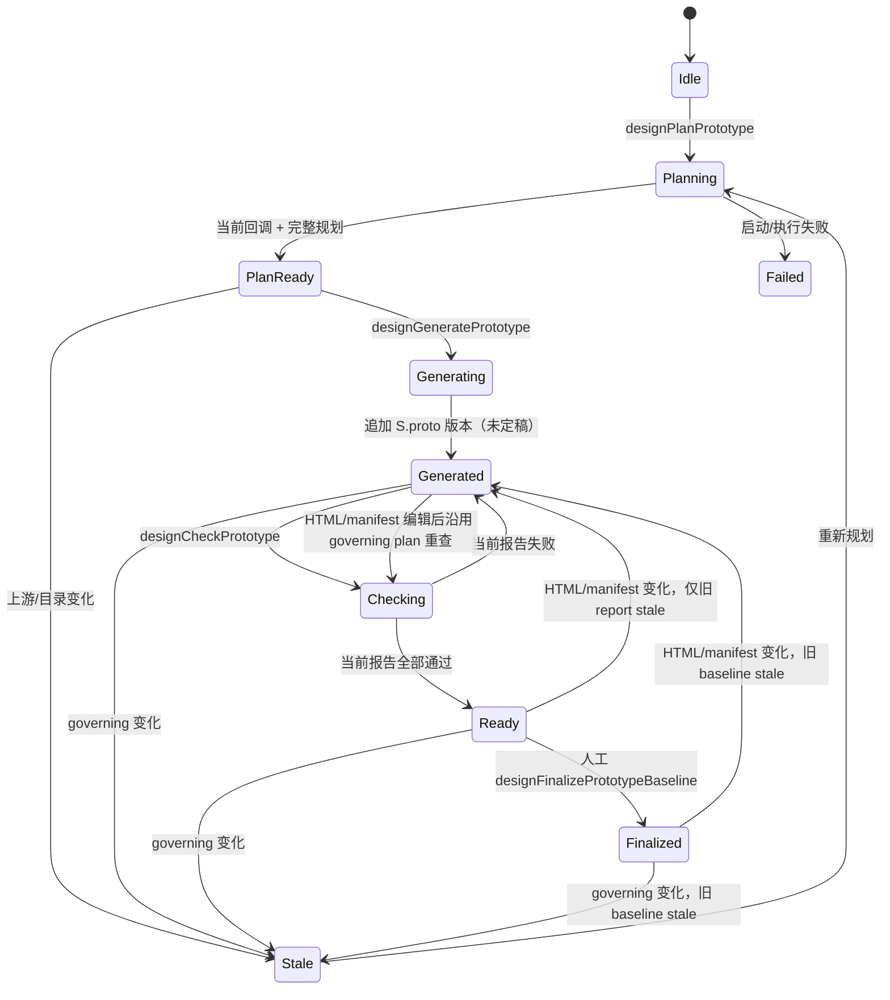
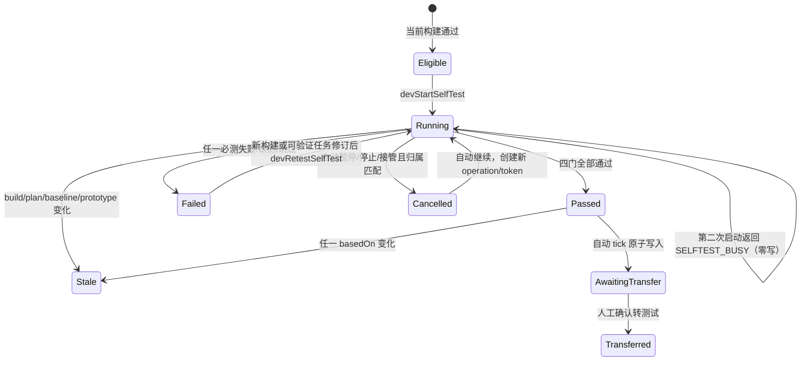

# v1.9 设计基线与开发自测契约

> 状态：整体设计候选，等待独立设计门禁。
> 基线：main `e129d9c` / v1.8。
> 作用域：客户项目「喀麦隆门户网站」的单 HTML 页内模拟；刷新回到固定种子。

## 1. 目标、非目标与退出条件

本轮把两条链闭合：其一，以已定稿 PRD、概要设计、七册详细设计和独立 `design-catalog.json` 识别角色、页面、流程、状态和控件，生成可操作的多页原型，完成正反向追溯与语义检查后由人定稿共同设计基线；其二，在批准任务全部合并并完成当前 main 构建后，运行项目级开发自测，自动汇总不可变报告，全部门禁通过才进入 `awaiting-transfer`，最后仍由人确认转测试。当前冻结目录包含 16 页、9 条流程、8 个字段和 42 个控件；实现读取目录本身校验这些集合，不把计数硬编码为通过依据。

不接真实模型、Git、CI、后端、视觉相似度服务或跨刷新持久化；不支持任意上传 HTML 的通用语义理解；不改 v1.8 `DevStore` 的事务、只读 Proxy、任务/PR 双对象或既有公开契约；不引入全局权限系统；不自动定稿上游工件、降低门槛、忽略失败或转测试。

出现以下任一情况即停止当前路线并重新设计：需要修改 `DevStore` 公共契约或真实服务；需要从任意 HTML 推断业务语义；需要扩大自动权限到上游定稿、豁免失败或转测试；第二轮集中修正后仍出现同类旧回调、部分提交、身份漂移或证据复用缺口。

## 2. 权威状态与兼容边界

| 事实 | 唯一权威 | 规则 |
| --- | --- | --- |
| 原型 HTML | `S.proto.versions` 中 `S.proto.cur` 指向版本的 `html` | 不在 `S.design.prototype` 复制 HTML 或另建 `prototypeDraft`。版本可附带声明 manifest，但 manifest 不是页面存在性的证据。 |
| 原型期望目录 | `V19_DESIGN_CATALOG`（来自 `design-catalog.json` 的固定页内镜像） | 独立于原型产物；页面、流程、状态或控件被删后仍留在期望侧，检查必须发现。 |
| 实际页面与交互 | 从当前 HTML 真实解析所得 `observed` | 必须核对实际 DOM 标记、可见控件与交互处理；不能仅相信 manifest。 |
| 原型规划 | `S.design.prototype.plans` | 追加式完整快照；`currentPlanId` 只选择当前计划，不改历史。 |
| 原型检查 | `S.design.prototype.checkReports` | 追加式不可变报告；`currentCheckReportId` 只指向当前输入上的报告。 |
| 共同设计基线 | `S.design.prototype.baselines` | 只由用户显式定稿产生；`currentBaselineId` 指向当前共同基线。 |
| 设计异步操作 | `S.design.prototype.operation` | 同时最多一个 planning/generating/checking 操作；`opToken` 隔离旧回调。 |
| 设计 UI 选择 | `S.designUi.prototypePageId/prototypeStateId` | 仅展示状态，不进 fingerprint、证据、定稿或开发输入。 |
| 开发业务事实 | `S.dev` / `DevStore` | v1.8 公开事务/Proxy/任务-PR 双对象契约不变；内部 additive 扩展为 `selftest`、`operations.selftest`、`build.uiArtifact`/重算身份和 PR `mergeBasis`。 |
| 开发自测操作 | `S.dev.operations.selftest` | 操作身份、父自动 run 归属和生命周期的唯一权威，不在 `S.dev.selftest` 复制 operation。 |
| 开发自测报告 | `S.dev.selftest.reports` | 追加式不可变历史；`currentReportId` 只指向当前输入上最近完成的报告。 |
| 自动运行归属 | `S.dev.autopilot.run.runId + runToken` | 自测 operation 必须同时匹配两个字段才归自动运行；人工启动不得冒认。 |
| 转测试依据 | `devTransferGate()` 与 `S.dev.transfer` | 当前构建、当前设计基线和当前通过报告同时有效；交接回执引用完整身份。 |
| 故障注入与 timer | `V19_TEST_HOOKS` / `V19_RUNTIME` | 只是确定性模拟输入和运行资源，不是业务权威，不参与批准身份。 |

`S.proto` 初始可以是 `cur === 0`。页面显示“尚未生成”和目录期望缺口；第一次生成必须先得到完整、当前的规划。若种子未来带已有首页，也将它当作待检查的现有版本，不暗中视作完整或已定稿。

## 3. 实时身份与 fingerprint

设计链明确区分“不随生成结果变化的治理输入”和“每次变化的原型输出”，避免生成新版本后让规划自我失效。

`designPrototypeGoverningSnapshot()` 每次调用实时观察：

```js
{
  ownerProjectId: 'pj1',
  requirements: { versionId, finalizationId, fingerprint },
  hld: { versionId, finalizationId, fingerprint },
  lld: {
    documents: [{ docKey, versionId, finalizationId, fingerprint }],
    fingerprint
  },
  catalog: { catalogVersion, fingerprint },
  sourceAuditRulesFingerprint: '...',
  governingFingerprint: '...'
}
```

`designPrototypeOutputSnapshot()` 单独观察当前原型：

```js
{
  versionId,
  htmlFingerprint,
  manifestFingerprint,
  contentFingerprint,
  pendingCount,
  modified,
  finalized,
  finalizationId
}
```

`designPrototypeSnapshot()` 只是方便 UI/调用方的一次组合读取，返回 `{ governing, prototype }`；规划有效性只比较 `governing.governingFingerprint`，检查与基线另比较 prototype `contentFingerprint`。生成 operation 额外记录启动时 `generationInputPrototypeFingerprint`，防止生成期间人工上传/修改覆盖；成功追加新版本后规划仍有效。人工编辑或上传不改变 governing plan，可在同一 plan 下重新检查；再次“按计划生成”则以当次 operation 的原型输入身份防并发覆盖。

版本号或 `finalized` 布尔值不能单独代表身份。PRD/HLD/LLD 项包含当前内容规范化哈希和每次定稿序号；同版本解锁再定稿也产生新 `finalizationId`。原型 `contentFingerprint` 只由当前版本号、HTML 与 manifest 的独立哈希构成；`pendingCount/modified/finalized/finalizationId` 是 readiness 观察值，不进入内容 fingerprint。这样人工定稿不会让刚产生的基线立即过期，但任何内容、版本或 manifest 变化仍会失效。

目录不能自己证明来自上游。`designAuditCatalogAgainstSources()` 以实时 PRD/HLD/LLD 文本为一侧、catalog 为另一侧，使用固定示例的版本化 `V19_SOURCE_AUDIT_RULES` 提取并比对：PRD 的 REQ-001～REQ-007 和 UI 适用性、HLD 业务模块/边界、LLD 的页面布局、字段校验、角色能力、接口字段、持久状态、流程与非 UI 规则。规则版本进入 `sourceAuditRulesFingerprint`。删除上游条款、只删除 catalog 对应项、来源锚点内容不匹配都失败；发现规则表不认识的新 REQ、页面型条款、字段、状态或权限语义时记 `SOURCE_UNVERIFIED/humanRequired`，不能静默忽略。正向检查从上游提取事实出发，反向检查从 catalog 条目回到实际章节内容，不能只遍历 catalog 自身。

V1.9 初始化时对客户示例 API 详细设计保存一次明确的“v1.9 原型对应性澄清”新版本并按已确认上游种子初始化约定定稿；旧 V1.8 文件不变。这是本版本示例数据修订，不是运行时规划器自动修改或替人定稿。字段契约为：

```js
{
  status: 'draft' | 'review' | 'published' | 'archived',
  workflowView: 'draft' | 'submitted' | 'pending-publish' | 'returned' | 'published' | 'archived',
  allowedActions: ('edit' | 'submit-review' | 'approve' | 'return' | 'publish' | 'unpublish' | 'archive')[],
  lastTransition?: { action, actorRole, at, reason? }
}
```

`status` 仍是持久权威；`workflowView/allowedActions/lastTransition` 由服务端按角色和当前记录返回。`pending-publish` 必须满足 `status='review'` 且 `allowedActions` 含 publish；`returned` 必须满足 `status='draft'` 且 `lastTransition.action='return'`。前端不得只凭角色或 status 推断。catalog 的状态映射和 CMS 编辑/审核/发布页必须引用这一新 API 版本，source audit 同时核对字段内容、API 当前 fingerprint 与新 finalizationId。初始化默认健康；运行后字段缺失、新条款不识别或目录再冲突仍产生 `STATUS_SOURCE_CONFLICT/SOURCE_UNVERIFIED + humanRequired`，规划器不自动改上游。

fingerprint 不包含时间、当前页、展开状态、滚动位置或助手开合。规范 JSON 的对象 key 排序，具名集合按稳定 ID 排序，流程步骤和页面状态原顺序保留。规划、检查、定稿、开发输入解析、开发准备/批准、自动 tick、自测开始/完成和转测试都重新观察对应 governing/content 身份，不靠事件通知推定新鲜度。

## 4. 设计规划、检查与共同基线 schema

```js
S.design.prototype = {
  ownerProjectId: 'pj1',
  status: 'idle',
  // idle | planning | plan-ready | generating | generated |
  // checking | ready | finalized | stale | failed
  operation: null,
  currentPlanId: '',
  currentCheckReportId: '',
  currentBaselineId: '',
  plans: [],
  checkReports: [],
  baselines: [],
  audit: [],
  nextPlan: 1,
  nextCheck: 1,
  nextBaseline: 1,
  nextOperation: 1,
  nextAudit: 1
};

S.designUi = Object.assign(S.designUi || {}, {
  prototypePageId: '',
  prototypeStateId: '',
  prototypePanel: 'plan'
});
```

当前异步操作：

```js
{
  operationId: 'PROTO-OP-1',
  runId: 'PROTO-PLAN-1',
  opToken: 'PROTO-PLAN-1-...',
  dispatchAction: 'plan', // plan | generate | check
  owner: 'design-human',
  kind: 'planning', // planning | generating | checking（展示别名）
  status: 'running', // running | done | failed | stale | cancelled
  input: {
    governingFingerprint: '...',
    prototypeContentFingerprint: '...'
  },
  startedAt: '...'
}
```

### 4.1 异步 operation identity 权威表

下表是 V1.9 全部新增异步动作的唯一身份定义；函数实现、cancel、callback、dispatch expected 与失败测试都从同一行取值，不再各自判断 owner 或输入。

| dispatchAction | 公开入口与 owner | 开始事务冻结输入 | 合法取消/失效 | callback 提交前必须同时满足 |
| --- | --- | --- | --- | --- |
| `plan` | `designPlanPrototype` / `design-human` | governing + 当前 prototype content | 任何合法 proto 内容写把当前 op 换新 token 并标 stale；governing 变化由回调判 stale | operationId/opToken/action/owner；实时 governing 与 prototype content 都等于 input。plan 的长期 `basedOn` 只保存 governing，当前原型缺口另存 `diagnostics.observedAtPrototypeContentFingerprint`。 |
| `generate` | `designGeneratePrototype` / `design-human` | governing + 生成前 prototype content | 任一 proto 内容写先旋转 token、标 stale，再提交该写入 | operation tuple；实时 governing/content 等于 input；current plan 自身哈希正确且 basedOn governing 一致。成功后追加新 proto 输出，不拿输出反查 input。 |
| `check` | `designCheckPrototype` / `design-human` | governing + 被检查 prototype content | 编辑、上传、版本切换、提交、重新生成、pending 应用等先旋转 token并标 stale | operation tuple；实时 governing/content 等于 input；current plan 自身哈希正确且 basedOn governing 一致。报告 `basedOn.prototype` 必须等于 input content。 |
| `manual-selftest` | 页面直接 `devStartSelfTest` / `manual` | selftest snapshot + 当前 build raw identity + acceptanceRuleFingerprint | auto pause/stop/takeover 不取消；项目离开或显式失效按自身 opToken | operation tuple/action/owner；实时 snapshot、raw build identity 与规则 fingerprint 一致；不存在父 run 要求。 |
| `selftest` | dispatcher 调 `devStartSelfTest` / `autopilot` | 同上 + authorizationId + 既有 `autopilotRunId/autopilotRunToken` | 只有同时匹配这两个既有父运行字段的 auto control 才取消，并先旋转父 token | manual 条件 + operation 中已存 action、active authorization，且 `run.runId/runToken` 分别等于 operation 的 `autopilotRunId/autopilotRunToken`，run status 与 snapshot 全匹配。 |
| `manual-retest` | 页面直接 `devRetestSelfTest` / `manual` | 同 manual-selftest + 系统派生 retestOf/remediation identity | 同 manual-selftest | manual 条件 + 当前失败报告、retestOf、remediationFingerprint 和新 build 内容身份全匹配。 |
| `selftest-retest` | dispatcher 调 `devRetestSelfTest` / `autopilot` | 同 selftest + 系统派生 retestOf/remediation identity | 同 selftest | auto 条件 + dispatchAction 恰为 selftest-retest + retestOf/reportFingerprint/remediationFingerprint 全匹配。 |

`S.dev.operations.selftest.dispatchAction` 保存上表四种开发动作之一。owner 谓词为：`selftest|selftest-retest → autopilot`，`manual-selftest|manual-retest → manual`。只有 `DEV_RUNTIME.autopilotDispatch.action` 与目标 action 完全一致，且创建事务内父 run、token、authorization、snapshot、retest identity 均通过，才可写 autopilot；否则拒绝创建，不能降级成 manual。`DEV_RUNTIME.autopilotDispatch` 只是 `v18DispatchAction` 调用入口期间的同步上下文，入口返回即清除；它只用于创建 operation 时鉴别 owner 和冻结身份。异步 callback 不再读取该瞬时对象，而是校验 operation 已存的 `dispatchAction/autopilotRunId/autopilotRunToken/authorizationId/snapshot`、当前 run 与 active authorization；若实现使用 `run.lastDispatch`，还须匹配同一 dispatch identity。

所有合法 `S.proto` 内容/readiness 写都经 `commitPrototypeAction` 的统一 pre-write hook 检查当前 design operation。若为 running，先在同一 draft 旋转 opToken并标 stale，再写内容；旧 callback 观察旧 token 后严格零写。尤其 `check(A) → edit/upload(B) → callback(A)` 只能得到 B 成功、旧 check 零报告/零审计，或先由 A 完成后再写 B 使旧 report stale，不能出现跨输入报告。

running 只在其冻结输入仍实时有效时构成 busy。`designPlanPrototype/designGeneratePrototype/designCheckPrototype` 在返回 `DESIGN_BUSY` 前必须调用 `designPrototypeOperationValid`：有效的当前 operation 才零写拒绝；无效 operation 则在本次新请求的同一小型事务内核对旧 tuple、旋转旧 token，以 audit 保存 stale receipt，再将 current slot 替换为通过当前门禁的新 operation；当前门禁不通过时保留 stale operation。即使 governing 或 prototype 内容由未经过 pre-write hook 的受信任种子/测试变更造成，下一次公开入口也能收敛，不会永久 busy。淘汰审计属于新请求；随后到达的旧 callback 仍严格零报告、零 ID、零 current 指针、零 audit。

规划是完整版本快照，不是“已生成页面”的投影：

```js
{
  planId: 'PROTO-PLAN-1',
  revision: 1,
  basedOn: designPrototypeGoverningSnapshot(),
  catalogVersion: 'V1.9-draft-1',
  pages: [{
    pageId: 'P-PUB-HOME',
    roles: ['访客', '公民'],
    requiredStateIds: ['ready', 'fallback', 'slow', 'mobile'],
    requiredControlIds: ['language', 'search', 'service-cards'],
    requiredFieldIds: [],
    reqIds: ['REQ-001', 'REQ-003', 'REQ-004'],
    hldRefs: ['hld:h1', 'hld:h3'],
    lldRefs: ['mod:o0', 'ui:u0', 'alg:g1'],
    taskIds: ['T-201', 'T-206'],
    proposedTaskIds: []
  }],
  flows: [{ flowId: 'F-001', pageIds: ['P-PUB-HOME', 'P-PUB-SECTION', 'P-PUB-CONTENT'] }],
  viewportProfileIds: ['public-desktop', 'public-tablet', 'public-mobile', 'cms-desktop'],
  statusDisplayMappingFingerprint: '...',
  requirementCoverage: [{ reqId, uiApplicable, pageIds, flowIds, nonUiCoverageIds, result }],
  reverseTrace: [{ pageId, reqIds, hldRefs, lldRefs, result }],
  sourceAudit: {
    rulesFingerprint: '...',
    forward: [{ sourceRef, catalogTargets, result }],
    reverse: [{ targetId, sourceRefs, result }],
    unverified: []
  },
  issues: [{ issueId, code, severity, target, message, sourceRefs, humanRequired }],
  complete: true,
  fingerprint: '...',
  createdBy: 'ai-prototype-planner',
  createdAt: '...'
}
```

`complete` 只有在目录的全部页面、必需状态、控件、字段、流程、视口、状态展示映射、UI 适用 REQ 和 `nonUiCoverage` 均被枚举，sourceAudit 正反向通过，且没有 `humanRequired` 或阻断问题时为真。规划可呈现当前原型缺口，但不能把计划内条目当作已经存在。`taskIds` 必须能在当前任务池找到；`proposedTaskIds`（固定示例含 `P-PUB-SECTION → T-210`）作为下游开发准备需物化的可见缺口，不冒充已有任务，也不因设计发生在开发拆解之前而单独阻断设计定稿。计划只绑定 governing snapshot；`finalized` 等 readiness 值单独重验。

检查报告把期望、声明和真实观察分开：

```js
{
  reportId: 'PROTO-CHECK-1',
  planId: 'PROTO-PLAN-1',
  basedOn: {
    governing: designPrototypeGoverningSnapshot(),
    prototype: designPrototypeOutputSnapshot(),
    planFingerprint: '...'
  },
  expected: { catalogVersion, pageIds, flowIds, requirementIds },
  declared: { manifestFingerprint, pages, flows },
  observed: {
    htmlFingerprint,
    recognition: 'recognized', // recognized | unsupported | invalid
    pages: [{
      pageId,
      stateIds,
      controls: [{ controlId, label, type, action, targetPageId, visible, interactive }],
      fields: [{ fieldId, label, type, required, accept, maxSizeMb }]
    }],
    flows: [{ flowId, reachable }]
  },
  coverage: {
    requirements: [{ reqId, forwardRefs, result }],
    reverse: [{ targetId, sourceRefs, result }],
    pages: [{
      pageId,
      requiredStates, observedStates,
      requiredControls, observedControls,
      requiredFields, observedFields,
      result
    }]
  },
  semantics: [{ checkId, sourceRefs, expected, actual, result }],
  issues: [{ issueId, code, severity, target, message, sourceRefs, humanRequired }],
  gates: { catalog: true, traceability: true, semantics: true, interaction: true },
  status: 'pass', // pass | fail
  fingerprint: '...',
  createdAt: '...'
}
```

实际解析以 DOM 标记和控件行为为准：至少识别 `data-prototype-page`、`data-prototype-state`、`data-prototype-control`、`data-prototype-field`、控件可见文案/类型/action、跨页目标、字段必填/类型/附件约束和可触发处理。控件 ID 存在但 label/type/action/target 与目录语义不符，或没有 `onclick`/事件绑定/可验证导航目标，分别记 `CONTROL_SEMANTIC_MISMATCH` 或 `CONTROL_INERT`；字段缺失或约束错误记 `FIELD_MISSING/FIELD_CONSTRAINT_MISMATCH`。状态语义还必须服从目录 `statusDisplayMapping`：`draft/review/published/archived` 是持久状态，submitted/pending-publish/returned 只是带依据的工作流视图，不得暗中新增数据库枚举或由前端凭角色猜测。manifest 用于声明来源与映射；DOM 缺页面、状态、控件或字段时，即使 manifest 声称存在也失败。DOM 存在未声明或无 REQ/HLD/LLD 来源的业务页面/动作时，反向追溯失败。上传无法识别固定标记的任意 HTML 记 `recognition='unsupported'`，所有未验证项保持未执行，不得通过。

共同基线只保存身份和检查结论，不复制 HTML：

```js
{
  baselineId: 'DESIGN-BL-1',
  ownerProjectId: 'pj1',
  basedOn: {
    governing: designPrototypeGoverningSnapshot(),
    prototype: designPrototypeOutputSnapshot() // 已设置 finalization 后的 draft 观察值
  },
  governingFingerprint: '...',
  prototypeContentFingerprint: '...',
  planId: 'PROTO-PLAN-1',
  planFingerprint: '...',
  checkReportId: 'PROTO-CHECK-1',
  checkReportFingerprint: '...',
  prototypeVersionId: 'v1',
  prototypeHtmlFingerprint: '...',
  prototypeManifestFingerprint: '...',
  catalogVersion: 'V1.9-draft-1',
  catalogFingerprint: '...',
  traceability: {
    pageToTasks: [{ pageId, flowIds, taskIds, proposedTaskIds }],
    taskToPages: [{ taskId, pageIds, flowIds, source: 'existing' | 'proposed' }]
  },
  uiAcceptance: {
    rulesVersion: 'V19-UI-1',
    rulesFingerprint: '...',
    requiredPageStateCoverage: 1,
    criticalItemsMin: 1,
    generalVisualComplianceMin: 0.95,
    severeDeviationMax: 0,
    matrix: [{
      pageId,
      viewportId,
      expectedCriticalCheckIds: [],
      expectedGeneralCheckIds: [],
      checkDefinitions: [{ checkId, kind, sourceRefs, severity }]
    }]
  },
  fingerprint: '...',
  finalizedBy: 'superopen',
  finalizedAt: '...'
}
```

历史 plan/report/baseline 追加后深冻结，并用自身 fingerprint 验证内容未变。`current*Id` 不是有效性证据。plan 门禁重验 governing；report 门禁重验 governing + plan + prototype content；baseline 有效性重验 governing + prototype content + plan/report 自身哈希，readiness 再独立要求 `finalized=true`、finalizationId 匹配、pending=0、modified=false。

## 5. 设计状态转换与原子写入



`commitPrototypeAction(action, target, mutator)` 是 `S.design.prototype` 与 `S.proto` 新链的唯一写边界。它深拷贝这两个对象、在隔离草稿上重验项目/operation/实时 fingerprint、执行业务写和 `designAudit()`，所有检查通过后一次替换；render/toast/timer 作为提交后 effect。mutator、audit、invariant 或发布前校验抛错时，两个对象、计数器、current 指针和 effect 全部字节等价回滚。

现有原型上传、重新生成、源码修改确认、版本切换、提交、解锁和再定稿入口只要改变当前 HTML、manifest、pending、modified 或 finalization，就必须进入该小型事务或调用同事务内的失效逻辑；不能只改 `S.proto` 留下 `ready/finalized`。PRD/HLD/LLD 的既有写法不纳入新事务，门禁靠实时 snapshot 发现变化并将旧计划/报告/基线视为 stale。

异步顺序统一为：同步预检 → 事务登记 operation 与审计 → 提交 → 启动 timer → 回调先在事务外比对 `operationId + opToken` → 进入事务后再次比对 token 与对应 governing/input/output snapshot → 追加不可变结果、更新 current 指针与审计 → 提交 → UI effect。旧 token 不匹配时直接 `return false`，不改 operation、不追加 audit、不分配 ID、不 render。

timer 启动失败先在 `V19_RUNTIME.prototypeStartFailures[operationId]` 保存 `{opToken,error}`，再尝试小型事务把当前 operation 标为 failed。若该失败登记的 audit/invariant 也失败回滚，runtime 收据仍让 `designRecoverPrototypeStart()` 可见且可达；恢复函数只按原 operationId/opToken 幂等补记 failed，不生成 plan/report/prototype、不重复分配 ID。之后由人重新启动原动作并取得新 token。

定稿事务顺序为：重验项目 → 当前 plan 存在/完整/自身哈希正确/实时 governing 一致 → 当前 report 存在/pass/自身哈希正确/plan 与实时 governing 一致 → pending=0 且 modified=false → `S.proto` 当前 content 与 report 完全一致 → **先在同一 draft 设置** `S.proto.finalized=true/finalVer/finalizationId` → 基于该 draft 重新读取定稿后 output snapshot → 追加绑定 governing + 定稿后 output 的 baseline → 设置 `currentBaselineId` → 设计审计 → 原子提交。baseline 后续 validity 比较 governing fingerprint 与 prototype content fingerprint；readiness 独立比较 finalized/finalizationId/pending/modified。不得从不完整规划、旧检查、仅 manifest、旧 `S.proto.finalized` 或旧 DSG-P 登记恢复出新基线。

旧 `finalProto/doFinalProto` 保留函数名兼容调用点，但实现必须委托 `designFinalizePrototypeBaseline()`；旧“仍要定稿”绕过未决检查的分支移除。任何未决 source audit、semantic、coverage、interaction、pending 或 modified 都只能返回 gate issue，不能二次确认越过。

## 6. 设计公开 API 与稳定 UI 挂钩

所有 gate 同步返回 `{ ok, issues: [{ code, message, target? }] }`；无写函数不得产生 toast 或 audit。

表中“异步模拟”沿用现有单 HTML 习惯：公开入口同步完成预检与 operation 登记，并立即返回启动结果/operation；实际完成由 timer callback 提交。入口不返回一个等待 timer 完成才 resolve 的 Promise，测试在调用入口后推进虚拟时钟。

| API | 同步性 | 行为 |
| --- | --- | --- |
| `designPrototypeGoverningSnapshot()` | 同步纯函数 | 观察 PRD/HLD/LLD/catalog/source-audit 规则身份。 |
| `designPrototypeOutputSnapshot()` | 同步纯函数 | 观察当前 S.proto content 与 readiness。 |
| `designPrototypeSnapshot()` | 同步纯函数 | 一次返回 governing + prototype，调用方必须按契约分别比较。 |
| `designPrototypeFingerprint()` | 同步纯函数 | 返回当前 governing/content 两个 fingerprint，不混为一个生命周期。 |
| `designPrototypeGate(action)` | 同步纯函数 | 统一 plan/generate/check/finalize/develop 门禁；`develop` 只认可实时有效的共同基线。 |
| `designPrototypeOperationValid(op)` | 同步纯函数 | 按 §4.1 校验当前 tuple、action/owner 和实时 governing/prototype 输入。 |
| `designAuditCatalogAgainstSources()` | 同步纯函数 | 从实时上游事实与 catalog 两侧独立建立正反向审计。 |
| `designRecoverPrototypeStart()` | 同步事务 | 由 runtime 收据幂等补记启动失败，不生成业务产物。 |
| `designPlanPrototype()` | 异步模拟 | 追加完整 planning 快照，不改 HTML。 |
| `designGeneratePrototype()` | 异步模拟 | 只消费当前完整规划，向 `S.proto.versions` 追加多页 HTML + manifest，保持未定稿。 |
| `designCheckPrototype()` | 异步模拟 | 从当前 HTML 独立解析 DOM，与目录和 manifest 比较，追加报告。 |
| `designFinalizePrototypeBaseline()` | 同步人工动作 | 重验并原子产生共同基线；永不由 timer/AI 自动调用。 |
| `designExportPrototypeBaseline()` | 同步页内操作 | 以 Blob 真正下载当前基线身份和检查摘要 JSON/Markdown；旧基线明确标历史。 |
| `designSelectPrototypePage(pageId,stateId)` | 同步 UI 动作 | 切换可操作预览，不改业务证据。 |

稳定 testid：

- `prototype-workbench`、`prototype-status`、`prototype-plan`、`prototype-generate`、`prototype-check`、`prototype-finalize`
- `prototype-page-list`、`prototype-page-${pageId}`、`prototype-state-${stateId}`、`prototype-preview`
- `prototype-issues`、`prototype-issue-${issueId}`、`prototype-baseline-current`

## 7. 开发输入身份与兼容传播

`resolveDevInputs()` 保留名称和既有返回语义，在原 PRD/HLD/七册输入后增加一项必需的共同设计基线：

```js
{
  artifactId: 'DESIGN-BASELINE',
  versionId: baseline.baselineId,
  finalizationId: baseline.baselineId,
  hash: baseline.fingerprint,
  required: true,
  prototypeVersionId: baseline.prototypeVersionId,
  prototypeHtmlFingerprint: baseline.prototypeHtmlFingerprint,
  catalogFingerprint: baseline.catalogFingerprint,
  checkReportId: baseline.checkReportId
}
```

开发 `baseline.key/fingerprint/items`、准备修订 `basedOn`、批准计划、authorization、run receipt、task/quality/AI review/build 身份、变更影响和交接回执沿既有路径传播该项。准备阶段读取 baseline 的 page↔task 双向快照：existing task 必须继续反查页面/状态来源；`proposedTaskIds` 仍不写入现有任务池，但产生带 page/state/control/REQ/HLD/LLD 出处的 create-task proposal。固定示例 `P-PUB-SECTION → T-210` 必须由准备批准事务物化，批准前仍显示设计承接缺口。

物化后的任务冻结 `designBaselineId/designBaselineFingerprint/designPageIds/designFlowIds/designStateIds`，proposal/authorization receipt 保存 `proposalId + proposedTaskId + pageIds + flowIds + baselineId`。拒绝或未决 proposal 不产生任务，baseline 的 proposed 反查仍显示缺口；批准后页面→任务和任务→页面从同一冻结 plan 解析，不能各自扫描当前 catalog 得到漂移结果。

`resolveDevInputs` 在当前共同基线缺失、stale、自身哈希错误或与实时 governing/content snapshot 不一致时返回原格式的失败 issue；不另建旁路 parser，不绕过 `devMarkInputDirty/devReconcileInputs`。设计基线变化使旧开发 baseline、准备、授权、build 和自测报告失效，但保留历史事实。

## 8. 开发自测 schema 与判定

当前 main build 必须携带独立的候选 UI 工件，不能用设计原型充当实现：

```js
S.dev.build.uiArtifact = {
  artifactId: 'BUILD-UI-1',
  html: '<!doctype html>...',
  htmlFingerprint: '...',
  implementationManifest: { pageIds: [], sourceTaskRevisions: {} },
  manifestFingerprint: '...'
};
```

候选 UI HTML 由独立实现模板和已合并 task/code revision 生成，禁止复制 `S.proto` HTML/manifest 或把 catalog 对象原样当作 observed。`devInspectBuildUiArtifact()` 对 build 保存的 HTML 重新解析页面、状态、字段、控件和交互；缺工件、无法识别或解析错误都记 `not-run`。设计侧比较对象来自当前通过的 prototype check report observed，构建侧来自 build UI artifact observed，两者身份分别进入报告。

### 8.1 build UI 原始内容与重算身份

`devBuildIdentity(build)` 是纯函数，直接从 `build.uiArtifact.html` 和 canonical `implementationManifest` 重算 `computedHtmlFingerprint/computedManifestFingerprint`；缓存的 `htmlFingerprint/manifestFingerprint` 若保留只作收据，任一与重算值不等即返回 `BUILD_UI_FINGERPRINT_MISMATCH`。`devBuildFingerprint(build)` 使用这两个**重算值**计算规范哈希：`{status, baselineKey, sourceFingerprint, planSnapshotId, commits, taskRevisions, codeRevisions, evidenceIndex, uiArtifact:{computedHtmlFingerprint,computedManifestFingerprint,sourceTaskRevisions}}`。对象 key 与 ID 集合稳定排序；`buildId/runId/startedAt/finishedAt` 不进入内容 fingerprint。重新产生同内容 buildId 不算修复。

completed build 及其 uiArtifact 深冻结。`commitDevAction` 的 invariant 拒绝在既有 completed build 内改 HTML/manifest/缓存 hash；合法新实现只能由新 `build.complete` 一次替换为新 receipt。即使有人绕过冻结或在序列化 draft 中只改原始 HTML，operation valid、report current gate 和 transfer gate 仍实时调用 `devBuildIdentity`，比较重算 fingerprint 并因缓存不符或 basedOn 不符 fail closed。

### 8.2 page×viewport expected evidence-set 权威表

`V19_UI_ACCEPTANCE_RULES` 是独立版本化规则，不从报告结果反推分母：

```js
{
  version: 'V19-UI-1',
  criticalRules: [
    { id: 'critical-rbac', applies: 'CMS area 或 denied/forbidden/unauthorized/locked 状态', sourceRefs: [] },
    { id: 'critical-identity', applies: 'P-PUB-ACCOUNT', sourceRefs: [] },
    { id: 'critical-application', applies: '含 REQ-003 页面', sourceRefs: [] },
    { id: 'critical-publish-archive', applies: 'F-009 涉及页面', sourceRefs: [] },
    { id: 'critical-language-fallback', applies: '含 REQ-004 页面', sourceRefs: [] }
  ],
  generalDerivers: ['required-state','control','field','flow-step','viewport-layout','status-mapping']
}
```

`deriveUiAcceptanceMatrix(catalog, rules)` 只在共同设计基线事务中运行并保存 immutable matrix。页面与视口的适用关系由 `page.area === viewport.area` 唯一派生；每个格子的 critical 集合由上述 applies 规则派生，一般集合由该页全部 required states、controls、fields、关联 flow steps、对应 viewport rule 和适用 status mapping 派生。每个 check definition 保存具体 sourceRefs。最终检查唯一键为 `pageId + ':' + viewportId + ':' + checkId`。

基线门禁要求 matrix 精确覆盖所有 catalog page×applicableViewport；每格 `expectedCriticalCheckIds.length >= max(1, criticalItemsMin)`，expectedGeneral 非空，check ID 无重复，全部 sourceRefs 可解析。matrix 和完整 definitions 进入 `rulesFingerprint` 与 baseline fingerprint。自测报告只能消费 baseline 冻结的 expected 集合；实际 check ID 集合必须与 expected 集合完全相等，缺项、额外项、重复项、空 critical 或未知状态一律 fail，再以 expected 集合长度为分母计算比例。

### 8.3 PR 合并依据

V1.9 新发生的合并必须在同一 `commitDevAction` 事务中向 `task.pr` 与 `S.dev.prs` 对应对象写入内容相等、深冻结的 `mergeBasis`；两个 PR 对象、当前 commit/head、质量证据和 merge audit 任一不一致则整体回滚：

```js
// 当前 checklist 全部确认
{
  kind: 'manual-checklist', prId, commitId, headRevision,
  checklistSnapshot: [{ id, label, checked: true }],
  auditEventId // 本次 pr.merge
}

// 有理由豁免人工项；reason 本身不豁免 unit/CI/版本门禁
{
  kind: 'manual-skip', prId, commitId, headRevision,
  checklistSnapshot: [{ id, label, checked }],
  skipReceipt: { reason, actor, at, auditEventId } // 精确 pr.manual.skip
}

// 自动路径沿用 V1.8 事实并规范化审计引用
{
  kind: 'autopilot-authorization',
  authorizationId, aiReviewEvidenceId, mergeAuditId
}
```

人工 `prMerge` 在事务内先校验自动 unit/CI/版本门禁和人工分支，再由 `devAudit` 分配并返回本次 `pr.merge` eventId，构造 basis 后同时写两个 PR 对象；自动合并同样补齐 `mergeAuditId`。`devResolveMergeBasis(pr)` 是同步纯函数，先要求双对象 basis 规范化内容相等并匹配当前 PR。对 V1.8 种子中已合并但无 basis 的事实，只能在以下精确证据同时存在时派生只读 `legacy-manual` 规范结果：同一 `prId/commitId/headRevision/taskRev` 的 `pr.merge` 审计，以及与当前 checklist 每项匹配的 `pr.manual.check` 审计，或同一 PR 的 `pr.manual.skip` 审计与当前非空 skip reason 完全相等。审计缺少足以证明 commit/head 的身份时不得按“最接近事件”猜测；返回 `MERGE_BASIS_MISSING`。派生结果不回写历史对象，不把任意缺字段、任意 checklist 或任意理由默认当成人工合并。

```js
S.dev.selftest = {
  currentReportId: '',
  reports: [],
  nextReport: 1
};

S.dev.operations.selftest = {
  runId: 'SELFTEST-RUN-1',
  opToken: 'SELFTEST-RUN-1-...',
  kind: 'selftest',
  dispatchAction: 'manual-selftest',
  projectId: 'pj1',
  status: 'running', // running | done | failed | stale | cancelled
  owner: 'manual', // manual | autopilot
  authorizationId: '',
  autopilotRunId: '',
  autopilotRunToken: '',
  snapshot: {
    buildId: 'BUILD-1',
    buildFingerprint: '...',
    buildUiArtifactId: 'BUILD-UI-1',
    buildUiHtmlFingerprint: '...',
    planSnapshotId: 'PLAN-SNAP-1',
    planFingerprint: '...',
    baselineKey: 'BL-pj1-...',
    inputFingerprint: '...',
    designBaselineId: 'DESIGN-BL-1',
    designBaselineFingerprint: '...',
    prototypeVersionId: 'v1',
    prototypeHtmlFingerprint: '...',
    prototypeCheckReportId: 'PROTO-CHECK-1',
    prototypeObservedFingerprint: '...',
    catalogFingerprint: '...',
    acceptanceRuleFingerprint: '...',
    taskRevisions: { 'T-201': 1 },
    commits: ['COMMIT-...']
  },
  retestOfReportId: '',
  remediationFingerprint: '',
  remediationRefs: [],
  reason: '',
  startedAt: '...'
};
```

owner、dispatcher、父 run 与回调校验只按 §4.1 权威表判定。任何入口都不能在校验失败时从 autopilot 静默降级为 manual。

报告 schema 冻结为：

```js
{
  reportId: 'SELFTEST-1',
  status: 'pass', // pass | fail
  basedOn: { /* operation.snapshot 的深拷贝 */ },
  operation: {
    runId, opToken, dispatchAction, owner, authorizationId, autopilotRunId, autopilotRunToken,
    retestOfReportId, remediationFingerprint, remediationRefs, reason
  },
  summary: {
    total, passed, failed, skipped, notRun,
    requiredPages, testedPages, requiredStates, testedStates,
    requiredPageViewports, testedPageViewports,
    severeDeviationCount
  },
  checks: [{
    id, group, required, sourceRefs, expected, actual,
    status // pass | fail | skipped | not-run
  }],
  ui: {
    prototypeVersionId,
    prototypeObservedFingerprint,
    buildId,
    buildUiArtifactId,
    buildObservedFingerprint,
    pages: [{
      pageId,
      requiredStateIds,
      testedStateIds,
      applicableViewportIds,
      viewports: [{
        viewportId,
        expectedCriticalCheckIds,
        expectedGeneralCheckIds,
        actualCriticalCheckIds,
        actualGeneralCheckIds,
        requiredStateIds,
        testedStateIds,
        critical: { passed, total, ratio },
        general: { passed, total, ratio },
        severeDeviationCount,
        checks: [{ id, viewportId, kind, stateId, sourceRefs, expected, actual, status }],
        status
      }],
      critical: { passed, total, ratio }, // 所有适用视口交集
      general: { passed, total, ratio },  // 所有适用视口逐个达标后才汇总
      severeDeviationCount,
      checks: [], // viewports[].checks 的带 viewportId 扁平索引，便于报告定位
      status
    }]
  },
  reviewEvidence: {
    prs: [{
      prId, taskId, commitId,
      mergeBasis: {
        kind: 'manual-checklist' | 'manual-skip' | 'autopilot-authorization' | 'legacy-manual',
        prId, commitId, headRevision,
        checklistSnapshot, skipReceipt, authorizationId, aiReviewEvidenceId, mergeAuditId,
        sourceAuditEventIds
      },
      status
    }]
  },
  gates: {
    functional: { ok, issues },
    integration: { ok, issues },
    ui: { ok, issues },
    review: { ok, issues }
  },
  defects: [{ defectId, checkId, pageId, viewportId, stateId, severity, message, sourceRefs, remediationHint }],
  reportFingerprint: '...',
  createdAt: '...'
}
```

四个 gate 分别计算，最终 status 取交集：

1. `functional`：批准任务的当前单测、PR CI、接口契约与必测功能检查全部 pass；任务覆盖率达到各自批准阈值。
2. `integration`：前后端联调和关键业务冒烟矩阵全部执行且 pass；至少包含门户内容、办事申请、CMS 发布、检索/开放数据四组固定链。
3. `ui`：只消费 baseline `uiAcceptance.matrix`。每个格子先要求 expected/actual critical 与 general ID 集合分别完全相等且各 ID 唯一，`critical.total === expectedCriticalCheckIds.length`、`general.total === expectedGeneralCheckIds.length`，critical 总数达到冻结最小值，再要求 required state 覆盖率 100%、关键项 100%、一般项 `>= 0.95`、严重偏差 0；所有格子通过后页面才通过。公众页面逐项覆盖 desktop/tablet/mobile，CMS 只覆盖其明确适用的 desktop。禁止空集合、缩小分母、跨视口或跨页平均。
4. `review`：逐 PR 调用 `devResolveMergeBasis`，保存完整规范化 basis。`manual-checklist/legacy-manual` 要求当前 checklist 全部确认且来源事件精确匹配；`manual-skip/legacy-manual` 的豁免分支要求带 reason/actor/at/auditEventId 的合法 skip receipt；`autopilot-authorization` 要求不可变历史 authorization receipt 证明该 PR 当时位于授权范围，并匹配独立 AI review 与自动合并审计，不要求旧 authorization 在 stop/rework/交接后仍为 active。各分支都要求当前 task/code/head、静态检查、合并事实和 main build 有效，不能无条件要求每个 PR 都有 AI review，也不能用人工 checklist 放行自动合并。

`skipped` 和 `not-run` 无论有无原因都不能计 pass；required 检查任一 skipped/not-run 使所属 gate fail。功能通过而 UI 失败、一般项总平均超过 95% 但单页不足、关键项不足 100%、必测状态少一个或出现严重偏差时，整体一律 fail。

默认模拟结果由当前固定目录、构建和任务证据确定，报告必须显示“页内模拟”。故障注入固定为：

```js
V19_TEST_HOOKS = {
  selftestOutcomeByCheck: {}, // checkId -> pass | fail | skipped | not-run
  uiOutcomeByPage: {},       // pageId -> pass | fail | skipped | not-run
  uiOutcomeByCheck: {}       // pageId + ':' + viewportId + ':' + checkId -> 同上；优先级最高
};
```

hook 不改 S.dev、设计目录或阈值；它只决定本次模拟执行生成的真实报告结果。优先级为 UI check → UI page →通用 check → 确定性默认。未知值作为 `fail`，不能默认为 pass。

报告追加后深冻结。`devSelfTestGate()` 重算 `reportFingerprint`，核对 currentReportId、operation 非 running、全部 basedOn、baseline rulesFingerprint、expected/actual 集合，并实时从原始 build UI 调用 `devBuildIdentity` 重算内容 fingerprint；任一不一致 fail。历史报告、被篡改报告、被改原始 build UI 或缩小检查集合都不能放行。

## 9. 自测状态、自动主线与恢复



`operations.selftest` 是项目级全局单飞。任意 owner 的 current operation 为 running 时，公开启动入口先实时调用 `devSelfTestOperationValid`。仍有效才返回 `SELFTEST_BUSY`，operation、current report、audit 和父 run 零写；已经因 build/plan/baseline/prototype/rules/父身份变化而无效时，在新请求的同一事务内核对旧 tuple、旋转旧 opToken 并标 stale。若旧 operation 属于 autopilot 且当前父 run 仍精确匹配旧 `autopilotRunId/autopilotRunToken`，同一事务先旋转父 token并置 `blocked/SELFTEST_INPUT_STALE`；不匹配则绝不改其他 run。随后重新执行当前入口门禁，满足才登记新 operation，否则只保留可恢复的 stale/block 收据。由未经过常规写入口的受信任测试/种子变化也可经此路径恢复，不会永久 `SELFTEST_BUSY`。`devSelfTestGate()` 在 current operation 仍为 running 时必须 fail，即使 currentReportId 仍指向旧 pass；因此新运行期间旧报告不能放行或进入 awaiting-transfer。

自动 runner 在任务全部合法合并后按以下次序决策：

1. 当前 build 无效时只派发一次 build。
2. 若存在 manual selftest running，runner 只等待，不写 `lastDispatch`、不认领、不取消。
3. 若 manual selftest 完成 pass，runner 可直接消费当前报告进入 awaiting-transfer；若完成 fail，runner 在独立事务换 token 并阻断 `SELFTEST_FAILED`，但报告仍记录 owner=manual，不冒认 operation。
4. 没有历史失败报告或最近报告为 pass 但已因新输入过期时，派发 `selftest`。
5. 最近报告为 fail 时，普通 `devStartSelfTest` 返回 `RETEST_REQUIRED`。若没有新的实质 build/remediation 身份，runner 直接保持/进入 `SELFTEST_FAILED`，不派发；若有，则派发 `selftest-retest`，由系统从失败报告和当前事实派生 reason、retestOf 与 remediationRefs。
6. 当前报告 pass 后才写 `awaiting-transfer`。

`v18DispatchIdentity/Phase/Expected` 同时增加 `selftest` 与 `selftest-retest`，phase 显示“开发自测”；expected 严格按 §4.1 对应行验证 operation.dispatchAction/owner/authorizationId/autopilotRunId/autopilotRunToken。`selftest-retest` identity 另含失败 reportFingerprint、实时重算 buildFingerprint 和 remediationFingerprint。同一身份不得二次派发，失败也不无限重跑。

自测异步顺序复用 `DevStore.transact/commitDevAction`：单飞/资格预检 → 仅在同步派发调用栈读取 `DEV_RUNTIME.autopilotDispatch` 并按 §4.1 冻结 dispatchAction/owner/输入/既有 autopilot 父身份 → start audit → effect 启动 timer（同步派发上下文此时已可清空）→ 回调外比对 opToken → 完成事务内按同一表重验 operation 已存 action、snapshot、当前 active authorization 和当前 runId/token/status → 从原始 build UI 重算 identity 并独立解析 prototype/build observed → 按 baseline expected matrix 生成完整集合 → 追加报告 → 设置 currentReportId → operation done → 若 auto 且失败，换父 runToken并写 blocked/SELFTEST_FAILED → audit → 提交。callback 不依赖瞬时 `autopilotDispatch`；旧 opToken 或旧父 runToken 回调严格零写。

`devAutoPause/devAutoStop/devAutoTakeover` 沿 v1.8 逻辑只取消 `autopilotRunId + autopilotRunToken` 同时匹配的 running selftest，先换父 token，再标记 operation cancelled；人工 selftest 不受影响。控制型取消后 `devAutoResume` 重验当前身份并创建新 selftest operation/token，不复用旧 callback 或半成品报告。若人工 operation 仍 running，resume 只恢复父 runner 并等待它完成。

真实失败报告不能仅再次点击就变绿。`devRetestSelfTest(reason)` 要求非空 reason 作为说明，但 reason 本身不算修复证据；当前 build 必须是失败报告之后产生的新回执，且还要求以下至少一项相对失败报告发生实质变化：

- 当前 `buildFingerprint/commits` 的内容身份已变化；
- 失败相关任务的 `taskRev/codeRev/remediationEvents` 派生 fingerprint 已变化，并被当前新 build 的输入身份覆盖。

只改变 `buildId`/时间、清除 hook 或重新跑相同 commits 不算实质修复。因此所有合法复测最终都基于内容身份变化后的新当前构建；`remediationRefs` 只能由系统从任务修订、返工记录、变更处置和构建证据派生，调用方不能自由填入。复测报告记录 `retestOfReportId`、新旧构建和这些引用。无实质变化时返回 `RETEST_WITHOUT_CHANGE`，不创建 operation 或 audit。

timer 启动失败先在 `V19_RUNTIME.selftestStartFailures[runId]` 保存 `{opToken,error}`，再尝试事务写 `operations.selftest.status='failed'`；自动 run 进入 `blocked/SELFTEST_START_FAILED`。若失败登记或 audit 再次失败回滚，runtime 收据仍让恢复入口可达。`devRecoverSelfTestStart()` 以 runId/opToken 幂等补记失败状态，不执行检查、不制造报告；随后显式继续/重试创建新 token。控制故障可在身份一致时恢复，报告失败则只能返工、新构建、显式复测。输入变化使 operation/report stale；通过既有变更影响与重新准备/批准链恢复。

## 10. 自测公开 API、UI 与交接

本节“异步模拟”与设计入口语义相同：函数同步返回启动结果/operation，timer 随后完成；调用方不得先 await 一个依赖该 timer 的 Promise 再推进虚拟时钟。

| API | 同步性 | 行为 |
| --- | --- | --- |
| `devStartSelfTest(options)` | 异步模拟 | 人工默认；只有 dispatcher 上下文可归属 auto。 |
| `devRetestSelfTest(reason)` | 异步模拟 | 基于系统派生修复证据和新构建追加复测。 |
| `devRecoverSelfTestStart()` | 同步事务 + 异步后续 | 从 runtime 收据幂等补记启动失败，不直接重跑。 |
| `devSelfTestGate(dev)` | 同步纯函数 | 返回 `{ok,issues}`，验证当前不可变报告和实时身份。 |
| `devSelfTestOperationValid(op)` | 同步纯函数 | 核对 project/snapshot/opToken；auto 另核对既有 autopilotRunId/autopilotRunToken、authorization 和 action。 |
| `devBuildIdentity(build)` | 同步纯函数 | 从原始 HTML/manifest 重算哈希并校验缓存收据。 |
| `devBuildFingerprint(build)` | 同步纯函数 | 只使用重算原始内容 hash 计算 build 内容身份。 |
| `devInspectBuildUiArtifact(build)` | 同步纯函数 | 从候选 UI HTML 建立独立 observed；缺失/未知不通过。 |
| `deriveUiAcceptanceMatrix(catalog,rules)` | 同步纯函数 | 生成冻结的 page×viewport expected evidence-set。 |
| `devResolveMergeBasis(pr)` | 同步纯函数 | 校验双对象不可变 basis；旧事实仅从精确审计/checklist/skip 收据派生，否则 fail closed。 |
| `devExportSelfTestReport(reportId)` | 同步页内操作 | 以 Blob 真正下载 Markdown/JSON；默认 current，历史导出明确标历史且不改变 current。 |

稳定 testid：

- `selftest-summary`、`selftest-start`、`selftest-retest`、`selftest-status`
- `selftest-report`、`selftest-export`、`selftest-blocker`
- `selftest-gate-functional`、`selftest-gate-integration`、`selftest-gate-ui`、`selftest-gate-review`
- `selftest-page-${pageId}`、`selftest-viewport-${pageId}-${viewportId}`、`selftest-state-${stateId}`
- 沿用 `auto-status`、`auto-pause`、`auto-resume`、`auto-stop`、`auto-takeover` 和人工转测按钮行为。

开发页“质量验收”统一改名“开发自测”，保留质量目标、单任务单测/CI、PR/AI 评审、集成构建和转测试子视图，并新增项目自测报告视图。原型预览与构建实现预览必须标明两个独立身份；不得将同一个 DOM 同时放两侧冒充比较。

客户原型预览的状态选择器属于 MSF 外层工具，不嵌进客户页面。生成物按真实信息架构区分门户首页/栏目与详情、办事指南/步骤表单/回执/进度、检索/开放数据、CMS 工作台/块编辑/审核/发布等页面，不用同一种“需求 + 状态 + 操作按钮”说明卡批量替代。客户页显示固定示例业务数据与真实业务文案；按钮执行目录指定的导航、校验、语言切换、步骤推进、复制、重试、权限拒绝或发布流转，不能统一退化为 toast。目录对象只提供期望与生成输入，实际 DOM 解析结果由独立观察器重新建立，不能把同一个 catalog 对象直接回显为 observed 或自测结果。

`devTransferGate()` 在既有条件后增加 `devSelfTestGate`。自动 run 正常托管时要求 `awaiting-transfer`；人工接管后的 run 可消费 manual pass 报告，但成功交接事务必须先旋转 runToken、取消仅属于旧 token 的 operation，再把所有与本次计划/授权相关的非终态 run 原子置 `transferred`、active authorization 置 `consumed`。因此 taken-over/paused/blocked 不能在交接后 resume；也不能保留可重放授权。没有自动 run 的纯人工路径仍要求当前 pass 报告。

`devBuildHandoffReceipt()` 深拷贝当前报告的 `reportId/reportFingerprint/status/basedOn/gates/defects` 摘要以及 design baseline、prototype、catalog、build UI artifact 身份。报告导出和交接均解析同一 currentReportId；交接事务失败时 transfer、authorization、run/token、operation 和报告指针全部保持原状态。

## 11. 完整失败与反例矩阵

| 反例／失败点 | 必须结果 | 恢复入口 |
| --- | --- | --- |
| 未规划直接生成 | `PLAN_REQUIRED`，S.proto 与审计零写 | `designPlanPrototype` |
| planning handler/audit/invariant 失败 | prototype/S.proto/ID/effect 全回滚 | 修正后重新规划 |
| planning/generate/check timer 启动失败 | runtime 保存原 operation/token；正常登记 failed，不生成产物 | 重新启动原动作 |
| 设计启动失败登记/audit 再失败 | 事务回滚，runtime 恢复入口仍可达 | `designRecoverPrototypeStart` 幂等补记 |
| planning/check/generate 旧 callback 晚到 | 严格零写，含零 audit、零 current 指针变化 | 当前 operation 自行完成 |
| governing/prototype 绕过写入口变化，旧 design op 仍 running | 新公开入口先淘汰无效 tuple 并换 token；只有实时有效 op 才 `DESIGN_BUSY` | 按当前门禁创建新 operation |
| plan 缺页面/状态/流程/非 UI 承接 | complete=false，不能生成 | 查看 issue 后重新规划 |
| plan 完成后上游或 catalog 变化 | governing 变化，旧 plan stale，不能生成/检查/定稿 | 重新规划 |
| generate 成功追加原型版本 | plan 仍因 governing 一致而有效；report 绑定新 output | 继续检查 |
| generate 中当前原型被上传/修改 | generation input identity 不符，旧回调严格零写 | 基于当前原型重试 |
| 生成中途失败或事务 audit 失败 | 不追加残缺 S.proto 版本 | 修正后重试生成 |
| 同时删除上游 UI REQ/LLD 条款和 catalog 项 | 固定 source audit 从规则表发现源缺失，不能“共同消失即通过” | 恢复/审阅上游和目录 |
| 上游新增未识别页面/字段/权限条款 | `SOURCE_UNVERIFIED/humanRequired` | 人补充目录/规则后重新规划 |
| catalog 来源锚点存在但内容不支持规则 | 正反向 source audit fail | 修正目录或上游设计 |
| workflowView/allowedActions 澄清缺失或被删 | `STATUS_SOURCE_CONFLICT`，不能生成/定稿 | 既有设计编辑→提交→人工定稿 |
| 初始无原型 | 明确显示目录缺口，不伪装首页或定稿 | 规划后生成 |
| 上传任意无标记 HTML | `unsupported`，未验证项不通过 | 按目录生成或补齐可识别结构 |
| manifest 有页面但 HTML 删除页面 | `PAGE_MISSING`，catalog/interaction gate fail | 修复 HTML 后重查 |
| HTML 有页面但删 required state/control | `STATE_MISSING/CONTROL_MISSING` | 修复后重查 |
| 控件 ID 在但 label/type 错误 | `CONTROL_SEMANTIC_MISMATCH` | 按目录语义修复后重查 |
| 页面存在但控件无事件/死按钮 | `CONTROL_INERT` | 修复后重查 |
| HTML 多出无来源页面/动作 | 反向追溯失败 | 补来源或移除越界设计 |
| REQ 只有编号无内容证据 | 正向覆盖失败 | 补具体 page/state/control/flow 证据 |
| HLD/LLD/原型字段、角色、状态冲突 | semantics fail，humanRequired 不自动改上游 | 人处理冲突后重查 |
| UI 选择页/状态变化 | 仅 UI 更新，不使计划/报告 stale | 无需恢复 |
| 检查后源码、manifest、pending 或上游变化 | report stale，不能定稿 | 提交版本并重查 |
| 定稿存在 pending/modified | 门禁拒绝 | 处理 pending、提交版本 |
| 定稿先生成 baseline 再切 finalized | 禁止；必须先在同一 draft finalization，再取 post-final snapshot | 修正事务顺序 |
| 调用旧 finalProto/doFinalProto | 委托共同基线门禁，不出现“仍要定稿”旁路 | 处理全部 issue 后重试 |
| 定稿事务 audit 失败 | S.proto.finalized 与 baseline 整体回滚 | 修正后再次人工定稿 |
| 已 final 基线任一组成变化 | current baseline stale，旧开发输入失效 | 新规划/检查/人工定稿 |
| 开发准备试图使用旧 DESIGN-BL | `INPUT_CHANGED`，不创建授权/run | reconcile 后重新准备批准 |
| T-210 proposal 未批准/被拒绝 | 不生成任务，页面→proposed task 缺口保持可见 | 修订准备并重新批准 |
| T-210 proposal 批准 | 任务保存 baseline/page/flow/state 反查，收据保存 proposal 映射 | 沿批准计划执行 |
| 未全部合并或 build 无效启动 selftest | gate 拒绝，零 operation/报告 | 完成任务/构建 |
| build 缺独立 uiArtifact/HTML 不可识别 | UI 检查 `not-run`，整体 fail | 生成当前 build UI 工件 |
| 只改 build UI 原始 HTML/manifest、保留缓存 hash | `BUILD_UI_FINGERPRINT_MISMATCH`；operation/report/transfer 全部失效 | 产生冻结的新 build receipt |
| 设计原型 DOM 被当作 build 实现 DOM | 身份/来源检查失败，不生成符合度证据 | 使用独立实现产物 |
| 新人工合并只改 status、不写双对象 basis | 合并事务失败回滚；review gate `MERGE_BASIS_MISSING` | 走 V1.9 `prMerge` 原子入口 |
| 旧 merged PR 缺 basis 且审计无法精确绑定 commit/head/checklist/skip | 不猜测 manual，review gate fail closed | 保留历史并重新产生可验证当前 PR |
| 人工启动 selftest | owner=manual，父字段空 | 人工查看结果 |
| auto 派发 selftest | 父 runId+runToken 同时绑定 | runner 等待 |
| 实时有效 selftest running 时再次启动 | `SELFTEST_BUSY` 严格零写，全局单飞 | 等当前 operation 完成/取消 |
| 外部身份变化后无效 selftest 仍标 running | 新入口原子换旧 token并标 stale；匹配的 auto 父 run 换 token并阻断，不永久 busy | 重验准备/授权/构建后新启动 |
| auto 遇已在跑的 manual selftest | 只等待且不写 lastDispatch；manual 身份不变 | 完成后消费 pass 或阻断 fail |
| 旧 pass currentReport 存在但新 operation running | `devSelfTestGate` fail，不 awaiting-transfer | 等当前结果 |
| manual selftest 完成 fail | parent run 换 token 后阻断，但报告 owner 仍 manual | 返工、新 build、复测 |
| selftest 旧 opToken/父 token callback | 严格零写，含零 audit/报告 | 当前运行继续 |
| selftest 中 build/plan/baseline/prototype 变化 | operation stale，不出可用报告 | 新构建后重跑 |
| required check skipped/not-run | 所属 gate 和整体 fail | 修复/补执行后新构建复测 |
| 公众页面只测 desktop 未测 tablet/mobile | 对应 page×viewport 缺测，UI gate fail | 补齐所有适用视口 |
| 只让 mobile 关键项失败 | 对应 defect 必含 mobile `viewportId`，该格/页/UI/整体 fail，不能被 desktop 稀释 | 修复 mobile 后新构建复测 |
| 报告删除 expected check、增加未知 check、重复 check 或 critical 为空 | actual/expected 集合不等或最小项不足，UI gate fail | 按 baseline matrix 完整执行 |
| CMS 被错误要求移动视口或公众页漏移动视口 | 与 catalog viewport applicability 不一致，UI gate fail | 按目录重建矩阵 |
| 功能 pass、UI fail | 整体 fail，不 awaiting-transfer | 修复 UI 后新构建复测 |
| 总平均 >=95%，单页一般项 <95% | UI gate fail | 定位该页修复 |
| 关键项 99% 或 required state 缺一项 | UI gate fail | 补齐到 100% |
| 严重偏差 1 项 | UI gate fail | 修复并复测 |
| 报告失败后无变化重跑 | `RETEST_WITHOUT_CHANGE`，零新 operation/audit | 返工并产生新 build |
| 失败后新授权调用普通 selftest | `RETEST_REQUIRED`；runner 只能选 selftest-retest | 系统派生复测身份 |
| selftest-retest 重复同一失败/build/remediation identity | 不再派发，不触发 DISPATCH_NO_PROGRESS 循环 | 新修复和新 build |
| 只填 reason/remediationRefs | 不作为修复证据，拒绝复测 | 系统观察真实任务/构建变化 |
| hook 强制 fail/skip/not-run | 写入真实失败报告，不改阈值 | 清除 hook 后仍需新构建/修复证据 |
| pause/stop/takeover auto selftest | 先换父 token，只取消归属匹配 operation | resume 创建新 operation/token |
| pause/stop 遇人工 selftest | 人工 operation 保持运行 | 人工自行完成 |
| selftest timer 启动失败 | operation failed；auto run `SELFTEST_START_FAILED` | 显式恢复启动 |
| 报告对象被改或 fingerprint 不符 | current gate fail | 以新合法运行追加报告 |
| 历史 pass 报告但当前身份变化 | 不放行，currentId 也不能豁免实时检查 | 新构建/自测 |
| 导出历史报告 | 明确历史身份，不改变 current | 无需恢复 |
| build pass、selftest pass | auto 才进入 awaiting-transfer，runner timer 停止 | 人工确认转测 |
| selftest pass 但人工未确认 | 不产生 S4 交接 | 等人工按钮 |
| 交接事务失败 | transfer/auth/run/report 指针整体保持 | 修正后重试 |
| taken-over/paused/blocked run 以 manual pass 报告交接 | 成功时旋转 token、取消旧归属 operation、run=transferred、auth=consumed | 已终态，不能 resume |
| 刷新 | 全部新状态回固定种子 | 重新演示；不声称崩溃恢复 |

## 12. 实现与验证门禁

实现前一次性建立下列 RED：设计期望与实际独立、缺页/状态/控件、任意 HTML 未识别、过期检查、原子回滚、旧回调零写；开发 baseline 传播；自测四门、逐页阈值、skip/not-run、失败复测证据、manual/auto 归属、暂停停止接管、报告不可变、交接引用。

验证顺序为：快速纯逻辑与 schema → 设计规划/生成/检查/定稿浏览器链 → 开发人工自测链 → 自动 build→selftest→awaiting-transfer 链 → 失败与恢复矩阵 → v1.8 人工/自动兼容回归 → 1280/1440/1920 助手开合与客户原型移动视口。代码冻结前不重复跑高成本完整回归。

完成主张必须给出候选 SHA、测试命令和计数、浏览器页面/状态/视口、失败探针、旧 V1.1～V1.8 哈希以及独立整体审查结论。测试全绿但独立审查 NO-GO 时仍保持未完成。
